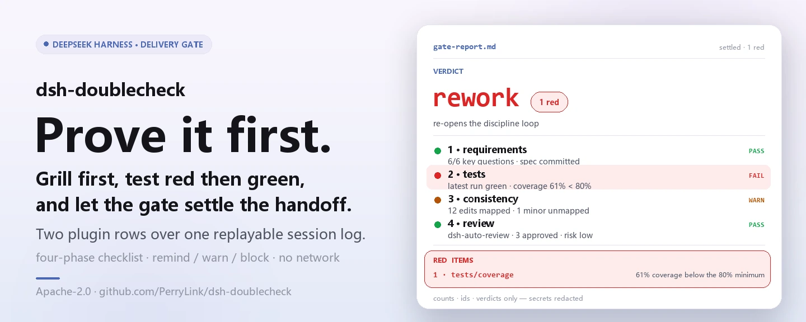

<div align="center">

<picture>
  <source media="(prefers-color-scheme: dark)" srcset="docs/assets/dsh-doublecheck-hero-en-dark.webp">
  
</picture>

# dsh-doublecheck

**Convierte «ya está hecho» en un veredicto con pruebas: interroga los requisitos primero, demuestra el test en rojo y luego en verde, y deja que una puerta de cuatro fases decida entregable o retrabajo antes del traspaso.**

La puerta de calidad de entrega para DeepSeek Harness: dos filas de plugin vigilan el mismo registro de sesión reproducible y convierten el ciclo de disciplina grill → design → red → green → review → verify en comandos, herramientas y un veredicto que queda escrito en un informe.

[Instalar](#instalación-en-tres-pasos) · [Configuración](#configuración) · [FAQ](#faq) · [简体中文](README.md) · [English](README.en.md) · [Español](README.es.md) · [Português](README.pt.md) · [हिन्दी](README.hi.md)

[](LICENSE)
[](#compatibilidad)
[](https://www.npmjs.com/package/dsh-doublecheck)
[](https://github.com/PerryLink/dsh-doublecheck/actions/workflows/ci.yml)
[](#compatibilidad)

[](https://github.com/PerryLink/dsh-doublecheck/stargazers)
[](https://www.npmjs.com/package/dsh-doublecheck)
[](https://dshfind.com/plugins/PerryLink/dsh-doublecheck?ref=badge)
[](https://securityscorecards.dev/viewer/?uri=github.com/PerryLink/dsh-doublecheck)
[](https://dsh.market/)
[](https://gitee.com/perrylink/dsh-doublecheck)

```sh
dsh plugin --profile <name> add dsh-doublecheck
```

</div>

<sub>Plugin de la comunidad, no afiliado a DeepSeek. Repositorio canónico: <https://github.com/PerryLink/dsh-doublecheck> (Gitee es un espejo).</sub>

## Qué es

`dsh-doublecheck` no instala un prompt: instala dos filas de plugin. `doublecheck-grill` interroga los requisitos y los deja escritos como spec; `doublecheck-guard` vigila cada límite de edición, de prueba y de traspaso. Ambas leen el mismo registro de sesión durable, así que tras reanudar, bifurcar o reiniciar ven exactamente las mismas pruebas.

Un `/gate run` pliega lo que ya ocurrió en la sesión en una lista de cuatro fases —si los requisitos se confirmaron uno a uno, si la última ejecución de tests está en rojo o en verde, si cada edición sirve a una dimensión del spec, qué concluye la revisión— y fija un veredicto **entregable / requiere retrabajo**, escrito como un informe que puedes pegar en la descripción de un PR.

No escribe tu código ni juzga su aspecto. Hace una sola cosa: que la frase «ya está» lleve pruebas detrás.

<picture>
  <source media="(prefers-color-scheme: dark)" srcset="docs/assets/dsh-doublecheck-flow-v5-dark.svg">
  
</picture>

## Instalación en tres pasos

1. **Instalar** (elige un canal):

   ```sh
   # canal git (última main; el script prepare compila solo con dependencias de producción)
   dsh plugin --profile web add github:PerryLink/dsh-doublecheck
   # canal npm (versiones publicadas)
   dsh plugin --profile web add dsh-doublecheck
   # canal tarball: pnpm pack en este repositorio y luego
   dsh plugin --profile web add ./dsh-doublecheck-<version>.tgz
   ```

   Ambas filas (`doublecheck-grill` y `doublecheck-guard`) se activan con el perfil.

2. **Configuración mínima**: no hace falta ninguna — el patch del bundle ya inserta las dos filas; una sobreescritura por id tiene que reenunciar toda la config de la fila (ver «Configuración»). La forma equivalente en el patch del perfil:

   ```yaml
   - insert:
       - id: doublecheck-grill
         name: 'dsh-doublecheck/grill'
       - id: doublecheck-guard
         name: 'dsh-doublecheck/guard'
   ```

3. **Verificar que monta**:

   ```sh
   dsh --profile web --dump-config | grep -E -A3 'id: doublecheck-(grill|guard)'
   ```

   ```text
   > /doublecheck status
   > /gate status
   ```

**Desinstalar**: `dsh plugin --profile web remove dsh-doublecheck` (o quita las dos filas del patch del perfil).

> Si quieres un modo estricto sin configuración —cada puerta en intensidad `block` y con evidencia de cobertura obligatoria— aplica la capa incluida encima del patch del bundle: `dsh --profile web --patch ./node_modules/dsh-doublecheck/strict.patch.yml`.

## Capacidades clave

Cada punto de control de `dsh-doublecheck` toma su evidencia del registro de sesión, no de la frase «ya lo probé»:

- **Horno de requisitos (`doublecheck-grill`)** — la skill `grill-requirements`, las herramientas `doublecheck_skills`, `doublecheck_spec` y `doublecheck_report` y el flujo de verificación por dimensión. Sin consenso no se toca la implementación.
- **Guarda de disciplina (`doublecheck-guard`)** — la puerta de grill, las puertas de evidencia rojo/verde, la revisión adversaria, los comandos `/doublecheck` y `/gate`, la tarjeta de ajustes `gate` y la puerta de entrega de cuatro fases, en intensidad `remind` / `warn` / `block`.
- **La evidencia sale del registro, no de un autoinforme** — cada recordatorio, revisión y aviso de puerta inyectado viaja por los canales estándar hasta el registro de sesión; los hechos durables viajan por `doublecheck/state`, `doublecheck/gate` o resultados de herramientas. La reproducción es el estado, así que una sesión reanudada o bifurcada vuelve a obtener el mismo `/gate run`.
- **Una comprobación fallida, una luz roja** — falta el spec, la última ejecución no está en verde, la cobertura queda bajo el umbral, una edición no se mapea a ninguna dimensión del spec o aparece un hallazgo blocker/major: todo se vuelve una luz roja con sugerencia de retrabajo; los avisos y los saltos nunca cambian el veredicto.
- **Informes auditables** — los informes de puerta y de entrega registran solo recuentos, ids y veredictos, sin contenido de archivos ni texto de sesión; los textos de hallazgos producidos por el modelo pasan por un redactor de secretos antes de guardarse o mostrarse.

El ciclo es una sola línea: grill → design → red → green → review → verify. Cada paso deja evidencia reproducible, mientras que las seis dimensiones del requisito, la puerta de consenso y el spec estructurado quedan en la sesión y en el espacio de trabajo.

Las seis etapas del ciclo de disciplina:

| Etapa | Significado |
|---|---|
| **grill** | Interroga las seis dimensiones del requisito; se niega a implementar hasta el consenso. |
| **design** | El spec acordado se registra con `doublecheck_spec`. |
| **red** | Una ejecución de tests que falla demuestra el hueco antes de tocar la implementación. |
| **green** | Una ejecución de tests que pasa después de las ediciones cierra el ciclo. |
| **review** | Un crítico adversario bifurcado audita la entrega contra el spec. |
| **verify** | `doublecheck_report` más un flujo de verificación por dimensión demuestran la entrega. |

## Herramientas y superficies

| Superficie | Tipo | Notas |
|---|---|---|
| `doublecheck_skills` | herramienta | Lista y carga las cuatro skills incluidas a través del registro de skills. |
| `doublecheck_spec` | herramienta | Registra el spec de seis dimensiones en el registro de sesión y en una copia markdown del espacio de trabajo. |
| `doublecheck_report` | herramienta | Pliega la evidencia de disciplina en un informe de entrega (flujo de verificación por dimensión opcional). |
| `/doublecheck status\|report\|on\|off` | comando | Interruptor, módulos, intensidad, hechos de etapa, informe plegado y el override durable de encendido/apagado. |
| `/gate status\|run\|config` | comando | Progreso en vivo de la lista, informe ya fijado de entregable/retrabajo y configuración efectiva. |
| `grill-requirements`, `red-green-tdd`, `delivery-review`, `delivery-proof` | skill | Skills de disciplina incluidas que cubren las seis etapas del ciclo. |
| `gate` | campo de config vivo | La lista configurable es el único campo `.volatile()` de la fila de guarda: se edita desde la tarjeta de ajustes de la fila (espacio de nombres = id de entrada del perfil) y se lee una vez al cargar. |
| `strict.patch.yml` | capa | Todas las puertas en intensidad `block` más el requisito de cobertura, en una sola capa de patch. |
| `dsh-doublecheck/invariant` | fila acompañante | Informa contradicciones de la ruta de escritura del paquete a través del registro `invariants` del host. |
| `doublecheck` | proyección de sesión | Una línea de estado acotada que un cliente renderiza: etapa, último veredicto de puerta, luces rojas, ediciones, marcas de spec/revisión. Ver [Cómo leer la línea de estado](#cómo-leer-la-línea-de-estado). |

### Cómo leer la línea de estado

La proyección de sesión `doublecheck` es una **cadena** de texto y, a propósito, una sola línea: la idea es que cualquier cliente pueda mostrarla sin recortar nada. El `/status` de un puente de chat, una barra de estado o cualquier consumidor propio la renderiza tal cual:

```text
gate:rework r2 | stage:green | test:green edits:12 spec:yes review:yes | goal:ship parser fix
```

| Segmento | Se lee como |
|---|---|
| `gate:<veredicto> r<n>` | El último veredicto de la puerta de entrega —`none` antes de cualquier ejecución, si no `deliverable` o `rework`— y su número de luces rojas `r<n>`. |
| `stage:<etapa>` | La etapa de disciplina alcanzada según la evidencia durable: `grill`, `design`, `red`, `green`, `review`, `verify`. |
| `test:<color>` | El color de la última ejecución de tests: `none`, `red`, `green`. |
| `edits:<n>` | Ediciones de implementación plegadas del registro de sesión (escribir archivos de test no cuenta). |
| `spec:yes` / `spec:no` | Si existe un `doublecheck_spec` registrado. |
| `review:yes` / `review:no` | Si existe un registro de revisión adversaria. |
| `goal:<extracto>` | El objetivo del spec registrado, recortado. Solo aparece cuando `spec:yes`. |

La línea está acotada **por construcción**, así que ningún renderizador la trunca:

- Presupuesto duro: **120 caracteres**. Un renderizador que conserva valores de hasta 120 caracteres —el renderizador genérico de proyecciones del puente de WeChat es uno— muestra la línea completa. La antigua forma de objeto ocupaba 131 caracteres **vacía**, y por eso el veredicto y el recuento de rojos solían quedar cortados.
- Los tres primeros segmentos son **sin pérdida**. Los recuentos por encima de `9999` luces rojas o `99999` ediciones se imprimen como `9999+` / `99999+` en lugar de crecer sin límite; un valor no finito o negativo se imprime como `0`.
- `goal:` es el único segmento con pérdida. Se aplana a una sola línea (los saltos y caracteres de control pasan a espacios, `|` pasa a `/`) y se recorta al presupuesto restante, como máximo 40 caracteres, terminando en `…` cuando se recortó. El objetivo completo está en `/doublecheck status` y en el informe de entrega.
- Esto es un vistazo, no el registro: `/gate status` y `/doublecheck status` renderizan el estado completo.

El `stateVersion` de la proyección es **3**. Incrementarlo descarta la fila de caché persistida por una versión anterior y vuelve a plegar la clave desde el registro de sesión, de modo que una sesión actualizada recalcula la línea en lugar de mostrar una obsoleta. El estado plegado persistido no cambia y una sesión anterior a la actualización nunca falla al cargar.

## Fases de la puerta

La puerta de entrega agrega la evidencia durable de la sesión en una lista configurable de cuatro fases y fija una decisión de **entregable / requiere retrabajo**. Cada fase pliega solo el registro de sesión (la reproducción ES el estado), así que una ejecución se vuelve a derivar igual tras reanudar o bifurcar.

| Fase | Comprueba | Fuente de evidencia | Coste de modelo |
|---|---|---|---|
| Interrogación de requisitos | Lista de preguntas clave confirmada una a una (seis preguntas de dimensión de spec por defecto) | `doublecheck_spec` registrado + llamadas a `ask_user_question` | ninguno |
| Evidencia de tests | Color de la última ejecución, fallos después del verde, umbral de cobertura opcional, informe dsh-eval opcional | Ejecuciones de test de shell en el registro de sesión (`[exit code: N]`, porcentajes de cobertura); el archivo de informe dsh-eval cuando `gate.tests.evalReports.enabled` | ninguno |
| Consistencia de la implementación | Mapa diff ↔ requisito: cada edición debe servir a una dimensión del spec | Revisor bifurcado local (hallazgos estructurados, herramientas de solo lectura) | un subagent |
| Conclusión de la revisión | El veredicto de entrega; `engine: auto` consume los registros de veredicto de dsh-auto-review cuando existen, si no el revisor local | Eventos `autoReview/verdict` / `autoReview/rejection`, o el revisor bifurcado local | un subagent (local) |

Las luces rojas son comprobaciones fallidas (falta el spec, la última ejecución falla, cobertura bajo el mínimo, una edición sin mapear, hallazgos blocker/major): cada una lleva una sugerencia de retrabajo. Los avisos y los saltos nunca cambian la decisión. La puerta integra [dsh-auto-review](https://github.com/PerryLink/dsh-auto-review) como dependencia débil: `review.engine: auto` pliega sus registros de veredicto cuando existen y degrada al revisor local en caso contrario; `gate.tests.evalReports.enabled` pliega el informe dsh-eval de su motor de evaluación (suites de regresión de prompt / estrés / equidad) en la evidencia de tests y lo salta con honestidad cuando no hay informe. La puerta nunca sintetiza solicitudes de aprobación.

## Ejemplos

Estos son los puntos de entrada reales del plugin; instálalo una vez y llama a uno.

### Ejemplo detallado

**Comando**

~~~sh
/gate run
~~~

**Salida**

~~~text
# Delivery gate report

> **Verdict: rework required** — 2 red item(s)
> The gate is red. Re-open the work in plan mode to re-check the open items before delivering.
~~~

*Observed from `README.md §Example report (lines 243-251)`*

### Rama de fallo

**Entrada**

~~~text
/doublecheck maybe
~~~

**Salida**

~~~text
Unknown /doublecheck argument "maybe". Usage: /doublecheck status|report|on|off
~~~

*Observed from `plugins/dsh-doublecheck/src/guard/prose.ts:191-192; plugins/dsh-doublecheck/src/guard/command.ts:156; plugins/dsh-doublecheck/tests/command.spec.ts:201-208`*

### Ejemplos breves

- `doublecheck_skills`
- `doublecheck_spec`

### Informe de ejemplo

`/gate run` devuelve este markdown: pégalo en la descripción de un PR:

````markdown
# Delivery gate report

> **Verdict: rework required** — 2 red item(s)
> The gate is red. Re-open the work in plan mode to re-check the open items before delivering.

## 1. Requirements interrogation — PASS
- [✔] **What outcome must the delivery produce?** — spec dimension "goal" committed
- [✔] **What is in scope, and what is out of scope?** — spec dimension "scope" committed
- [✔] **Which observable checks prove the work is done?** — spec dimension "acceptanceCriteria" committed
- [✔] **What can go wrong, and what is the correct behavior in each case?** — spec dimension "failureModes" committed
- [✔] **What is traded when goals conflict; what is optional?** — spec dimension "priorities" committed
- [✔] **What does the user explicitly not want?** — spec dimension "nonGoals" committed

## 2. Test evidence — FAIL
- [✔] **passing test run** — latest test run passed
- [✔] **failing cases after green** — 0 failing run(s) after green (allowed: 0)
- [✖] **coverage evidence** — 61% coverage below the 80% minimum — rework: raise coverage above the configured minimum

## 3. Implementation consistency — WARN
- [⚠] **[minor] src/telemetry.ts touched without a requirement** — [minor] the edit adds a metric no spec dimension covers

## 4. Review conclusion — PASS
- [✔] **dsh-auto-review conclusion** — 3 call(s) approved by dsh-auto-review (latest risk: low)

## Red items
1. **tests/coverage** — 61% coverage below the 80% minimum — *rework: raise coverage above the configured minimum*
2. **consistency/finding-1** — [minor] the edit adds a metric no spec dimension covers — *rework: src/telemetry.ts touched without a requirement*

## Audit
- review engine: dsh-auto-review
- generated at: 2026-08-14T12:00:00.000Z
- counts, ids, and verdicts only: no file contents or session text are embedded, and recognized secrets are redacted.
````

### Salida de CI

`/gate run` también escribe un `gate-report.json` (el mismo estado fijado como JSON sin pérdida, junto a `gate-report.md`). La CLI `doublecheck-gate` convierte ese archivo en salida legible por máquina para GitHub Actions:

```sh
# JSON (comentario de PR / carga de estado)
doublecheck-gate --format json --input gate-report.json
# SARIF 2.1.0 (subida a code-scanning / comprobación de estado)
doublecheck-gate --format sarif < gate-report.json
```

La CLI solo serializa el `GateState` ya fijado: nunca vuelve a ejecutar la puerta de cuatro fases ni los pliegues de evidencia. Su código de salida mapea el veredicto: `0` = entregable, `1` = retrabajo, `2` = error de uso/parseo.

## Configuración

Todos los ajustes son campos `Config` de Schemastery (modificables desde cordis.yml). Una sobreescritura dirigida por id reemplaza la fila entera: reenuncia cada clave que necesites. `cordis.patch.yml` documenta cada clave en línea; los valores por defecto del Schema son la única fuente de los ajustes.

Claves más usadas:

| Clave | Por defecto | Significado |
|---|---|---|
| `specFile` | `'doublecheck-spec.md'` | Archivo del espacio de trabajo para el spec markdown registrado (fila grill). |
| `reportFile` | `'doublecheck-report.md'` | Archivo del espacio de trabajo para el informe de entrega (fila grill). |
| `intensity` | `'remind'` | Fuerza de aplicación de las puertas de grill, rojo/verde y revisión (`remind` / `warn` / `block`). |
| `enableByDefault` | `true` | Interruptor maestro para sesiones sin un registro `/doublecheck on\|off`. |
| `language` | `'en'` | Idioma de los textos inyectados de recordatorio/denegación/revisión/puerta (`en` / `zh`). |
| `modules.adversary` | `false` | Activado, habilita la revisión del crítico bifurcado al llegar a verde. |
| `gate.enabled` | `true` | Interruptor maestro del panel de puerta y del aviso rojo en el límite de turno. |
| `gate.review.engine` | `'auto'` | `auto` = registros de veredicto de dsh-auto-review cuando existen, si no el revisor local; `local` = siempre local. |

<details>
<summary>Tabla de configuración completa (39 claves)</summary>

| Clave | Por defecto | Significado |
|---|---|---|
| `specFile` | `'doublecheck-spec.md'` | Archivo del espacio de trabajo para el spec markdown registrado (fila grill). |
| `reportFile` | `'doublecheck-report.md'` | Archivo del espacio de trabajo para el informe de entrega (fila grill). |
| `reportVerify` | `true` | Ejecutar el flujo de verificación por defecto (fila grill). |
| `verifyProvider` | `'fork'` | Proveedor de subagent para los verificadores por dimensión (fila grill). |
| `verifyMode` | `'all'` | `all` = un verificador paralelo por dimensión; `single` = un verificador combinado (fila grill). |
| `intensity` | `'remind'` | Fuerza de aplicación de las puertas de grill, rojo/verde y revisión (`remind` / `warn` / `block`). |
| `enableByDefault` | `true` | Interruptor maestro para sesiones sin un registro `/doublecheck on\|off`. |
| `language` | `'en'` | Idioma de los textos inyectados de recordatorio/denegación/revisión/puerta (`en` / `zh`). |
| `guardTools` | `['edit', 'write']` | Nombres de las herramientas de mutación que vigilan ambas puertas. |
| `vagueTaskMaxChars` | `200` | Las tareas más largas nunca se consideran vagas. |
| `remindOnce` | `true` | Inyectar cada recordatorio como máximo una vez por sesión (durable entre reinicios). |
| `testToolNames` | `['bash', 'pwsh']` | Nombres de herramientas de shell que pueden ejecutar tests. |
| `testCommandPatterns` | *(pnpm / npm / yarn / bun test, pytest, go / cargo / make test, node --test, deno test, uv run pytest)* | Regex que un comando debe cumplir para contar como ejecución de tests. |
| `testFilePatterns` | *(directorios de test, `*.test.*` / `*.spec.*`)* | Regex que identifican archivos de test: siempre editables, exentos de la puerta roja. |
| `modules.grill` | `true` | Apagado, deshabilita la puerta de grill. |
| `modules.tdd` | `true` | Encendido, habilita las puertas de evidencia rojo/verde. |
| `modules.adversary` | `false` | Encendido, habilita la revisión del crítico bifurcado al llegar a verde. |
| `adversaryModel` | `null` | Ruta de modelo del crítico; `null` = el modelo principal se autorrevisa. |
| `adversaryProvider` | `'fork'` | Proveedor de subagent en el que corre el crítico. |
| `adversaryMaxFindings` | `5` | Tope de hallazgos (1–20) inyectados en la sesión. |
| `adversaryTools` | `['read', 'glob', 'grep']` | Lista permitida de herramientas del crítico; mantenla de solo lectura. |
| `adversaryTimeoutMs` | `120000` | Presupuesto de tiempo duro para una ejecución del crítico. |
| `gate.enabled` | `true` | Interruptor maestro del panel de puerta y del aviso rojo en el límite de turno. |
| `gate.planSuggestion` | `true` | Añadir la sugerencia de rechequeo en modo plan a los informes rojos. |
| `gate.reportFile` | `'gate-report.md'` | Archivo del espacio de trabajo para el informe de la puerta. |
| `gate.requirements.checklist` | *(seis preguntas de dimensión de spec)* | Lista configurable de preguntas clave: `{ id, question, specDimension, required }`. |
| `gate.requirements.minConfirmed` | `6` | Mínimo de preguntas obligatorias que deben pasar (1..número de obligatorias). |
| `gate.requirements.interrogateTool` | `'ask_user_question'` | Nombre de herramienta cuyas llamadas cuentan como evidencia de interrogación. |
| `gate.tests.requirePassingRun` | `true` | Una última ejecución de tests no superada (o ausente) es una luz roja. |
| `gate.tests.allowFailingRuns` | `0` | Ejecuciones fallidas tras el último verde permitidas antes de la luz roja. |
| `gate.tests.requireCoverage` | `false` | Encendido, exige evidencia de cobertura en la salida de tests. |
| `gate.tests.minCoveragePct` | `80` | Porcentaje mínimo de cobertura (0–100). |
| `gate.tests.evalReports.enabled` | `false` | Encendido, pliega el informe dsh-eval (el motor de evaluación de dsh-auto-review) en la evidencia de tests. |
| `gate.tests.evalReports.dir` | `'.eval-reports'` | Directorio relativo al espacio de trabajo que contiene el informe del motor. |
| `gate.tests.evalReports.file` | `'report.json'` | Nombre del archivo de informe dentro del directorio. |
| `gate.tests.evalReports.required` | `false` | Un informe ausente es luz roja exactamente cuando es true (si no, se salta). |
| `gate.consistency.*` | `provider: 'fork'`, `model: null`, `tools: ['read','glob','grep']`, `timeoutMs: 120000`, `maxFindings: 5` | Los ajustes del revisor de consistencia local (`model: null` = modelo principal). |
| `gate.review.engine` | `'auto'` | `auto` = registros de veredicto de dsh-auto-review cuando existen, si no el revisor local; `local` = siempre local. |
| `gate.review.provider` | `'fork'` | Proveedor del revisor local (su `model`/`tools`/`timeoutMs`/`maxFindings` coinciden con `gate.consistency.*`). |

</details>

Cada clave `gate.*` de arriba forma parte de un único **campo vivo**: la fila de guarda marca todo el bloque `gate` como `.volatile()`, así que es la tarjeta de ajustes editable de la fila (el espacio de nombres del formulario es el id de entrada del perfil). El resto son config de composición normal del patch del perfil. El bloque se lee una vez al cargar, así que una edición se aplica en la siguiente carga: `gate.enabled` decide si el aviso rojo del límite de turno se instala o no. En una línea de host cuya schemastery es anterior a `.volatile()` la fila monta igual: la tarjeta no está y el bloque viene del patch del perfil exactamente como antes.

Una mala configuración falla en voz alta al cargar: regex inválidas, listas de nombres vacías o duplicadas, umbrales fuera de rango e ids de lista duplicados lanzan error en lugar de no hacer nada en silencio. `strict.patch.yml` es la capa que bloquea todas las puertas y reenuncia la fila de guarda con `intensity: block`, todos los módulos encendidos y el requisito de cobertura activado.

Ejemplo de sobreescritura en el patch del perfil:

```yaml
- insert:
    - id: doublecheck-guard
      name: 'dsh-doublecheck/guard'
      config:
        language: zh
        intensity: block
        modules:
          tdd: true
          adversary: true
        gate:
          tests:
            requireCoverage: true
```

## FAQ

<details>
<summary>¿Dónde viven los datos? ¿Puede un informe filtrar el contenido de mis archivos?</summary>

Los hechos durables son dos eventos de sesión, `doublecheck/state` (el interruptor durable) y `doublecheck/gate` (el estado de puerta fijado), más cuatro archivos del espacio de trabajo: `doublecheck-spec.md`, `doublecheck-report.md`, `gate-report.md`, `gate-report.json` (rutas configurables). Los informes de puerta y de entrega registran solo recuentos, ids y veredictos: sin contenido de archivos y sin texto de sesión, y los textos de hallazgos producidos por el modelo pasan por un redactor de secretos antes de guardarse o mostrarse. Fuera del espacio de trabajo de la sesión no se toca nada.

</details>

<details>
<summary>¿Qué pasa en hosts sin escrituras durables? ¿Falla en silencio?</summary>

Nada es silencioso. Los registros durables detrás de `/doublecheck on|off` y `/gate run` viajan por la superficie de append `ignorable` del host; en un host sin ella las escrituras se saltan y el interruptor vuelve a estado de proceso (ver «Limitaciones conocidas»). La tarjeta de ajustes de la fila de guarda necesita el servicio de settings: donde la schemastery del host es anterior a `.volatile()` no hay tarjeta, pero la fila monta igual y el bloque `gate` sigue viniendo del patch del perfil. Cuando un seam de revisión o de adversario no puede correr, la conclusión se escribe con honestidad como «unavailable»/salto en lugar de un veredicto fabricado.

</details>

<details>
<summary>¿Compite con otros plugins por nombres de comando, eventos o slots?</summary>

No. Cada herramienta lleva espacio de nombres, no aporta ninguna clave de servicio, no registra slots de cliente ni prefijos `webServer`, y cada listener de eventos compartidos delega con `next()` sin cortocircuitar la cadena. El argumento punto por punto está en «Interoperabilidad con otros plugins DSH».

</details>

<details>
<summary>¿Cuántas llamadas al modelo cuesta un `/gate run`?</summary>

Las fases de interrogación de requisitos y de evidencia de tests son pliegues puros sin coste de modelo; las fases de consistencia y de conclusión de revisión arrancan un subagent bifurcado cada una (con `gate.review.engine: auto` y registros de veredicto de dsh-auto-review presentes, la fase de conclusión se puede consumir a coste cero). La revisión adversaria opcional añade uno más. Nada más llama al modelo ni a la red.

</details>

## Límites de seguridad

- **Visible para el modelo ⟺ registrado.** Cada recordatorio, revisión y aviso de puerta inyectado viaja por los canales estándar y queda en el registro de sesión; los hechos durables de spec/estado/puerta viajan por resultados de herramientas o por miembros de `SessionEventMap`.
- **Fallar cerrado / fallar en voz alta.** La config de guarda y de puerta se valida en `apply` (las aserciones lanzan); un seam de revisor o de adversario que no puede correr se resuelve como un aviso honesto de «unavailable»/salto en lugar de un veredicto falso.
- **Informes auditables.** Los informes de puerta y de entrega registran solo recuentos, ids y veredictos —sin contenido de archivos ni texto de sesión— y los textos de hallazgos producidos por el modelo pasan por un redactor de secretos antes de guardarse o mostrarse.
- **Sin red propia.** El plugin no hace peticiones de red directas; los subagents crítico y revisor viajan por el seam de subagents del host.
- **Dependencia débil de dsh-auto-review.** Nunca se importa ni se exige de forma dura; la puerta pliega sus registros de veredicto durable y degrada al revisor local, y nunca sintetiza solicitudes de aprobación.

## Permisos y datos

- **Lecturas**: el registro de sesión (`tool/call` / `tool/result` / `tool/ptc-dispatch`, fuentes `user/message` inyectadas y los registros de veredicto ajenos `autoReview/*`) solo en proceso; el estado opcional del servicio de modo plan. Las subllamadas PTC llevan la etiqueta predecesora `tool/code-dispatch` en hosts anteriores al renombrado V3; ambas etiquetas pliegan igual. Los avisos inyectados llevan el kind de origen `dsh-doublecheck` propio del productor; los registros anteriores a ese kind llegan como `plugin:dsh-doublecheck` (la migración V3→V4 del harness sobre un wrapper catch-all publicado) o como el wrapper `plugin` publicado, y las tres formas pliegan igual.
- **Escrituras**: `doublecheck-spec.md`, `doublecheck-report.md`, `gate-report.md` y `gate-report.json` en el espacio de trabajo de la sesión (rutas configurables) a través del seam `ctx.fs`; los eventos de sesión durables `doublecheck/state` y `doublecheck/gate`.
- **Llamadas al modelo**: las fases de consistencia y de revisión local de la puerta (un subagent cada una por `/gate run`), la revisión adversaria opcional y el flujo de verificación de `doublecheck_report` arrancan subagents; nada más llama a un modelo ni a la red.
- **Nunca se toca**: credenciales, variables de entorno ni ningún archivo fuera del espacio de trabajo de la sesión. El manifiesto de workshop declara solo `filesystem:read` y `filesystem:write`. Los informes de puerta llevan solo recuentos, ids y veredictos; los secretos reconocidos en los textos de revisión se redactan antes de guardarse o mostrarse.

## Limitaciones conocidas

- **Escrituras durables.** `/doublecheck on\|off` → `doublecheck/state` y `/gate run` → `doublecheck/gate` viajan por la superficie de append `ignorable` del host (después de rc.6 hasta `0.1.1-rc.2`). En hosts sin esa superficie (rc.6/rc.8, y `0.1.2-alpha.1`, que eliminó el sobre — `0.1.2-rc.1` restaura el campo solo para compatibilidad de lectura de logs guardados y sigue sin poder estamparlo), las escrituras se saltan y el interruptor queda en estado de proceso.
0.1.2-rc.1 (adaptado 2026-09-02): el sobre de sesión conserva su campo ignorable solo para compatibilidad de lectura de logs guardados; Session.append sigue sin poder estamparlo, así que el comportamiento de la puerta de auditoría no cambia.
0.1.5-alpha.1 (adaptado 2026-09-09): el formato de sesión V3 renombra el evento durable de subdespacho `tool/code-dispatch` a `tool/ptc-dispatch` (carga útil sin cambios; ambas etiquetas pliegan igual). Session.append sigue sin exponer un canal `ignorable`, así que las escrituras durables se siguen saltando y el interruptor sigue en estado de proceso: comportamiento sin cambios. (El espacio de nombres de settings `doublecheck-gate` que introdujo esta entrada se eliminó en 0.1.7-alpha.1, cuando el harness borró el registro de espacios de nombres.)
0.1.5-rc.1 (adaptado 2026-09-10): los pins de dependencias pasan a la línea publicada 0.1.5-rc.1; ningún cambio de seam afecta al comportamiento de este plugin.
0.1.5-rc.2 (adaptado 2026-09-11): los pins de dependencias pasan a la línea publicada 0.1.5-rc.2; ningún cambio de seam afecta al comportamiento de este plugin.
0.1.7-alpha.1 (adaptado 2026-10-04): el harness eliminó el kind de origen de mensaje catch-all `plugin` compartido (los avisos ahora llevan el kind `dsh-doublecheck` propio del productor, y el pliegue `remindOnce` sigue leyendo las dos formas previas a la actualización que un log durable puede contener), y reemplazó el registro de espacios de nombres de settings por `SettingsForms` (el espacio `doublecheck-gate` desaparece; la lista de la puerta es ahora el único campo `.volatile()` de la fila de guarda, aún leído una vez al cargar). Los pins de dev/test para `@deepseek-ai/cordis` y `@deepseek-ai/schemastery` pasan a `^4.0.3` / `^3.18.3`, donde `Volatile` y `.volatile()` existen por primera vez; los rangos de peer se mantienen en `^4.0.2` / `^3.18.2` y la superficie de campo vivo se detecta al cargar, así que las líneas de host más antiguas montan la fila sin tarjeta de ajustes. Sin cambios de comportamiento más allá de la ubicación de almacenamiento de settings.
- **Seams opcionales.** La tarjeta de ajustes de la fila de guarda aparece cuando el servicio de settings está montado; la tarjeta es la Config propia de esta fila (espacio de nombres = su id de entrada del perfil), y el bloque `gate` se lee una vez al cargar, así que sus valores se aplican al panel `/gate` y al aviso rojo en la siguiente carga. La superficie de campo vivo se detecta al cargar, así que en una línea de host cuya schemastery es anterior a `.volatile()` la fila monta igual —sin tarjeta, con el bloque `gate` tomado del patch del perfil. La línea de modo plan de `/gate status` lee el opcional `ctx.planMode` (muestra `unknown` sin él); la revisión adversaria necesita `ctx.subagents`; la verificación necesita `workflowEngine`.
- **Degradación local.** `gate.review.engine: auto` degrada al revisor local cuando dsh-auto-review está ausente o no tiene registros de veredicto en esta sesión: el informe nombra el motivo en lugar de inventar un veredicto.
- **La evidencia de dsh-eval es por archivo.** El motor de evaluación de dsh-auto-review (`dsh-eval`) escribe sus resultados de regresión de prompt / estrés / equidad en un archivo de informe del espacio de trabajo, no en el registro de sesión. `gate.tests.evalReports.enabled` pliega ese archivo (apagado por defecto; se salta cuando falta) y los recuentos plegados viajan con el registro durable `doublecheck/gate` para que una ejecución fijada siga siendo reproducible.

## Interoperabilidad con otros plugins DSH

Verificado contra **DSH `0.2.0-rc.2`** (el runtime para el que se publica este README) y el conjunto de plugins de muchas estrellas sondeado el 2026-10-05.

Este plugin **no interfiere** con otros plugins, incluidos los de muchas estrellas ampliamente instalados:

- **Sin colisión de nombres de herramienta.** Cada herramienta lleva espacio de nombres; no se registra ningún nombre desnudo propiedad de una herramienta publicada o de otro plugin.
- **Sin colisión de claves de servicio.** No aporta ninguna clave de servicio, así que no puede colisionar en una.
- **Sin colisión de slots.** No registra claves de slot de cliente, así que no compite por un asiento de `shadows-shipped-ui`.
- **Sin colisión de rutas HTTP.** No registra ningún prefijo `webServer`.
- **Sin colisión de capas de patch.** El patch del bundle solo `insert`a su propia fila; nunca sobrescribe la `config` de una fila integrada.
- **Sin mutación global.** No parchea prototipos, no reescribe `process.env` ni reemplaza el dispatcher global de fetch.

**Los listeners de eventos compartidos no interfieren por construcción.** Observa los eventos sensibles al orden `agent/turn-stopping`, `tools/post-execute`, `tools/pre-execute` con `ctx.on()` —el registro de difusión de Cordis, donde cada listener corre y ninguno puede matar de hambre a otro. **Cada listener delega con `next()`**, así que la cadena nunca se cortocircuita, y una mutación se aplica al valor que produjo `next()` en lugar de devolverse en su lugar:

- `tools/post-execute` — also used by `cc-safety-net` (1576★).
- `tools/pre-execute` — also used by `cc-safety-net` (1576★).

Evidencia estática: `dsh-plugin-doctor` K10–K13 informa `pass` en cada comprobación de este repositorio.

## Compatibilidad

| Superficie | Estado |
|---|---|
| Harness | DeepSeek Harness `dsh-v0.2.2-rc.1` (adaptado 2026-11-05): `engines.dsh` añade `>=0.2.2-0 <0.3.0` (toda línea anterior sigue admitida); las rutas de puerta y de proyección están cubiertas por la suite rc.1. |
| Node | `^22.19.0 \|\| >=24.9.0` |
| Plataformas | Todas (host puro; sin código nativo, sin peticiones de red propias) |
| Modelo | Cualquiera (la guarda nunca llama a un modelo; las fases de crítico y revisor corren como subagents del harness) |

## Ecosistema y calidad

- [Espejo Gitee](https://gitee.com/perrylink/dsh-doublecheck) (espejo sincronizado; GitHub es el canónico)
- [Página del plugin en dshfind](https://dshfind.com/plugins/PerryLink/dsh-doublecheck) (instalaciones y ranking)
- [Informe OpenSSF Scorecard](https://securityscorecards.dev/viewer/?uri=github.com/PerryLink/dsh-doublecheck) (impulsado por [.github/workflows/scorecard.yml](.github/workflows/scorecard.yml))
- [Informe de verificación de dsh-plugin-doctor](https://github.com/PerryLink/dsh-plugin-doctor#verified-徽章) (K10–K13 todos `pass`)
- [DSH Market](https://dsh.market/) (publicado)
- **Canal de la tienda 1024**: `npm i -g dsh1024` una vez, luego `dsh1024 plugin --profile web add dsh-doublecheck` (cuenta para el ranking de instalaciones de [deepseek1024.com](https://deepseek1024.com))
- [Base de conocimiento del ecosistema](https://perrylink.github.io/dsh-plugin-guide/): datos medidos, no marketing: guía de desarrollo de plugins · datos de selección de plugins · criterios de mantenimiento

## Desarrollo

```sh
pnpm install             # node ^22.19 || >=24
pnpm run build           # tsc --noEmitOnError (lib/ está comprometido en el repo)
pnpm run prepare         # tsc --noEmitOnError (canal de instalación git)
pnpm run prepublishOnly  # build + suite completa de tests
pnpm run typecheck       # tsc --noEmit + tsconfig de tests
pnpm run lint            # eslint src tests
pnpm test                # vitest run
pnpm run test:coverage   # vitest run --coverage
pnpm run pack:check      # build + empaquetar el tarball
pnpm run check:readmes   # puerta de consistencia de los README en cinco idiomas
```

`lib/` se compromete a propósito: el canal de instalación git resuelve el paquete sin paso de build, así que reconstruye con `pnpm run build` y confirma el árbol regenerado tras cambiar el código fuente. Las imágenes del README las genera programáticamente [`scripts/gen-readme-assets.py`](scripts/gen-readme-assets.py): Pillow dibuja el banner hero (zh/en × claro/oscuro, WebP) y un SVG escrito a mano dibuja el diagrama de estructura (flow-v5, claro/oscuro), así que el script se puede volver a ejecutar sin riesgo y sobrescribe de forma idempotente. El diagrama de flujo antiguo de una sola piel y las imágenes de demostración se conservan en `docs/assets/` para enlaces externos; los README solo referencian el nuevo hero y flow-v5.

Topics: `dsh`, `dsh-plugin`, `deepseek-harness`, `engineering-discipline`, `requirements`, `guard`, `skill`, `quality-gate`, `delivery-gate`

## Familia y agradecimientos

Este proyecto forma parte de la familia de plugins de DeepSeek Harness de [PerryLink](https://github.com/PerryLink) (todos Apache-2.0). Si te resulta útil, **una estrella ayuda a que la siguiente persona lo encuentre** — no hay nada bloqueado tras ella.

- [@PerryLink](https://github.com/PerryLink) — creador y mantenedor: el ciclo de disciplina grill → design → red → green → review → verify, la puerta de entrega de cuatro fases, la documentación en cinco idiomas y la tubería de CI/release.

<details>
<summary>Expandir todos los plugins</summary>

| Plugin | Estado |
|---|---|
| **[dsh-aqua-input-check](https://github.com/PerryLink/dsh-aqua-input-check)** |  |
| **[dsh-archive-check](https://github.com/PerryLink/dsh-archive-check)** |  |
| **[dsh-auto-review](https://github.com/PerryLink/dsh-auto-review)** |  |
| **[dsh-autotier](https://github.com/PerryLink/dsh-autotier)** | 🧊 CONGELADO — ver el README del repo |
| **[dsh-bid-ca-precheck](https://github.com/PerryLink/dsh-bid-ca-precheck)** |  |
| **[dsh-bid-qual-check](https://github.com/PerryLink/dsh-bid-qual-check)** |  |
| **[dsh-cert-mcp](https://github.com/PerryLink/dsh-cert-mcp)** | 🧊 CONGELADO — ver el README del repo |
| **[dsh-checkpoint-rewind](https://github.com/PerryLink/dsh-checkpoint-rewind)** |  |
| **[dsh-click](https://github.com/PerryLink/dsh-click)** |  |
| **[dsh-composer-history](https://github.com/PerryLink/dsh-composer-history)** |  |
| **[dsh-contract-stance](https://github.com/PerryLink/dsh-contract-stance)** |  |
| **[dsh-customs-doc-check](https://github.com/PerryLink/dsh-customs-doc-check)** |  |
| **[dsh-data-quality](https://github.com/PerryLink/dsh-data-quality)** | 🧊 CONGELADO — ver el README del repo |
| **[dsh-demurrage-ledger](https://github.com/PerryLink/dsh-demurrage-ledger)** |  |
| **[dsh-doublecheck](https://github.com/PerryLink/dsh-doublecheck)** |  |
| **[dsh-drill-script-check](https://github.com/PerryLink/dsh-drill-script-check)** |  |
| **[dsh-eia-guide-check](https://github.com/PerryLink/dsh-eia-guide-check)** |  |
| **[dsh-emergency-plan](https://github.com/PerryLink/dsh-emergency-plan)** |  |
| **[dsh-essay-rubric-check](https://github.com/PerryLink/dsh-essay-rubric-check)** |  |
| **[dsh-evidence-check](https://github.com/PerryLink/dsh-evidence-check)** |  |
| **[dsh-export-ctl-check](https://github.com/PerryLink/dsh-export-ctl-check)** |  |
| **[dsh-fast](https://github.com/PerryLink/dsh-fast)** |  |
| **[dsh-fmea-table-check](https://github.com/PerryLink/dsh-fmea-table-check)** |  |
| **[dsh-forecast-penalty](https://github.com/PerryLink/dsh-forecast-penalty)** |  |
| **[dsh-fund-research](https://github.com/PerryLink/dsh-fund-research)** |  |
| **[dsh-github](https://github.com/PerryLink/dsh-github)** |  |
| **[dsh-gongwen-flow-check](https://github.com/PerryLink/dsh-gongwen-flow-check)** |  |
| **[dsh-gongwen-word-check](https://github.com/PerryLink/dsh-gongwen-word-check)** |  |
| **[dsh-guard-plan-qc](https://github.com/PerryLink/dsh-guard-plan-qc)** |  |
| **[dsh-hazchem-check](https://github.com/PerryLink/dsh-hazchem-check)** |  |
| **[dsh-hazplan-check](https://github.com/PerryLink/dsh-hazplan-check)** |  |
| **[dsh-hidden-risk-map](https://github.com/PerryLink/dsh-hidden-risk-map)** |  |
| **[dsh-hs-classify](https://github.com/PerryLink/dsh-hs-classify)** |  |
| **[dsh-icd-rule-check](https://github.com/PerryLink/dsh-icd-rule-check)** |  |
| **[dsh-industry-research](https://github.com/PerryLink/dsh-industry-research)** |  |
| **[dsh-lawcite-adapter](https://github.com/PerryLink/dsh-lawcite-adapter)** |  |
| **[dsh-laya](https://github.com/PerryLink/dsh-laya)** |  |
| **[dsh-lc-doc-check](https://github.com/PerryLink/dsh-lc-doc-check)** |  |
| **[dsh-learning-gap-check](https://github.com/PerryLink/dsh-learning-gap-check)** |  |
| **[dsh-library](https://github.com/PerryLink/dsh-library)** |  |
| **[dsh-local-ai](https://github.com/PerryLink/dsh-local-ai)** |  |
| **[dsh-lsp-actions](https://github.com/PerryLink/dsh-lsp-actions)** |  |
| **[dsh-mask](https://github.com/PerryLink/dsh-mask)** |  |
| **[dsh-mcp-panel](https://github.com/PerryLink/dsh-mcp-panel)** |  |
| **[dsh-medrec-qc](https://github.com/PerryLink/dsh-medrec-qc)** |  |
| **[dsh-memento](https://github.com/PerryLink/dsh-memento)** | 🧊 CONGELADO — ver el README del repo |
| **[dsh-nsfc-form-check](https://github.com/PerryLink/dsh-nsfc-form-check)** |  |
| **[dsh-nurse-record-check](https://github.com/PerryLink/dsh-nurse-record-check)** |  |
| **[dsh-observe](https://github.com/PerryLink/dsh-observe)** |  |
| **[dsh-origin-rvc-check](https://github.com/PerryLink/dsh-origin-rvc-check)** |  |
| **[dsh-ota-review-check](https://github.com/PerryLink/dsh-ota-review-check)** |  |
| **[dsh-output-styles](https://github.com/PerryLink/dsh-output-styles)** |  |
| **[dsh-paper-doc-adapter](https://github.com/PerryLink/dsh-paper-doc-adapter)** |  |
| **[dsh-permission-rules](https://github.com/PerryLink/dsh-permission-rules)** |  |
| **[dsh-permit-report-check](https://github.com/PerryLink/dsh-permit-report-check)** |  |
| **[dsh-pipeline-check](https://github.com/PerryLink/dsh-pipeline-check)** |  |
| **[dsh-pleading-draft](https://github.com/PerryLink/dsh-pleading-draft)** |  |
| **[dsh-plugin-doctor](https://github.com/PerryLink/dsh-plugin-doctor)** | 🚫 RETIRADO (repo archivado) |
| **[dsh-plugin-guide](https://github.com/PerryLink/dsh-plugin-guide)** |  |
| **[dsh-plugin-kit](https://github.com/PerryLink/dsh-plugin-kit)** | 🚫 RETIRADO (repo archivado) |
| **[dsh-plugin-upgrade](https://github.com/PerryLink/dsh-plugin-upgrade)** | 🚫 RETIRADO (repo archivado) |
| **[dsh-policy-brief-draft](https://github.com/PerryLink/dsh-policy-brief-draft)** |  |
| **[dsh-power-loss-split](https://github.com/PerryLink/dsh-power-loss-split)** |  |
| **[dsh-power-ticket-check](https://github.com/PerryLink/dsh-power-ticket-check)** |  |
| **[dsh-ppap-check](https://github.com/PerryLink/dsh-ppap-check)** |  |
| **[dsh-protest-deadline](https://github.com/PerryLink/dsh-protest-deadline)** |  |
| **[dsh-railway-window](https://github.com/PerryLink/dsh-railway-window)** |  |
| **[dsh-repair-order-qc](https://github.com/PerryLink/dsh-repair-order-qc)** |  |
| **[dsh-research-report](https://github.com/PerryLink/dsh-research-report)** |  |
| **[dsh-review-reply-check](https://github.com/PerryLink/dsh-review-reply-check)** |  |
| **[dsh-rulefile-check](https://github.com/PerryLink/dsh-rulefile-check)** |  |
| **[dsh-safety-brief-check](https://github.com/PerryLink/dsh-safety-brief-check)** |  |
| **[dsh-score](https://github.com/PerryLink/dsh-score)** | 🧊 CONGELADO — ver el README del repo |
| **[dsh-session-sync](https://github.com/PerryLink/dsh-session-sync)** |  |
| **[dsh-site-log-check](https://github.com/PerryLink/dsh-site-log-check)** |  |
| **[dsh-skill-pack-security](https://github.com/PerryLink/dsh-skill-pack-security)** |  |
| **[dsh-soe-decision-check](https://github.com/PerryLink/dsh-soe-decision-check)** |  |
| **[dsh-soilwater-check](https://github.com/PerryLink/dsh-soilwater-check)** |  |
| **[dsh-sop-sync-check](https://github.com/PerryLink/dsh-sop-sync-check)** |  |
| **[dsh-spc-gbt-adapter](https://github.com/PerryLink/dsh-spc-gbt-adapter)** |  |
| **[dsh-talk](https://github.com/PerryLink/dsh-talk)** |  |
| **[dsh-tender-extract](https://github.com/PerryLink/dsh-tender-extract)** |  |
| **[dsh-tender-matrix](https://github.com/PerryLink/dsh-tender-matrix)** |  |
| **[dsh-test-drive](https://github.com/PerryLink/dsh-test-drive)** |  |
| **[dsh-ticktick](https://github.com/PerryLink/dsh-ticktick)** | 🚫 RETIRADO (repo archivado) |
| **[dsh-translate](https://github.com/PerryLink/dsh-translate)** |  |
| **[dsh-warranty-calc](https://github.com/PerryLink/dsh-warranty-calc)** |  |
| **[dsh-budget](https://github.com/PerryLink/dsh-budget)** | 🧊 CONGELADO — ver el README del repo |
| **[dsh-claude-move](https://github.com/PerryLink/dsh-claude-move)** | 🧊 CONGELADO — ver el README del repo |
| **[dsh-defend](https://github.com/PerryLink/dsh-defend)** | 🧊 CONGELADO — ver el README del repo |
| **[dsh-draw](https://github.com/PerryLink/dsh-draw)** | 🧊 CONGELADO — ver el README del repo |
| **[dsh-reach](https://github.com/PerryLink/dsh-reach)** | 🧊 CONGELADO — ver el README del repo |
| **[dsh-background-agents](https://github.com/PerryLink/dsh-background-agents)** | 🚫 RETIRADO (repo archivado) |
| **[dsh-session-pin](https://github.com/PerryLink/dsh-session-pin)** | 🚫 RETIRADO (repo archivado) |
| **[dsh-team-rooms](https://github.com/PerryLink/dsh-team-rooms)** | 🚫 RETIRADO (repo archivado) |

</details>

## Licencia

[Apache License 2.0](LICENSE) © 2026 dsh-doublecheck contributors

<p align="center"><sub>Apache-2.0 · Plugin de la comunidad, no afiliado a DeepSeek.</sub></p>
