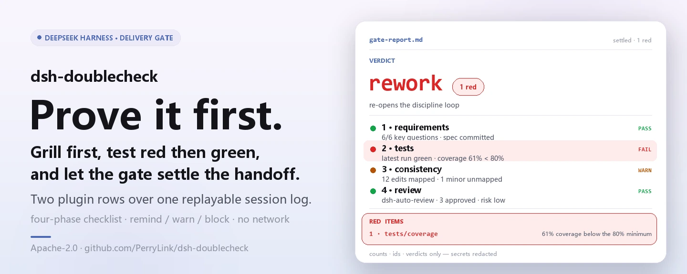

<div align="center">

<picture>
  <source media="(prefers-color-scheme: dark)" srcset="docs/assets/dsh-doublecheck-hero-en-dark.webp">
  
</picture>

# dsh-doublecheck

**«काम हो गया» को सबूतों वाला फ़ैसला बनाइए: पहले ज़रूरतों की पड़ताल, फिर टेस्ट पहले लाल और बाद में हरा, और हैंडऑफ़ से पहले चार-चरणीय गेट तय करे कि डिलीवरेबल है या रीवर्क चाहिए।**

DeepSeek Harness के लिए डिलीवरी क्वालिटी गेट: दो प्लगइन पंक्तियाँ उसी दोबारा चलाए जा सकने वाले सेशन लॉग को देखती हैं और grill → design → red → green → review → verify अनुशासन-चक्र को कमांड, टूल और एक ऐसे फ़ैसले में बदल देती हैं जो रिपोर्ट में दर्ज होता है।

[इंस्टॉल करें](#तीन-चरणों-में-शुरुआत) · [कॉन्फ़िगरेशन](#कॉन्फ़िगरेशन) · [FAQ](#faq) · [简体中文](README.md) · [English](README.en.md) · [Español](README.es.md) · [Português](README.pt.md) · [हिन्दी](README.hi.md)

[](LICENSE)
[](#संगतता)
[](https://www.npmjs.com/package/dsh-doublecheck)
[](https://github.com/PerryLink/dsh-doublecheck/actions/workflows/ci.yml)
[](#संगतता)

[](https://github.com/PerryLink/dsh-doublecheck/stargazers)
[](https://www.npmjs.com/package/dsh-doublecheck)
[](https://dshfind.com/plugins/PerryLink/dsh-doublecheck?ref=badge)
[](https://securityscorecards.dev/viewer/?uri=github.com/PerryLink/dsh-doublecheck)
[](https://dsh.market/)
[](https://gitee.com/perrylink/dsh-doublecheck)

```sh
dsh plugin --profile <name> add dsh-doublecheck
```

</div>

<sub>कम्युनिटी प्लगइन, DeepSeek से संबद्ध नहीं। मानक रेपो: <https://github.com/PerryLink/dsh-doublecheck> (Gitee एक मिरर है)।</sub>

## यह क्या है

`dsh-doublecheck` कोई प्रॉम्प्ट नहीं, दो प्लगइन पंक्तियाँ इंस्टॉल करता है। `doublecheck-grill` ज़रूरतों की पड़ताल करके उन्हें spec के रूप में दर्ज करता है; `doublecheck-guard` हर एडिट, टेस्ट और हैंडऑफ़ की सीमा पर निगरानी रखता है। दोनों वही टिकाऊ सेशन लॉग पढ़ते हैं, इसलिए रिज़्यूम, फ़ोर्क या रीस्टार्ट के बाद भी उन्हें बिल्कुल वही सबूत दिखते हैं।

एक `/gate run` सेशन में पहले से घटी बातों को चार-चरणीय चेकलिस्ट में बदलता है — ज़रूरतें एक-एक करके पुष्ट हुईं या नहीं, नवीनतम टेस्ट लाल है या हरा, हर एडिट spec के किसी आयाम की सेवा करता है या नहीं, समीक्षा का निष्कर्ष क्या है — और **डिलीवरेबल / रीवर्क ज़रूरी** का एक फ़ैसला तय करता है, जिसे PR विवरण में चिपकाया जा सकने वाली रिपोर्ट के रूप में लिखा जाता है।

यह आपका कोड नहीं लिखता और न ही उसकी सुंदरता तय करता है। यह एक ही काम करता है: «काम हो गया» वाक्य के पीछे सबूत खड़ा करता है।

<picture>
  <source media="(prefers-color-scheme: dark)" srcset="docs/assets/dsh-doublecheck-flow-v5-dark.svg">
  
</picture>

## तीन चरणों में शुरुआत

1. **इंस्टॉल** (कोई एक चैनल चुनें):

   ```sh
   # git चैनल (नवीनतम main; prepare स्क्रिप्ट सिर्फ़ प्रोडक्शन डिपेंडेंसी से बिल्ड करती है)
   dsh plugin --profile web add github:PerryLink/dsh-doublecheck
   # npm चैनल (प्रकाशित संस्करण)
   dsh plugin --profile web add dsh-doublecheck
   # tarball चैनल: इस रेपो में pnpm pack के बाद
   dsh plugin --profile web add ./dsh-doublecheck-<version>.tgz
   ```

   दोनों पंक्तियाँ (`doublecheck-grill` और `doublecheck-guard`) प्रोफ़ाइल के साथ सक्रिय हो जाती हैं।

2. **न्यूनतम कॉन्फ़िगरेशन**: कुछ भी ज़रूरी नहीं — bundle patch पहले से दोनों पंक्तियाँ डाल देता है; id-आधारित ओवरराइड पूरी पंक्ति की config दोबारा लिखता है (देखें «कॉन्फ़िगरेशन»)। प्रोफ़ाइल patch में बराबर रूप:

   ```yaml
   - insert:
       - id: doublecheck-grill
         name: 'dsh-doublecheck/grill'
       - id: doublecheck-guard
         name: 'dsh-doublecheck/guard'
   ```

3. **जाँचें कि माउंट हुआ**:

   ```sh
   dsh --profile web --dump-config | grep -E -A3 'id: doublecheck-(grill|guard)'
   ```

   ```text
   > /doublecheck status
   > /gate status
   ```

**अनइंस्टॉल**: `dsh plugin --profile web remove dsh-doublecheck` (या प्रोफ़ाइल patch से दोनों पंक्तियाँ हटा दें)।

> बिना कॉन्फ़िगरेशन वाला सख़्त मोड चाहिए — हर गेट `block` तीव्रता पर और कवरेज सबूत अनिवार्य — तो bundle patch के ऊपर साथ भेजी गई परत लगाएँ: `dsh --profile web --patch ./node_modules/dsh-doublecheck/strict.patch.yml`.

## मुख्य क्षमताएँ

`dsh-doublecheck` का हर चौकी अपना सबूत सेशन लॉग से लेता है, «मैंने टेस्ट कर लिया» वाक्य से नहीं:

- **ज़रूरतों की भट्टी (`doublecheck-grill`)** — साथ भेजी गई `grill-requirements` स्किल, मॉडल के लिए `doublecheck_skills`, `doublecheck_spec` और `doublecheck_report` टूल, और प्रति-आयाम सत्यापन वर्कफ़्लो। सहमति बने बिना इम्प्लीमेंटेशन शुरू नहीं होता।
- **अनुशासन गार्ड (`doublecheck-guard`)** — grill गेट, लाल/हरा सबूत गेट, विरोधी समीक्षा, `/doublecheck` और `/gate` कमांड, लाइव `gate` सेटिंग्स कार्ड, और चार-चरणीय डिलीवरी गेट — `remind` / `warn` / `block` तीव्रता पर।
- **सबूत लॉग से आता है, स्व-रिपोर्ट से नहीं** — हर इंजेक्ट किया गया रिमाइंडर, समीक्षा और गेट सूचना मानक चैनल से होकर सेशन लॉग में पहुँचती है; टिकाऊ तथ्य `doublecheck/state`, `doublecheck/gate` या टूल परिणामों से चलते हैं। रीप्ले ही स्टेट है, इसलिए रिज़्यूम या फ़ोर्क के बाद `/gate run` वही परिणाम देता है।
- **एक जाँच फेल, एक लाल बत्ती** — spec गायब, नवीनतम रन हरा नहीं, कवरेज सीमा से नीचे, कोई एडिट spec के किसी आयाम से जुड़ा नहीं, या blocker/major निष्कर्ष — हर एक रीवर्क सुझाव के साथ लाल बत्ती बनता है; चेतावनियाँ और छूटे हुए चरण कभी फ़ैसला नहीं पलटते।
- **ऑडिट-सुरक्षित** — गेट और डिलीवरी रिपोर्टें सिर्फ़ गिनती, id और फ़ैसले दर्ज करती हैं, फ़ाइल सामग्री या सेशन टेक्स्ट नहीं; मॉडल के बनाए निष्कर्ष टेक्स्ट स्टोर या दिखाने से पहले सीक्रेट-रेडैक्टर से गुज़रते हैं।

चक्र एक ही पंक्ति है: grill → design → red → green → review → verify. हर चरण दोबारा चलाने योग्य सबूत छोड़ता है, और छह ज़रूरत-आयाम, सहमति गेट तथा संरचित spec सेशन और वर्कस्पेस दोनों में दर्ज होते हैं।

अनुशासन-चक्र के छह चरण:

| चरण | अर्थ |
|---|---|
| **grill** | ज़रूरत के छह आयामों की पड़ताल; सहमति से पहले इम्प्लीमेंट करने से इंकार। |
| **design** | तय हुआ spec `doublecheck_spec` से दर्ज होता है। |
| **red** | इम्प्लीमेंटेशन बदलने से पहले फेल होता टेस्ट रन खाई साबित करता है। |
| **green** | बदलावों के बाद पास होता टेस्ट रन चक्र बंद करता है। |
| **review** | फ़ोर्क किया गया विरोधी समीक्षक spec के सामने डिलीवरी का ऑडिट करता है। |
| **verify** | `doublecheck_report` और प्रति-आयाम सत्यापन वर्कफ़्लो डिलीवरी साबित करते हैं। |

## टूल और सतहें

| सतह | प्रकार | नोट्स |
|---|---|---|
| `doublecheck_skills` | टूल | स्किल रजिस्ट्री सीम से पैकेज की चारों स्किल सूचीबद्ध और लोड करता है। |
| `doublecheck_spec` | टूल | पड़ताल से निकला छह-आयामी spec सेशन लॉग और वर्कस्पेस की markdown प्रति में दर्ज करता है। |
| `doublecheck_report` | टूल | अनुशासन के सबूतों को डिलीवरी रिपोर्ट में बदलता है (वैकल्पिक प्रति-आयाम सत्यापन वर्कफ़्लो)। |
| `/doublecheck status\|report\|on\|off` | कमांड | स्विच, मॉड्यूल, तीव्रता, चरण-तथ्य, मुड़ी रिपोर्ट और टिकाऊ on/off ओवरराइड। |
| `/gate status\|run\|config` | कमांड | लाइव चेकलिस्ट प्रगति, तय हो चुकी डिलीवरेबल/रीवर्क रिपोर्ट और प्रभावी कॉन्फ़िगरेशन। |
| `grill-requirements`, `red-green-tdd`, `delivery-review`, `delivery-proof` | स्किल | छहों चक्र-चरणों को ढकने वाली साथ भेजी गई अनुशासन स्किलें। |
| `gate` | लाइव config फ़ील्ड | प्लग करने योग्य चेकलिस्ट गार्ड पंक्ति का इकलौता `.volatile()` फ़ील्ड है: इसे पंक्ति के सेटिंग्स कार्ड से संपादित किया जाता है (namespace = पंक्ति की प्रोफ़ाइल एंट्री id) और लोड पर एक बार पढ़ा जाता है। |
| `strict.patch.yml` | परत | एक ही patch परत में हर गेट `block` तीव्रता पर और कवरेज अनिवार्यता सहित। |
| `dsh-doublecheck/invariant` | सहयोगी पंक्ति | होस्ट की `invariants` रजिस्ट्री से पैकेज की राइट-पाथ विरोधाभास रिपोर्ट करती है। |
| `doublecheck` | सेशन प्रोजेक्शन | क्लाइंट द्वारा रेंडर होने वाली एक सीमित स्टेटस लाइन: चरण, नवीनतम गेट फ़ैसला, लाल बत्तियाँ, एडिट्स, spec/समीक्षा फ़्लैग। देखें [स्टेटस लाइन कैसे पढ़ें](#स्टेटस-लाइन-कैसे-पढ़ें)। |

### स्टेटस लाइन कैसे पढ़ें

`doublecheck` सेशन प्रोजेक्शन एक सादा **स्ट्रिंग** है और जान-बूझकर एक ही पंक्ति — मक़सद यही है कि कोई भी क्लाइंट उसे बिना कुछ काटे दिखा सके। चैट ब्रिज का `/status`, स्टेटस बार या कोई अपना कंज़्यूमर उसे जैसा है वैसा ही रेंडर करता है:

```text
gate:rework r2 | stage:green | test:green edits:12 spec:yes review:yes | goal:ship parser fix
```

| खंड | पढ़ने का तरीक़ा |
|---|---|
| `gate:<फ़ैसला> r<n>` | डिलीवरी गेट का नवीनतम फ़ैसला — किसी भी रन से पहले `none`, वरना `deliverable` या `rework` — और उसकी लाल बत्तियों की गिनती `r<n>`। |
| `stage:<चरण>` | टिकाऊ सबूतों के आधार पर पहुँचा अनुशासन-चरण: `grill`, `design`, `red`, `green`, `review`, `verify`। |
| `test:<रंग>` | नवीनतम टेस्ट रन का रंग: `none`, `red`, `green`. |
| `edits:<n>` | सेशन लॉग से मुड़े इम्प्लीमेंटेशन एडिट्स (टेस्ट फ़ाइल लिखना नहीं गिना जाता)। |
| `spec:yes` / `spec:no` | क्या कोई दर्ज `doublecheck_spec` मौजूद है। |
| `review:yes` / `review:no` | क्या कोई विरोधी-समीक्षा रिकॉर्ड मौजूद है। |
| `goal:<अंश>` | दर्ज spec का लक्ष्य, काटा हुआ। सिर्फ़ `spec:yes` होने पर मौजूद। |

यह पंक्ति **बनावट से ही सीमित** है, इसलिए कोई रेंडरर इसे नहीं काटता:

- कड़ा बजट: **120 अक्षर**। जो रेंडरर 120 अक्षर तक के मान पूरे रखता है — WeChat ब्रिज का सामान्य प्रोजेक्शन रेंडरर ऐसा ही है — वह पूरी पंक्ति दिखाता है। पुराना ऑब्जेक्ट-आकार **खाली होने पर भी** 131 अक्षर का था, इसीलिए फ़ैसला और लाल गिनती कट जाते थे।
- पहले तीन खंड **बिना हानि** हैं। `9999` से ज़्यादा लाल बत्तियाँ या `99999` से ज़्यादा एडिट्स `9999+` / `99999+` छपते हैं, बढ़ते ही नहीं; अनंत या ऋणात्मक गिनती `0` छपती है।
- `goal:` इकलौता हानि वाला खंड है। इसे एक पंक्ति में चपटा किया जाता है (नई पंक्तियाँ और नियंत्रण अक्षर स्पेस बनते हैं, `|` से `/`) और बचे बजट तक काटा जाता है, अधिकतम 40 अक्षर, कटने पर `…` पर समाप्त। पूरा लक्ष्य `/doublecheck status` और डिलीवरी रिपोर्ट में है।
- यह एक नज़र है, रिकॉर्ड नहीं: `/gate status` और `/doublecheck status` पूरी स्थिति रेंडर करते हैं।

प्रोजेक्शन का `stateVersion` **3** है। इसे बढ़ाने से पुराने संस्करण की सहेजी गई प्रोजेक्शन-कैश पंक्ति छूट जाती है और कुंजी सेशन लॉग से दोबारा मुड़ती है, इसलिए अपग्रेड हुआ सेशन पुरानी पंक्ति दिखाने के बजाय उसे फिर से गणना करता है। सहेजी गई फ़ोल्ड स्थिति नहीं बदलती और अपग्रेड से पहले का सेशन कभी लोड होने में विफल नहीं होता।

## गेट के चरण

डिलीवरी गेट सेशन के टिकाऊ सबूतों को एक कॉन्फ़िगर करने योग्य चार-चरणीय चेकलिस्ट में जोड़ता है और **डिलीवरेबल / रीवर्क ज़रूरी** का एक निर्णय तय करता है। हर चरण सिर्फ़ सेशन लॉग मोड़ता है (रीप्ले ही स्टेट है), इसलिए रिज़्यूम या फ़ोर्क के बाद रन फिर वही नतीजा देता है।

| चरण | क्या जाँचता है | सबूत का स्रोत | मॉडल लागत |
|---|---|---|---|
| ज़रूरतों की पूछताछ | मुख्य-प्रश्न चेकलिस्ट का एक-एक करके पुष्ट होना (डिफ़ॉल्ट छह spec-आयाम प्रश्न) | दर्ज `doublecheck_spec` + `ask_user_question` कॉल | कोई नहीं |
| टेस्ट सबूत | नवीनतम रन का रंग, हरे के बाद फेल रन, वैकल्पिक कवरेज सीमा, वैकल्पिक dsh-eval रिपोर्ट | सेशन लॉग में shell टेस्ट रन (`[exit code: N]`, कवरेज प्रतिशत); `gate.tests.evalReports.enabled` होने पर dsh-eval रिपोर्ट फ़ाइल | कोई नहीं |
| इम्प्लीमेंटेशन की संगति | diff ↔ ज़रूरत का नक़्शा: हर एडिट को spec के किसी आयाम की सेवा करनी है | स्थानीय फ़ोर्क किया रिव्यूअर (संरचित निष्कर्ष, सिर्फ़-पढ़ने वाले टूल) | एक subagent |
| समीक्षा का निष्कर्ष | डिलीवरी का फ़ैसला; `engine: auto` मौजूद होने पर dsh-auto-review के टिकाऊ फ़ैसला-रिकॉर्ड लेता है, वरना स्थानीय रिव्यूअर | `autoReview/verdict` / `autoReview/rejection` घटनाएँ, या स्थानीय फ़ोर्क रिव्यूअर | एक subagent (स्थानीय) |

लाल बत्तियाँ फेल हुई जाँचें हैं (spec गायब, नवीनतम रन फेल, कवरेज न्यूनतम से नीचे, बिना मैपिंग वाला एडिट, blocker/major निष्कर्ष) — हर एक के साथ रीवर्क सुझाव आता है। चेतावनियाँ और छूटे चरण कभी निर्णय नहीं पलटते। गेट [dsh-auto-review](https://github.com/PerryLink/dsh-auto-review) को कमज़ोर निर्भरता के रूप में जोड़ता है: `review.engine: auto` मौजूद होने पर उसके फ़ैसला-रिकॉर्ड मोड़ता है और वरना स्थानीय रिव्यूअर पर उतर आता है; `gate.tests.evalReports.enabled` उसके eval इंजन की dsh-eval रिपोर्ट (prompt रिग्रेशन / स्ट्रेस / फ़ेयरनेस सूट) को टेस्ट सबूत में जोड़ता है और रिपोर्ट न होने पर ईमानदारी से छोड़ देता है। गेट कभी अप्रूवल अनुरोध नहीं गढ़ता।

## उदाहरण

ये प्लगइन के असली एंट्री पॉइंट हैं; एक बार इंस्टॉल करें, फिर कोई एक चलाएँ।

### विस्तृत उदाहरण

**कमांड**

~~~sh
/gate run
~~~

**आउटपुट**

~~~text
# Delivery gate report

> **Verdict: rework required** — 2 red item(s)
> The gate is red. Re-open the work in plan mode to re-check the open items before delivering.
~~~

*Observed from `README.md §Example report (lines 243-251)`*

### विफलता शाखा

**इनपुट**

~~~text
/doublecheck maybe
~~~

**आउटपुट**

~~~text
Unknown /doublecheck argument "maybe". Usage: /doublecheck status|report|on|off
~~~

*Observed from `plugins/dsh-doublecheck/src/guard/prose.ts:191-192; plugins/dsh-doublecheck/src/guard/command.ts:156; plugins/dsh-doublecheck/tests/command.spec.ts:201-208`*

### संक्षिप्त उदाहरण

- `doublecheck_skills`
- `doublecheck_spec`

### नमूना रिपोर्ट

`/gate run` यह markdown लौटाता है — इसे PR विवरण में चिपका दें:

````markdown
# Delivery gate report

> **Verdict: rework required** — 2 red item(s)
> The gate is red. Re-open the work in plan mode to re-check the open items before delivering.

## 1. Requirements interrogation — PASS
- [✔] **What outcome must the delivery produce?** — spec dimension "goal" committed
- [✔] **What is in scope, and what is out of scope?** — spec dimension "scope" committed
- [✔] **Which observable checks prove the work is done?** — spec dimension "acceptanceCriteria" committed
- [✔] **What can go wrong, and what is the correct behavior in each case?** — spec dimension "failureModes" committed
- [✔] **What is traded when goals conflict; what is optional?** — spec dimension "priorities" committed
- [✔] **What does the user explicitly not want?** — spec dimension "nonGoals" committed

## 2. Test evidence — FAIL
- [✔] **passing test run** — latest test run passed
- [✔] **failing cases after green** — 0 failing run(s) after green (allowed: 0)
- [✖] **coverage evidence** — 61% coverage below the 80% minimum — rework: raise coverage above the configured minimum

## 3. Implementation consistency — WARN
- [⚠] **[minor] src/telemetry.ts touched without a requirement** — [minor] the edit adds a metric no spec dimension covers

## 4. Review conclusion — PASS
- [✔] **dsh-auto-review conclusion** — 3 call(s) approved by dsh-auto-review (latest risk: low)

## Red items
1. **tests/coverage** — 61% coverage below the 80% minimum — *rework: raise coverage above the configured minimum*
2. **consistency/finding-1** — [minor] the edit adds a metric no spec dimension covers — *rework: src/telemetry.ts touched without a requirement*

## Audit
- review engine: dsh-auto-review
- generated at: 2026-08-14T12:00:00.000Z
- counts, ids, and verdicts only: no file contents or session text are embedded, and recognized secrets are redacted.
````

### CI आउटपुट

`/gate run` एक `gate-report.json` भी लिखता है (वही तय स्थिति बिना हानि JSON के रूप में, `gate-report.md` के बग़ल में)। `doublecheck-gate` CLI उस फ़ाइल को GitHub Actions के लिए मशीन-पठनीय आउटपुट में बदलती है:

```sh
# JSON (PR कमेंट / स्टेटस पेलोड)
doublecheck-gate --format json --input gate-report.json
# SARIF 2.1.0 (code-scanning अपलोड / स्टेटस जाँच)
doublecheck-gate --format sarif < gate-report.json
```

CLI सिर्फ़ पहले से तय `GateState` को सीरियलाइज़ करती है — वह चार-चरणीय गेट या सबूत मोड़ने के काम को दोबारा कभी नहीं चलाती। इसका exit कोड फ़ैसले को दिखाता है: `0` = डिलीवरेबल, `1` = रीवर्क, `2` = उपयोग/पार्स त्रुटि।

## कॉन्फ़िगरेशन

सभी ट्यूनिंग विकल्प Schemastery के `Config` फ़ील्ड हैं (cordis.yml से बदले जा सकते हैं)। id-आधारित ओवरराइड पूरी पंक्ति बदल देता है — जो भी कुंजी चाहिए, सब दोबारा लिखें। `cordis.patch.yml` हर कुंजी को इनलाइन समझाता है; Schema के डिफ़ॉल्ट ही ट्यूनिंग डिफ़ॉल्ट का इकलौता स्रोत हैं।

सबसे ज़्यादा काम आने वाली कुंजियाँ:

| कुंजी | डिफ़ॉल्ट | अर्थ |
|---|---|---|
| `specFile` | `'doublecheck-spec.md'` | दर्ज spec markdown के लिए वर्कस्पेस फ़ाइल (grill पंक्ति)। |
| `reportFile` | `'doublecheck-report.md'` | डिलीवरी रिपोर्ट के लिए वर्कस्पेस फ़ाइल (grill पंक्ति)। |
| `intensity` | `'remind'` | grill, लाल/हरा और समीक्षा गेटों की लागू करने की तीव्रता (`remind` / `warn` / `block`)। |
| `enableByDefault` | `true` | उन सेशन के लिए मास्टर स्विच जिनमें `/doublecheck on\|off` रिकॉर्ड नहीं है। |
| `language` | `'en'` | इंजेक्ट किए गए रिमाइंडर/मना/समीक्षा/गेट टेक्स्ट की भाषा (`en` / `zh`)। |
| `modules.adversary` | `false` | चालू होने पर हरे पड़ाव पर फ़ोर्क किया समीक्षक चलाता है। |
| `gate.enabled` | `true` | गेट पैनल और टर्न-सीमा की लाल सूचना का मास्टर स्विच। |
| `gate.review.engine` | `'auto'` | `auto` = मौजूद होने पर dsh-auto-review के फ़ैसला-रिकॉर्ड, वरना स्थानीय रिव्यूअर; `local` = हमेशा स्थानीय। |

<details>
<summary>पूरी कॉन्फ़िगरेशन तालिका (39 कुंजियाँ)</summary>

| कुंजी | डिफ़ॉल्ट | अर्थ |
|---|---|---|
| `specFile` | `'doublecheck-spec.md'` | दर्ज spec markdown के लिए वर्कस्पेस फ़ाइल (grill पंक्ति)। |
| `reportFile` | `'doublecheck-report.md'` | डिलीवरी रिपोर्ट के लिए वर्कस्पेस फ़ाइल (grill पंक्ति)। |
| `reportVerify` | `true` | डिफ़ॉल्ट रूप से सत्यापन वर्कफ़्लो चलाएँ (grill पंक्ति)। |
| `verifyProvider` | `'fork'` | प्रति-आयाम जाँचकर्ताओं के लिए subagent प्रोवाइडर (grill पंक्ति)। |
| `verifyMode` | `'all'` | `all` = हर आयाम के लिए एक समानांतर जाँचकर्ता; `single` = एक संयुक्त जाँचकर्ता (grill पंक्ति)। |
| `intensity` | `'remind'` | grill, लाल/हरा और समीक्षा गेटों की लागू करने की तीव्रता (`remind` / `warn` / `block`)। |
| `enableByDefault` | `true` | उन सेशन के लिए मास्टर स्विच जिनमें `/doublecheck on\|off` रिकॉर्ड नहीं है। |
| `language` | `'en'` | इंजेक्ट किए गए रिमाइंडर/मना/समीक्षा/गेट टेक्स्ट की भाषा (`en` / `zh`)। |
| `guardTools` | `['edit', 'write']` | दोनों गेट जिन बदलाव-टूलों पर नज़र रखते हैं। |
| `vagueTaskMaxChars` | `200` | इससे लंबे कार्य कभी अस्पष्ट नहीं माने जाते। |
| `remindOnce` | `true` | हर रिमाइंडर हर सेशन में अधिकतम एक बार इंजेक्ट करें (रीस्टार्ट के पार टिकाऊ)। |
| `testToolNames` | `['bash', 'pwsh']` | वे shell टूल जो टेस्ट चला सकते हैं। |
| `testCommandPatterns` | *(pnpm / npm / yarn / bun test, pytest, go / cargo / make test, node --test, deno test, uv run pytest)* | वे regex जिनसे मेल खाने पर कमांड टेस्ट रन गिना जाता है। |
| `testFilePatterns` | *(टेस्ट डायरेक्टरी, `*.test.*` / `*.spec.*`)* | टेस्ट फ़ाइल पहचानने वाले regex — हमेशा संपादन योग्य, लाल गेट से मुक्त। |
| `modules.grill` | `true` | बंद करने पर grill गेट हट जाता है। |
| `modules.tdd` | `true` | चालू होने पर लाल/हरा सबूत गेट सक्रिय। |
| `modules.adversary` | `false` | चालू होने पर हरे पड़ाव पर फ़ोर्क किया समीक्षक सक्रिय। |
| `adversaryModel` | `null` | समीक्षक का मॉडल रूट; `null` = मुख्य मॉडल स्वयं समीक्षा करता है। |
| `adversaryProvider` | `'fork'` | समीक्षक जिस subagent प्रोवाइडर पर चलता है। |
| `adversaryMaxFindings` | `5` | सेशन में इंजेक्ट किए जाने वाले निष्कर्षों की सीमा (1–20)। |
| `adversaryTools` | `['read', 'glob', 'grep']` | समीक्षक के टूल की अनुमति-सूची; इसे सिर्फ़-पढ़ने वाला रखें। |
| `adversaryTimeoutMs` | `120000` | एक समीक्षक रन का कड़ा समय बजट। |
| `gate.enabled` | `true` | गेट पैनल और टर्न-सीमा की लाल सूचना का मास्टर स्विच। |
| `gate.planSuggestion` | `true` | लाल रिपोर्टों में प्लान-मोड पुनःजाँच का सुझाव जोड़ें। |
| `gate.reportFile` | `'gate-report.md'` | गेट रिपोर्ट के लिए वर्कस्पेस फ़ाइल। |
| `gate.requirements.checklist` | *(छह spec-आयाम प्रश्न)* | प्लग करने योग्य मुख्य-प्रश्न चेकलिस्ट: `{ id, question, specDimension, required }`. |
| `gate.requirements.minConfirmed` | `6` | पास होने वाले अनिवार्य प्रश्नों की न्यूनतम संख्या (1..अनिवार्य संख्या)। |
| `gate.requirements.interrogateTool` | `'ask_user_question'` | वह टूल जिसकी कॉल पूछताछ का सबूत गिनी जाती है। |
| `gate.tests.requirePassingRun` | `true` | नवीनतम टेस्ट रन पास न हो (या न हो) तो लाल बत्ती। |
| `gate.tests.allowFailingRuns` | `0` | नवीनतम हरे के बाद लाल बत्ती से पहले स्वीकार्य फेल रन। |
| `gate.tests.requireCoverage` | `false` | चालू होने पर टेस्ट आउटपुट में कवरेज सबूत अनिवार्य। |
| `gate.tests.minCoveragePct` | `80` | न्यूनतम कवरेज प्रतिशत (0–100)। |
| `gate.tests.evalReports.enabled` | `false` | चालू होने पर dsh-eval रिपोर्ट (dsh-auto-review का eval इंजन) टेस्ट सबूत में जुड़ती है। |
| `gate.tests.evalReports.dir` | `'.eval-reports'` | इंजन की रिपोर्ट रखने वाली वर्कस्पेस-सापेक्ष डायरेक्टरी। |
| `gate.tests.evalReports.file` | `'report.json'` | डायरेक्टरी के अंदर रिपोर्ट फ़ाइल का नाम। |
| `gate.tests.evalReports.required` | `false` | true होने पर रिपोर्ट न होना ही लाल बत्ती है (वरना छोड़ दिया जाता है)। |
| `gate.consistency.*` | `provider: 'fork'`, `model: null`, `tools: ['read','glob','grep']`, `timeoutMs: 120000`, `maxFindings: 5` | स्थानीय संगति-रिव्यूअर के नॉब (`model: null` = मुख्य मॉडल)। |
| `gate.review.engine` | `'auto'` | `auto` = मौजूद होने पर dsh-auto-review के फ़ैसला-रिकॉर्ड, वरना स्थानीय रिव्यूअर; `local` = हमेशा स्थानीय। |
| `gate.review.provider` | `'fork'` | स्थानीय समीक्षा-रिव्यूअर का प्रोवाइडर (इसके `model`/`tools`/`timeoutMs`/`maxFindings` `gate.consistency.*` जैसे ही हैं)। |

</details>

ऊपर की हर `gate.*` कुंजी एक ही **लाइव फ़ील्ड** का हिस्सा है: गार्ड पंक्ति पूरे `gate` ब्लॉक को `.volatile()` चिह्नित करती है, इसलिए वही पंक्ति का संपादन योग्य सेटिंग्स कार्ड है (फ़ॉर्म namespace = पंक्ति की प्रोफ़ाइल एंट्री id)। बाक़ी कुंजियाँ प्रोफ़ाइल patch से आने वाली सामान्य composition config हैं। ब्लॉक लोड पर एक बार पढ़ा जाता है, इसलिए बदलाव अगले लोड पर लागू होता है — `gate.enabled` तय करता है कि टर्न-सीमा की लाल सूचना लगेगी या नहीं। जिस होस्ट की schemastery `.volatile()` से पुरानी है वहाँ पंक्ति फिर भी माउंट होती है: कार्ड नहीं मिलता और ब्लॉक पहले की तरह प्रोफ़ाइल patch से आता है।

ग़लत कॉन्फ़िगरेशन लोड पर ज़ोर से विफल होता है: अमान्य regex, खाली या दोहराई गई नाम-सूचियाँ, सीमा से बाहर थ्रेशोल्ड और दोहराई गई चेकलिस्ट id चुपचाप कुछ न करने के बजाय त्रुटि फेंकते हैं। `strict.patch.yml` वह परत है जो सभी गेट ब्लॉक करती है और गार्ड पंक्ति को `intensity: block`, सभी मॉड्यूल चालू और कवरेज अनिवार्यता सहित दोबारा लिखती है।

प्रोफ़ाइल patch में ओवरराइड का उदाहरण:

```yaml
- insert:
    - id: doublecheck-guard
      name: 'dsh-doublecheck/guard'
      config:
        language: zh
        intensity: block
        modules:
          tdd: true
          adversary: true
        gate:
          tests:
            requireCoverage: true
```

## FAQ

<details>
<summary>डेटा कहाँ रहता है? क्या रिपोर्ट मेरी फ़ाइलों की सामग्री बाहर ले जा सकती है?</summary>

टिकाऊ तथ्य दो सेशन घटनाएँ हैं, `doublecheck/state` (टिकाऊ स्विच) और `doublecheck/gate` (तय गेट स्थिति), साथ में चार वर्कस्पेस फ़ाइलें: `doublecheck-spec.md`, `doublecheck-report.md`, `gate-report.md`, `gate-report.json` (पथ कॉन्फ़िगर करने योग्य)। गेट और डिलीवरी रिपोर्टें सिर्फ़ गिनती, id और फ़ैसले दर्ज करती हैं: फ़ाइल सामग्री नहीं और सेशन टेक्स्ट नहीं, और मॉडल के बनाए निष्कर्ष टेक्स्ट स्टोर या दिखाने से पहले सीक्रेट-रेडैक्टर से गुज़रते हैं। सेशन वर्कस्पेस के बाहर कुछ भी नहीं छुआ जाता।

</details>

<details>
<summary>जिन होस्ट पर टिकाऊ लेखन नहीं है वहाँ क्या होता है? चुपचाप बिगड़ता है?</summary>

कुछ भी चुपचाप नहीं होता। `/doublecheck on|off` और `/gate run` के पीछे के टिकाऊ रिकॉर्ड होस्ट की `ignorable` append सतह से चलते हैं; ऐसी सतह न होने पर लेखन छूट जाता है और स्विच प्रोसेस-लोकल स्थिति में लौट आता है (देखें «ज्ञात सीमाएँ»)। गार्ड पंक्ति के सेटिंग्स कार्ड के लिए settings सेवा चाहिए: जहाँ होस्ट की schemastery `.volatile()` से पुरानी है वहाँ कार्ड नहीं मिलता, पर पंक्ति फिर भी माउंट होती है और `gate` ब्लॉक प्रोफ़ाइल patch से ही आता है। जब कोई रिव्यूअर या adversary सीम नहीं चल सकती, तो निष्कर्ष ईमानदारी से «unavailable»/छोड़ा गया लिखा जाता है, गढ़ा हुआ फ़ैसला नहीं।

</details>

<details>
<summary>क्या यह दूसरे प्लगइनों से कमांड नाम, घटनाओं या स्लॉट पर टकराता है?</summary>

नहीं। हर टूल namespaced है, कोई सेवा-कुंजी नहीं देता, कोई क्लाइंट स्लॉट या `webServer` प्रीफ़िक्स दर्ज नहीं करता, और साझा घटना श्रोता हमेशा `next()` से आगे सौंपते हैं, श्रृंखला कभी बाधित नहीं होती। बिंदु-दर-बिंदु तर्क «अन्य DSH प्लगइनों के साथ इंटरऑपरेबिलिटी» में है।

</details>

<details>
<summary>एक `/gate run` में कितनी मॉडल कॉल लगती हैं?</summary>

ज़रूरतों की पूछताछ और टेस्ट सबूत चरण शुद्ध फ़ोल्ड हैं, उनमें मॉडल लागत नहीं; संगति और समीक्षा-निष्कर्ष चरण एक-एक फ़ोर्क किया subagent चलाते हैं (`gate.review.engine: auto` और इस सेशन में dsh-auto-review के फ़ैसला-रिकॉर्ड होने पर समीक्षा-निष्कर्ष चरण शून्य लागत पर लिया जा सकता है)। वैकल्पिक विरोधी समीक्षा एक और जोड़ती है। इसके अलावा कोई मॉडल या नेटवर्क कॉल नहीं।

</details>

## सुरक्षा सीमाएँ

- **मॉडल को दिखने वाला ⟺ लॉग में दर्ज।** हर इंजेक्ट किया गया रिमाइंडर, समीक्षा और गेट सूचना मानक चैनल से होकर सेशन लॉग में पहुँचती है; टिकाऊ spec/state/gate तथ्य टूल परिणामों या `SessionEventMap` सदस्यों से चलते हैं।
- **फेल क्लोज़्ड / ज़ोर से विफल।** गार्ड और गेट की config `apply` में जाँची जाती है (असर्शन त्रुटि फेंकते हैं); जो रिव्यूअर या adversary सीम नहीं चल सकती वह नक़ली फ़ैसले के बजाय ईमानदार «unavailable»/छोड़ा गया सूचना बनकर रहती है।
- **ऑडिट-सुरक्षित रिपोर्टें।** गेट और डिलीवरी रिपोर्टें सिर्फ़ गिनती, id और फ़ैसले दर्ज करती हैं — फ़ाइल सामग्री या सेशन टेक्स्ट नहीं — और मॉडल के बनाए निष्कर्ष टेक्स्ट स्टोर या दिखाने से पहले सीक्रेट-रेडैक्टर से गुज़रते हैं।
- **अपना कोई नेटवर्क नहीं।** प्लगइन सीधे नेटवर्क अनुरोध नहीं करता; समीक्षक और रिव्यूअर subagent होस्ट की subagent सीम से चलते हैं।
- **dsh-auto-review पर कमज़ोर निर्भरता।** उसे कभी import नहीं किया जाता, कभी अनिवार्य नहीं बनाया जाता; गेट उसके टिकाऊ फ़ैसला-रिकॉर्ड मोड़ता है और स्थानीय रिव्यूअर पर उतर आता है, और कभी अप्रूवल अनुरोध नहीं गढ़ता।

## अनुमतियाँ और डेटा

- **पढ़ता है**: सेशन लॉग (`tool/call` / `tool/result` / `tool/ptc-dispatch`, इंजेक्ट किए `user/message` स्रोत और बाहरी `autoReview/*` फ़ैसला-रिकॉर्ड) सिर्फ़ प्रोसेस के अंदर; वैकल्पिक प्लान-मोड सेवा स्थिति। V3 नाम-बदलाव से पहले के होस्ट PTC उप-डिस्पैच पर पुराना लेबल `tool/code-dispatch` लगाते हैं; दोनों लेबल एक जैसा ही मोड़ते हैं। इंजेक्ट की गई सूचनाएँ इस पैकेज का अपना `dsh-doublecheck` संदेश-स्रोत kind लेकर आती हैं; उस kind से पहले दर्ज लॉग `plugin:dsh-doublecheck` (होस्ट के V3→V4 माइग्रेशन द्वारा प्रकाशित catch-all रैपर पर) या प्रकाशित `plugin` रैपर के रूप में आते हैं, और तीनों रूप एक जैसा मोड़ते हैं।
- **लिखता है**: सेशन वर्कस्पेस में `doublecheck-spec.md`, `doublecheck-report.md`, `gate-report.md` और `gate-report.json` (पथ कॉन्फ़िगर करने योग्य) `ctx.fs` सीम से; टिकाऊ `doublecheck/state` और `doublecheck/gate` सेशन घटनाएँ।
- **मॉडल कॉल**: गेट के संगति और स्थानीय-समीक्षा चरण (प्रति `/gate run` एक-एक subagent), वैकल्पिक विरोधी समीक्षा और `doublecheck_report` का सत्यापन वर्कफ़्लो subagent चलाते हैं; इसके अलावा कोई मॉडल या नेटवर्क कॉल नहीं।
- **कभी नहीं छुआ जाता**: क्रेडेंशियल, एनवायरनमेंट वेरिएबल या सेशन वर्कस्पेस के बाहर कोई फ़ाइल। workshop मैनिफ़ेस्ट सिर्फ़ `filesystem:read` और `filesystem:write` घोषित करता है। गेट रिपोर्टें सिर्फ़ गिनती, id और फ़ैसले ले जाती हैं; समीक्षा टेक्स्ट में पहचाने गए सीक्रेट स्टोर या दिखाने से पहले रेडैक्ट होते हैं।

## ज्ञात सीमाएँ

- **टिकाऊ लेखन।** `/doublecheck on\|off` → `doublecheck/state` और `/gate run` → `doublecheck/gate` होस्ट की `ignorable` append सतह (rc.6 के बाद से `0.1.1-rc.2` तक) पर निर्भर हैं। जिन होस्ट पर यह सतह नहीं है (rc.6/rc.8, और `0.1.2-alpha.1` जिसने envelope हटा दिया — `0.1.2-rc.1` केवल सहेजे गए लॉग पढ़ने की संगति के लिए फ़ील्ड लौटाता है और उसे स्टैम्प नहीं कर सकता), वहाँ लेखन छूट जाता है और स्विच प्रोसेस-लोकल रहता है।
0.1.2-rc.1 (2026-09-02 को अनुकूलित): सेशन envelope अपना ignorable फ़ील्ड केवल सहेजे गए लॉग पढ़ने की संगति के लिए रखता है - Session.append अब भी उसे स्टैम्प नहीं कर सकता, इसलिए ऑडिट-गेट व्यवहार अपरिवर्तित है।
0.1.5-alpha.1 (2026-09-09 को अनुकूलित): सेशन फ़ॉर्मेट V3 टिकाऊ उप-डिस्पैच घटना `tool/code-dispatch` का नाम `tool/ptc-dispatch` कर देता है (पेलोड अपरिवर्तित; दोनों लेबल एक जैसा मोड़ते हैं)। Session.append के पास अब भी `ignorable` चैनल नहीं है, इसलिए टिकाऊ लेखन छूटता रहता है और स्विच प्रोसेस-लोकल रहता है - व्यवहार अपरिवर्तित। (इस प्रविष्टि ने जो `doublecheck-gate` settings namespace शुरू किया था वह 0.1.7-alpha.1 में हट गया, जब होस्ट ने namespace रजिस्ट्री ही हटा दी।)
0.1.5-rc.1 (2026-09-10 को अनुकूलित): डिपेंडेंसी पिन प्रकाशित 0.1.5-rc.1 लाइन पर चले जाते हैं; कोई सीम बदलाव इस प्लगइन के व्यवहार को प्रभावित नहीं करता।
0.1.5-rc.2 (2026-09-11 को अनुकूलित): डिपेंडेंसी पिन प्रकाशित 0.1.5-rc.2 लाइन पर चले जाते हैं; कोई सीम बदलाव इस प्लगइन के व्यवहार को प्रभावित नहीं करता।
0.1.7-alpha.1 (2026-10-04 को अनुकूलित): होस्ट ने साझा catch-all `plugin` संदेश-स्रोत kind हटा दिया (सूचनाएँ अब इस पैकेज का अपना `dsh-doublecheck` kind लेकर आती हैं, और `remindOnce` फ़ोल्ड टिकाऊ लॉग में मौजूद दोनों पुराने रूपों को अब भी पढ़ता है), और settings namespace रजिस्ट्री की जगह `SettingsForms` ले आया (`doublecheck-gate` namespace चला गया; गेट चेकलिस्ट अब गार्ड पंक्ति का इकलौता `.volatile()` फ़ील्ड है, फिर भी लोड पर एक बार पढ़ा जाता है)। `@deepseek-ai/cordis` और `@deepseek-ai/schemastery` के dev/test पिन `^4.0.3` / `^3.18.3` पर चले जाते हैं, जहाँ `Volatile` और `.volatile()` पहली बार मौजूद हैं; peer रेंज `^4.0.2` / `^3.18.2` ही रहती हैं और लाइव-फ़ील्ड सतह लोड पर पहचानी जाती है, इसलिए पुरानी होस्ट लाइनें भी पंक्ति को बिना सेटिंग्स कार्ड के माउंट करती हैं। settings के भंडारण स्थान के अलावा कोई व्यवहार बदलाव नहीं।
- **वैकल्पिक सीमें।** गार्ड पंक्ति का सेटिंग्स कार्ड तब दिखता है जब settings सेवा माउंट हो; कार्ड इसी पंक्ति की Config है (namespace = उसकी प्रोफ़ाइल एंट्री id), और `gate` ब्लॉक लोड पर एक बार पढ़ा जाता है, इसलिए उसके मान अगले लोड पर `/gate` पैनल और लाल सूचना पर लागू होते हैं। लाइव-फ़ील्ड सतह लोड पर पहचानी जाती है, इसलिए जिस होस्ट की schemastery `.volatile()` से पुरानी है वहाँ पंक्ति फिर भी माउंट होती है — कार्ड के बिना, `gate` ब्लॉक प्रोफ़ाइल patch से लेकर। `/gate status` की प्लान-मोड पंक्ति वैकल्पिक `ctx.planMode` पढ़ती है (न होने पर `unknown` दिखाती है); विरोधी समीक्षा के लिए `ctx.subagents` चाहिए; सत्यापन के लिए `workflowEngine`।
- **स्थानीय अवनति।** जब dsh-auto-review मौजूद नहीं है या इस सेशन में उसके फ़ैसला-रिकॉर्ड नहीं हैं, तो `gate.review.engine: auto` स्थानीय रिव्यूअर पर उतर आता है — रिपोर्ट फ़ैसला गढ़ने के बजाय कारण लिखती है।
- **dsh-eval सबूत फ़ाइल-आधारित है।** dsh-auto-review का eval इंजन (`dsh-eval`) अपने prompt-रिग्रेशन / स्ट्रेस / फ़ेयरनेस परिणाम सेशन लॉग में नहीं, वर्कस्पेस की रिपोर्ट फ़ाइल में लिखता है। `gate.tests.evalReports.enabled` उस फ़ाइल को मोड़ता है (डिफ़ॉल्ट बंद; न होने पर छोड़ देता है) और मुड़ी गिनतियाँ टिकाऊ `doublecheck/gate` रिकॉर्ड के साथ चलती हैं ताकि तय हो चुका रन फिर भी दोबारा चल सके।

## अन्य DSH प्लगइनों के साथ इंटरऑपरेबिलिटी

**DSH `0.2.0-rc.2`** (यह README जिस रनटाइम के लिए है) और 2026-10-05 को सर्वे किए गए हाई-स्टार प्लगइन सेट के सामने सत्यापित।

यह प्लगइन अन्य प्लगइनों में **दख़ल नहीं देता**, उन व्यापक रूप से इंस्टॉल हाई-स्टार प्लगइनों में भी नहीं:

- **टूल नाम का कोई टकराव नहीं।** हर टूल namespaced है; किसी भी पहले से भेजे गए टूल या दूसरे प्लगइन के नंगे नाम पर दावा नहीं।
- **सेवा-कुंजी का कोई टकराव नहीं।** कोई सेवा-कुंजी नहीं देता, इसलिए टकरा ही नहीं सकता।
- **स्लॉट का कोई टकराव नहीं।** कोई क्लाइंट स्लॉट कुंजी दर्ज नहीं करता, इसलिए `shadows-shipped-ui` सीट के लिए नहीं लड़ता।
- **HTTP रूट का कोई टकराव नहीं।** कोई `webServer` प्रीफ़िक्स दर्ज नहीं करता।
- **patch परत का कोई टकराव नहीं।** bundle patch सिर्फ़ अपनी पंक्ति `insert` करता है; भीतरी पंक्ति की `config` कभी नहीं लिखता।
- **कोई ग्लोबल बदलाव नहीं।** प्रोटोटाइप नहीं बदलता, `process.env` नहीं लिखता, ग्लोबल fetch dispatcher नहीं बदलता।

**साझा घटना श्रोता बनावट से ही एक-दूसरे में दख़ल नहीं देते।** यह क्रम-संवेदी घटनाएँ `agent/turn-stopping`, `tools/post-execute`, `tools/pre-execute` `ctx.on()` से सुनता है — Cordis का ब्रॉडकास्ट रजिस्ट्रेशन, जहाँ हर श्रोता चलता है और कोई किसी को भूखा नहीं मार सकता। **यहाँ हर श्रोता `next()` से आगे सौंपता है**, इसलिए श्रृंखला कभी बाधित नहीं होती, और बदलाव `next()` के लौटाए मान पर लागू होता है, उसकी जगह लौटाकर नहीं:

- `tools/post-execute` — also used by `cc-safety-net` (1576★).
- `tools/pre-execute` — also used by `cc-safety-net` (1576★).

स्थिर सबूत: इस रेपो की हर जाँच पर `dsh-plugin-doctor` K10–K13 `pass` रिपोर्ट करता है।

## संगतता

| सतह | स्थिति |
|---|---|
| Harness | DeepSeek Harness `dsh-v0.2.2-rc.1` (2026-11-05 को अनुकूलित): `engines.dsh` में `>=0.2.2-0 <0.3.0` जुड़ता है (हर पुरानी लाइन स्वीकार्य रहती है); गेट और प्रोजेक्शन पथ rc.1 टेस्ट सूट से ढके हैं। |
| Node | `^22.19.0 \|\| >=24.9.0` |
| प्लेटफ़ॉर्म | सभी (शुद्ध होस्ट; कोई नेटिव कोड नहीं, अपना कोई सीधा नेटवर्क अनुरोध नहीं) |
| मॉडल | कोई भी (गार्ड स्वयं कभी मॉडल नहीं बुलाता; समीक्षक और रिव्यूअर चरण होस्ट subagent के रूप में चलते हैं) |

## इकोसिस्टम और गुणवत्ता

- [Gitee मिरर](https://gitee.com/perrylink/dsh-doublecheck) (सिंक मिरर; GitHub मानक है)
- [dshfind प्लगइन पेज](https://dshfind.com/plugins/PerryLink/dsh-doublecheck) (इंस्टॉल और रैंकिंग)
- [OpenSSF Scorecard रिपोर्ट](https://securityscorecards.dev/viewer/?uri=github.com/PerryLink/dsh-doublecheck) ([.github/workflows/scorecard.yml](.github/workflows/scorecard.yml) से संचालित)
- [dsh-plugin-doctor सत्यापन रिपोर्ट](https://github.com/PerryLink/dsh-plugin-doctor#verified-徽章) (K10–K13 सभी `pass`)
- [DSH Market](https://dsh.market/) (सूचीबद्ध)
- **1024 स्टोर चैनल**: पहले `npm i -g dsh1024`, फिर `dsh1024 plugin --profile web add dsh-doublecheck` ([deepseek1024.com](https://deepseek1024.com) की इंस्टॉल रैंकिंग में गिना जाता है)
- [इकोसिस्टम ज्ञान-कोश](https://perrylink.github.io/dsh-plugin-guide/): मापे गए आँकड़े, मार्केटिंग नहीं: प्लगइन डेवलपमेंट गाइड · प्लगइन चयन के आँकड़े · रखरखाव के मानदंड

## डेवलपमेंट

```sh
pnpm install             # node ^22.19 || >=24
pnpm run build           # tsc --noEmitOnError (lib/ जान-बूझकर कमिट है)
pnpm run prepare         # tsc --noEmitOnError (git इंस्टॉल चैनल)
pnpm run prepublishOnly  # build + पूरा टेस्ट सूट
pnpm run typecheck       # tsc --noEmit + टेस्ट tsconfig
pnpm run lint            # eslint src tests
pnpm test                # vitest run
pnpm run test:coverage   # vitest run --coverage
pnpm run pack:check      # build + tarball पैक
pnpm run check:readmes   # पाँच भाषाओं के README की संगति जाँच
```

`lib/` जान-बूझकर कमिट है: git इंस्टॉल चैनल पैकेज को बिना build चरण के हल करता है, इसलिए सोर्स बदलने के बाद `pnpm run build` से दोबारा बनाकर बनी ट्री भी कमिट करें। README की तस्वीरें [`scripts/gen-readme-assets.py`](scripts/gen-readme-assets.py) से प्रोग्रामेटिक रूप से बनती हैं: hero बैनर Pillow से (zh/en × हल्का/गहरा WebP) और संरचना चित्र हाथ से लिखे SVG से (flow-v5, हल्का/गहरा), इसलिए स्क्रिप्ट बिना जोखिम दोबारा चलाई जा सकती है और idempotent ढंग से ओवरराइट करती है। पुराना एकल-स्किन फ़्लो चित्र और डेमो छवियाँ बाहरी लिंक के लिए `docs/assets/` में बनी रहती हैं; README केवल नए hero और flow-v5 को संदर्भित करते हैं।

Topics: `dsh`, `dsh-plugin`, `deepseek-harness`, `engineering-discipline`, `requirements`, `guard`, `skill`, `quality-gate`, `delivery-gate`

## परिवार और आभार

यह परियोजना [PerryLink](https://github.com/PerryLink) की DeepSeek Harness प्लगइन फ़ैमिली का हिस्सा है (सभी Apache-2.0)। अगर यह काम आए, तो **एक स्टार अगले व्यक्ति को इसे खोजने में मदद करता है** — स्टार के पीछे कुछ भी बंद नहीं है।

- [@PerryLink](https://github.com/PerryLink) — निर्माता और अनुरक्षक: grill → design → red → green → review → verify अनुशासन-चक्र, चार-चरणीय डिलीवरी गेट, पाँच भाषाओं का दस्तावेज़ और CI/रिलीज़ पाइपलाइन।

<details>
<summary>सभी प्लगइन देखें</summary>

| प्लगइन | स्थिति |
|---|---|
| **[dsh-aqua-input-check](https://github.com/PerryLink/dsh-aqua-input-check)** |  |
| **[dsh-archive-check](https://github.com/PerryLink/dsh-archive-check)** |  |
| **[dsh-auto-review](https://github.com/PerryLink/dsh-auto-review)** |  |
| **[dsh-autotier](https://github.com/PerryLink/dsh-autotier)** | 🧊 फ़्रोज़न — रेपो README देखें |
| **[dsh-bid-ca-precheck](https://github.com/PerryLink/dsh-bid-ca-precheck)** |  |
| **[dsh-bid-qual-check](https://github.com/PerryLink/dsh-bid-qual-check)** |  |
| **[dsh-cert-mcp](https://github.com/PerryLink/dsh-cert-mcp)** | 🧊 फ़्रोज़न — रेपो README देखें |
| **[dsh-checkpoint-rewind](https://github.com/PerryLink/dsh-checkpoint-rewind)** |  |
| **[dsh-click](https://github.com/PerryLink/dsh-click)** |  |
| **[dsh-composer-history](https://github.com/PerryLink/dsh-composer-history)** |  |
| **[dsh-contract-stance](https://github.com/PerryLink/dsh-contract-stance)** |  |
| **[dsh-customs-doc-check](https://github.com/PerryLink/dsh-customs-doc-check)** |  |
| **[dsh-data-quality](https://github.com/PerryLink/dsh-data-quality)** | 🧊 फ़्रोज़न — रेपो README देखें |
| **[dsh-demurrage-ledger](https://github.com/PerryLink/dsh-demurrage-ledger)** |  |
| **[dsh-doublecheck](https://github.com/PerryLink/dsh-doublecheck)** |  |
| **[dsh-drill-script-check](https://github.com/PerryLink/dsh-drill-script-check)** |  |
| **[dsh-eia-guide-check](https://github.com/PerryLink/dsh-eia-guide-check)** |  |
| **[dsh-emergency-plan](https://github.com/PerryLink/dsh-emergency-plan)** |  |
| **[dsh-essay-rubric-check](https://github.com/PerryLink/dsh-essay-rubric-check)** |  |
| **[dsh-evidence-check](https://github.com/PerryLink/dsh-evidence-check)** |  |
| **[dsh-export-ctl-check](https://github.com/PerryLink/dsh-export-ctl-check)** |  |
| **[dsh-fast](https://github.com/PerryLink/dsh-fast)** |  |
| **[dsh-fmea-table-check](https://github.com/PerryLink/dsh-fmea-table-check)** |  |
| **[dsh-forecast-penalty](https://github.com/PerryLink/dsh-forecast-penalty)** |  |
| **[dsh-fund-research](https://github.com/PerryLink/dsh-fund-research)** |  |
| **[dsh-github](https://github.com/PerryLink/dsh-github)** |  |
| **[dsh-gongwen-flow-check](https://github.com/PerryLink/dsh-gongwen-flow-check)** |  |
| **[dsh-gongwen-word-check](https://github.com/PerryLink/dsh-gongwen-word-check)** |  |
| **[dsh-guard-plan-qc](https://github.com/PerryLink/dsh-guard-plan-qc)** |  |
| **[dsh-hazchem-check](https://github.com/PerryLink/dsh-hazchem-check)** |  |
| **[dsh-hazplan-check](https://github.com/PerryLink/dsh-hazplan-check)** |  |
| **[dsh-hidden-risk-map](https://github.com/PerryLink/dsh-hidden-risk-map)** |  |
| **[dsh-hs-classify](https://github.com/PerryLink/dsh-hs-classify)** |  |
| **[dsh-icd-rule-check](https://github.com/PerryLink/dsh-icd-rule-check)** |  |
| **[dsh-industry-research](https://github.com/PerryLink/dsh-industry-research)** |  |
| **[dsh-lawcite-adapter](https://github.com/PerryLink/dsh-lawcite-adapter)** |  |
| **[dsh-laya](https://github.com/PerryLink/dsh-laya)** |  |
| **[dsh-lc-doc-check](https://github.com/PerryLink/dsh-lc-doc-check)** |  |
| **[dsh-learning-gap-check](https://github.com/PerryLink/dsh-learning-gap-check)** |  |
| **[dsh-library](https://github.com/PerryLink/dsh-library)** |  |
| **[dsh-local-ai](https://github.com/PerryLink/dsh-local-ai)** |  |
| **[dsh-lsp-actions](https://github.com/PerryLink/dsh-lsp-actions)** |  |
| **[dsh-mask](https://github.com/PerryLink/dsh-mask)** |  |
| **[dsh-mcp-panel](https://github.com/PerryLink/dsh-mcp-panel)** |  |
| **[dsh-medrec-qc](https://github.com/PerryLink/dsh-medrec-qc)** |  |
| **[dsh-memento](https://github.com/PerryLink/dsh-memento)** | 🧊 फ़्रोज़न — रेपो README देखें |
| **[dsh-nsfc-form-check](https://github.com/PerryLink/dsh-nsfc-form-check)** |  |
| **[dsh-nurse-record-check](https://github.com/PerryLink/dsh-nurse-record-check)** |  |
| **[dsh-observe](https://github.com/PerryLink/dsh-observe)** |  |
| **[dsh-origin-rvc-check](https://github.com/PerryLink/dsh-origin-rvc-check)** |  |
| **[dsh-ota-review-check](https://github.com/PerryLink/dsh-ota-review-check)** |  |
| **[dsh-output-styles](https://github.com/PerryLink/dsh-output-styles)** |  |
| **[dsh-paper-doc-adapter](https://github.com/PerryLink/dsh-paper-doc-adapter)** |  |
| **[dsh-permission-rules](https://github.com/PerryLink/dsh-permission-rules)** |  |
| **[dsh-permit-report-check](https://github.com/PerryLink/dsh-permit-report-check)** |  |
| **[dsh-pipeline-check](https://github.com/PerryLink/dsh-pipeline-check)** |  |
| **[dsh-pleading-draft](https://github.com/PerryLink/dsh-pleading-draft)** |  |
| **[dsh-plugin-doctor](https://github.com/PerryLink/dsh-plugin-doctor)** | 🚫 रिटायर्ड (रेपो संग्रहीत) |
| **[dsh-plugin-guide](https://github.com/PerryLink/dsh-plugin-guide)** |  |
| **[dsh-plugin-kit](https://github.com/PerryLink/dsh-plugin-kit)** | 🚫 रिटायर्ड (रेपो संग्रहीत) |
| **[dsh-plugin-upgrade](https://github.com/PerryLink/dsh-plugin-upgrade)** | 🚫 रिटायर्ड (रेपो संग्रहीत) |
| **[dsh-policy-brief-draft](https://github.com/PerryLink/dsh-policy-brief-draft)** |  |
| **[dsh-power-loss-split](https://github.com/PerryLink/dsh-power-loss-split)** |  |
| **[dsh-power-ticket-check](https://github.com/PerryLink/dsh-power-ticket-check)** |  |
| **[dsh-ppap-check](https://github.com/PerryLink/dsh-ppap-check)** |  |
| **[dsh-protest-deadline](https://github.com/PerryLink/dsh-protest-deadline)** |  |
| **[dsh-railway-window](https://github.com/PerryLink/dsh-railway-window)** |  |
| **[dsh-repair-order-qc](https://github.com/PerryLink/dsh-repair-order-qc)** |  |
| **[dsh-research-report](https://github.com/PerryLink/dsh-research-report)** |  |
| **[dsh-review-reply-check](https://github.com/PerryLink/dsh-review-reply-check)** |  |
| **[dsh-rulefile-check](https://github.com/PerryLink/dsh-rulefile-check)** |  |
| **[dsh-safety-brief-check](https://github.com/PerryLink/dsh-safety-brief-check)** |  |
| **[dsh-score](https://github.com/PerryLink/dsh-score)** | 🧊 फ़्रोज़न — रेपो README देखें |
| **[dsh-session-sync](https://github.com/PerryLink/dsh-session-sync)** |  |
| **[dsh-site-log-check](https://github.com/PerryLink/dsh-site-log-check)** |  |
| **[dsh-skill-pack-security](https://github.com/PerryLink/dsh-skill-pack-security)** |  |
| **[dsh-soe-decision-check](https://github.com/PerryLink/dsh-soe-decision-check)** |  |
| **[dsh-soilwater-check](https://github.com/PerryLink/dsh-soilwater-check)** |  |
| **[dsh-sop-sync-check](https://github.com/PerryLink/dsh-sop-sync-check)** |  |
| **[dsh-spc-gbt-adapter](https://github.com/PerryLink/dsh-spc-gbt-adapter)** |  |
| **[dsh-talk](https://github.com/PerryLink/dsh-talk)** |  |
| **[dsh-tender-extract](https://github.com/PerryLink/dsh-tender-extract)** |  |
| **[dsh-tender-matrix](https://github.com/PerryLink/dsh-tender-matrix)** |  |
| **[dsh-test-drive](https://github.com/PerryLink/dsh-test-drive)** |  |
| **[dsh-ticktick](https://github.com/PerryLink/dsh-ticktick)** | 🚫 रिटायर्ड (रेपो संग्रहीत) |
| **[dsh-translate](https://github.com/PerryLink/dsh-translate)** |  |
| **[dsh-warranty-calc](https://github.com/PerryLink/dsh-warranty-calc)** |  |
| **[dsh-budget](https://github.com/PerryLink/dsh-budget)** | 🧊 फ़्रोज़न — रेपो README देखें |
| **[dsh-claude-move](https://github.com/PerryLink/dsh-claude-move)** | 🧊 फ़्रोज़न — रेपो README देखें |
| **[dsh-defend](https://github.com/PerryLink/dsh-defend)** | 🧊 फ़्रोज़न — रेपो README देखें |
| **[dsh-draw](https://github.com/PerryLink/dsh-draw)** | 🧊 फ़्रोज़न — रेपो README देखें |
| **[dsh-reach](https://github.com/PerryLink/dsh-reach)** | 🧊 फ़्रोज़न — रेपो README देखें |
| **[dsh-background-agents](https://github.com/PerryLink/dsh-background-agents)** | 🚫 रिटायर्ड (रेपो संग्रहीत) |
| **[dsh-session-pin](https://github.com/PerryLink/dsh-session-pin)** | 🚫 रिटायर्ड (रेपो संग्रहीत) |
| **[dsh-team-rooms](https://github.com/PerryLink/dsh-team-rooms)** | 🚫 रिटायर्ड (रेपो संग्रहीत) |

</details>

## लाइसेंस

[Apache License 2.0](LICENSE) © 2026 dsh-doublecheck contributors

<p align="center"><sub>Apache-2.0 · कम्युनिटी प्लगइन, DeepSeek से संबद्ध नहीं।</sub></p>
