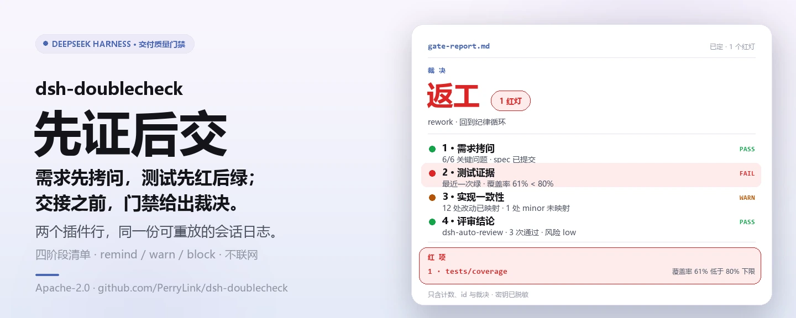
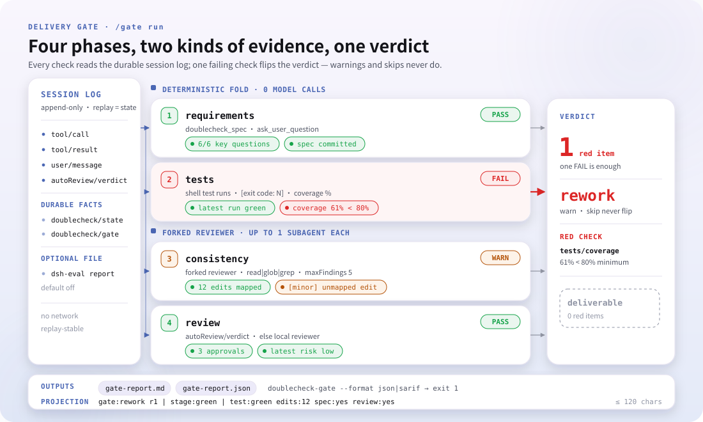

<div align="center">

<picture>
  <source media="(prefers-color-scheme: dark)" srcset="docs/assets/dsh-doublecheck-hero-zh-dark.webp">
  
</picture>

# dsh-doublecheck

**把交付从「自称完成」变成有证据的裁决：需求先拷问，测试先红后绿，交接之前由四阶段门禁给出可交付 / 返工。**

DeepSeek Harness 的交付质量门禁：两个插件行盯住同一份可重放的会话日志，把 grill → design → red → green → review → verify 的纪律闭环变成命令、工具，和一条会被写进报告的裁决。

[安装](#三步上手) · [配置](#配置) · [FAQ](#faq) · [简体中文](README.md) · [English](README.en.md) · [Español](README.es.md) · [Português](README.pt.md) · [हिन्दी](README.hi.md)

[](LICENSE)
[](#兼容性)
[](https://www.npmjs.com/package/dsh-doublecheck)
[](https://github.com/PerryLink/dsh-doublecheck/actions/workflows/ci.yml)
[](#兼容性)

[](https://github.com/PerryLink/dsh-doublecheck/stargazers)
[](https://www.npmjs.com/package/dsh-doublecheck)
[](https://dshfind.com/plugins/PerryLink/dsh-doublecheck?ref=badge)
[](https://securityscorecards.dev/viewer/?uri=github.com/PerryLink/dsh-doublecheck)
[](https://dsh.market/)
[](https://gitee.com/perrylink/dsh-doublecheck)

```sh
dsh plugin --profile <name> add dsh-doublecheck
```

</div>

<sub>社区插件，与 DeepSeek 官方无关。唯一仓库：<https://github.com/PerryLink/dsh-doublecheck>（Gitee 为镜像）。</sub>

## 它是什么

`dsh-doublecheck` 装进来的不是一段提示词，而是两个插件行：`doublecheck-grill` 把需求拷问清楚并落成 spec，`doublecheck-guard` 在改动、测试与交接的每个边界上把关。两者读的是同一份持久会话日志——恢复、分叉、重启之后，它们看到的证据完全一样。

一次 `/gate run` 会把会话里已经发生的事实折叠成四阶段清单：需求是否逐项被确认、最近一次测试是红还是绿、每处改动是否服务于某个 spec 维度、评审结论是什么，然后给出**可交付 / 需要返工**的裁决，并写成一份可直接贴进 PR 描述的报告。

它不替你写代码，也不判断代码好不好看；它只做一件事——让「做完了」这句话必须带上证据。

<picture>
  <source media="(prefers-color-scheme: dark)" srcset="docs/assets/dsh-doublecheck-flow-v5-dark.svg">
  
</picture>

## 三步上手

1. **安装**（三选一）：

   ```sh
   # git 渠道（最新 main）：prepare 脚本只用生产依赖构建
   dsh plugin --profile web add github:PerryLink/dsh-doublecheck
   # npm 渠道（已发布版本）
   dsh plugin --profile web add dsh-doublecheck
   # tarball 渠道：本仓库 pnpm pack 后
   dsh plugin --profile web add ./dsh-doublecheck-<version>.tgz
   ```

   两个行（`doublecheck-grill` 与 `doublecheck-guard`）随 profile 自动激活。

2. **最小配置**：开箱即用，bundle patch 已经插入这两行；要覆盖时才需要重述整行 config（见「配置」）。等价的 profile patch 形态：

   ```yaml
   - insert:
       - id: doublecheck-grill
         name: 'dsh-doublecheck/grill'
       - id: doublecheck-guard
         name: 'dsh-doublecheck/guard'
   ```

3. **验证已生效**：

   ```sh
   dsh --profile web --dump-config | grep -E -A3 'id: doublecheck-(grill|guard)'
   ```

   ```text
   > /doublecheck status
   > /gate status
   ```

**卸载**：`dsh plugin --profile web remove dsh-doublecheck`（或从 profile patch 删掉那两行）。

> 想要零配置的严格模式——每个门禁都以 `block` 强度开启、并且要求覆盖率证据——把随包附带的覆盖层叠在 bundle patch 之上：`dsh --profile web --patch ./node_modules/dsh-doublecheck/strict.patch.yml`。

## 核心能力

`dsh-doublecheck` 的每一道关卡都从会话日志里取证据，而不是听一句「我测过了」：

- **需求熔炉（`doublecheck-grill`）** —— 内置的 `grill-requirements` 技能，加上面向模型的 `doublecheck_skills`、`doublecheck_spec`、`doublecheck_report` 三个工具，以及按维度执行的验证工作流。共识没达成，就不动实现。
- **纪律守卫（`doublecheck-guard`）** —— grill 门禁、红/绿证据门禁、对抗式评审、`/doublecheck` 与 `/gate` 命令、实时的 `gate` 设置卡片，以及四阶段交付门禁。强度分 `remind` / `warn` / `block` 三档。
- **证据来自日志，不来自自述** —— 每条注入的提醒、评审与门禁通知都走标准通道落进会话日志；持久事实走 `doublecheck/state`、`doublecheck/gate` 事件或工具结果。重放即状态，恢复或分叉后重跑 `/gate run` 得到同一结果。
- **一项不过就亮红灯** —— 缺 spec、最近一次测试不是绿的、覆盖率低于门槛、有改动没映射到 spec 维度、评审给出 blocker/major 发现，都会变成一条带返工建议的红灯；警告与跳过永远不翻转裁决。
- **审计安全** —— 门禁与交付报告只写计数、id 与裁决，不含文件内容或会话文本；模型产出的发现文本在存储或显示之前先过密钥脱敏。

闭环是一条线：grill → design → red → green → review → verify。每一步都留下可重放的证据，而六个需求维度、共识门禁与结构化 spec 会同时落到会话与工作区。

纪律闭环的六个阶段：

| 阶段 | 含义 |
|---|---|
| **grill** | 拷问六个需求维度；在达成共识之前拒绝实现。 |
| **design** | 通过 `doublecheck_spec` 提交已经确定的 spec。 |
| **red** | 在实现改动之前，用一次失败的测试运行证明差距。 |
| **green** | 改动之后一次通过的测试运行闭合闭环。 |
| **review** | 一个分叉的对抗式批评者对照 spec 审计交付。 |
| **verify** | `doublecheck_report` 加上按维度的验证工作流证明交付。 |

## 工具与界面

| 界面 | 类型 | 说明 |
|---|---|---|
| `doublecheck_skills` | 工具 | 通过技能注册表接口列出并加载包内的四个内置技能。 |
| `doublecheck_spec` | 工具 | 把拷问得出的六维 spec 提交到会话日志，并在工作区留一份 markdown。 |
| `doublecheck_report` | 工具 | 把纪律证据折叠成交付报告（可选按维度验证工作流）。 |
| `/doublecheck status\|report\|on\|off` | 命令 | 开关、模块、强度、阶段事实、折叠报告，以及持久的开关覆盖。 |
| `/gate status\|run\|config` | 命令 | 实时清单进度、已定的可交付/返工报告，以及生效配置。 |
| `grill-requirements`、`red-green-tdd`、`delivery-review`、`delivery-proof` | 技能 | 覆盖全部六个闭环阶段的内置纪律技能。 |
| `gate` | 活动配置字段 | 可插拔清单是守卫行唯一的 `.volatile()` 字段：从该行的设置卡片编辑（命名空间 = 该行的 profile 条目 id），加载时读取一次。 |
| `strict.patch.yml` | 覆盖层 | 一个补丁层里以 `block` 强度打开每道门禁，并要求覆盖率。 |
| `dsh-doublecheck/invariant` | 伴生行 | 通过宿主的 `invariants` 注册表报告本包自有写路径的矛盾。 |
| `doublecheck` | 会话投影 | 客户端渲染的一行有界状态：阶段、最近裁决、红灯数、编辑数与 spec/评审标记。见[如何读状态行](#如何读状态行)。 |

### 如何读状态行

`doublecheck` 会话投影是一个**字符串**，而且刻意只有一行——这样任何客户端都能完整显示它、不会切掉内容。聊天桥的 `/status`、状态栏或任何自定义消费者都原样渲染：

```text
gate:rework r2 | stage:green | test:green edits:12 spec:yes review:yes | goal:ship parser fix
```

| 片段 | 读法 |
|---|---|
| `gate:<裁决> r<n>` | 最近一次交付门禁的裁决——未运行时是 `none`，否则是 `deliverable` 或 `rework`——以及它的红灯数 `r<n>`。 |
| `stage:<阶段>` | 依据持久证据到达的纪律阶段：`grill`、`design`、`red`、`green`、`review`、`verify`。 |
| `test:<颜色>` | 最近一次测试运行的颜色：`none`、`red`、`green`。 |
| `edits:<n>` | 从会话日志折叠出的实现编辑数（写测试文件不计入）。 |
| `spec:yes` / `spec:no` | 日志中是否存在已提交的 `doublecheck_spec`。 |
| `review:yes` / `review:no` | 是否存在对抗式评审记录。 |
| `goal:<摘录>` | 已提交 spec 的目标，会被裁剪。仅当 `spec:yes` 时出现。 |

这一行的长度**由构造保证有界**，因此不会被任何渲染器截断：

- 硬预算：**120 个字符**。凡是原样保留 120 字符以内取值的渲染器——微信桥的通用投影渲染器就是其中之一——都会完整显示这一行。旧的「对象」形态**空态就有 131 个字符**，这正是裁决与红灯数过去总被切掉的原因。
- 前三段是**无损的**。红灯数超过 `9999`、编辑数超过 `99999` 时打印为 `9999+` / `99999+`，而不会无限增长；非有限值或负数打印为 `0`。
- `goal:` 是唯一有损的一段。它会被压成单行（换行与控制字符变空格，`|` 变 `/`），并裁剪到剩余预算，最多 40 个字符，被裁剪时以 `…` 结尾。完整目标见 `/doublecheck status` 与交付报告。
- 这是一眼速览，不是记录本身：`/gate status` 与 `/doublecheck status` 渲染完整状态。

该投影的 `stateVersion` 为 **3**。递增它会丢弃旧版本写入的持久化投影缓存行，并以该键从会话日志重新折叠，因此升级后的会话会重算这一行，而不是显示过期值。折叠状态本身没有变化，升级前的会话也不会因此加载失败。

## 门禁阶段

交付门禁把会话的持久证据聚合成一份可配置的四阶段清单，并确定一个**可交付 / 需要返工**的裁决。每个阶段只折叠会话日志（重放即状态），因此一次运行在恢复或分叉之后会得到相同的结果。

| 阶段 | 检查 | 证据来源 | 模型成本 |
|---|---|---|---|
| 需求询问 | 逐项确认的关键问题清单（默认六个 spec 维度问题） | 已提交的 `doublecheck_spec` + `ask_user_question` 调用 | 无 |
| 测试证据 | 最近运行的颜色、绿色之后的失败运行、可选覆盖率阈值、可选 dsh-eval 报告 | 会话日志里的 shell 测试运行（`[exit code: N]`、覆盖率百分比）；开启 `gate.tests.evalReports.enabled` 时的 dsh-eval 报告文件 | 无 |
| 实现一致性 | 差异 ↔ 需求映射：每次改动都必须服务于某个 spec 维度 | 本地分叉评审者（结构化发现、只读工具） | 一个 subagent |
| 评审结论 | 交付裁决；`engine: auto` 在存在时消费 dsh-auto-review 的持久裁决记录，否则用本地评审者 | `autoReview/verdict` / `autoReview/rejection` 事件，或本地分叉评审者 | 一个 subagent（本地） |

红灯就是失败的检查项（缺 spec、最近一次运行失败、覆盖率低于下限、有改动未映射、blocker/major 级发现），每一项都附带返工建议。警告与跳过永远不会翻转裁决。门禁把 [dsh-auto-review](https://github.com/PerryLink/dsh-auto-review) 作为弱依赖集成：`review.engine: auto` 在存在时折叠它的裁决记录，否则降级到本地评审者；`gate.tests.evalReports.enabled` 把它的评测引擎（dsh-eval）写出的报告（prompt 回归 / 压测 / 公平性套件）并进测试证据，并在报告不存在时如实跳过。门禁从不合成审批请求。

## 示例

以下都是插件真实存在的入口；装好之后直接调用其中一个即可。

### 详细示例

**命令**

~~~sh
/gate run
~~~

**输出**

~~~text
# Delivery gate report

> **Verdict: rework required** — 2 red item(s)
> The gate is red. Re-open the work in plan mode to re-check the open items before delivering.
~~~

*Observed from `README.md §Example report (lines 243-251)`*

### 失败分支

**输入**

~~~text
/doublecheck maybe
~~~

**输出**

~~~text
Unknown /doublecheck argument "maybe". Usage: /doublecheck status|report|on|off
~~~

*Observed from `plugins/dsh-doublecheck/src/guard/prose.ts:191-192; plugins/dsh-doublecheck/src/guard/command.ts:156; plugins/dsh-doublecheck/tests/command.spec.ts:201-208`*

### 简短示例

- `doublecheck_skills`
- `doublecheck_spec`

### 示例报告

`/gate run` 返回这样一份 markdown——可以直接贴进 PR 描述：

````markdown
# Delivery gate report

> **Verdict: rework required** — 2 red item(s)
> The gate is red. Re-open the work in plan mode to re-check the open items before delivering.

## 1. Requirements interrogation — PASS
- [✔] **What outcome must the delivery produce?** — spec dimension "goal" committed
- [✔] **What is in scope, and what is out of scope?** — spec dimension "scope" committed
- [✔] **Which observable checks prove the work is done?** — spec dimension "acceptanceCriteria" committed
- [✔] **What can go wrong, and what is the correct behavior in each case?** — spec dimension "failureModes" committed
- [✔] **What is traded when goals conflict; what is optional?** — spec dimension "priorities" committed
- [✔] **What does the user explicitly not want?** — spec dimension "nonGoals" committed

## 2. Test evidence — FAIL
- [✔] **passing test run** — latest test run passed
- [✔] **failing cases after green** — 0 failing run(s) after green (allowed: 0)
- [✖] **coverage evidence** — 61% coverage below the 80% minimum — rework: raise coverage above the configured minimum

## 3. Implementation consistency — WARN
- [⚠] **[minor] src/telemetry.ts touched without a requirement** — [minor] the edit adds a metric no spec dimension covers

## 4. Review conclusion — PASS
- [✔] **dsh-auto-review conclusion** — 3 call(s) approved by dsh-auto-review (latest risk: low)

## Red items
1. **tests/coverage** — 61% coverage below the 80% minimum — *rework: raise coverage above the configured minimum*
2. **consistency/finding-1** — [minor] the edit adds a metric no spec dimension covers — *rework: src/telemetry.ts touched without a requirement*

## Audit
- review engine: dsh-auto-review
- generated at: 2026-08-14T12:00:00.000Z
- counts, ids, and verdicts only: no file contents or session text are embedded, and recognized secrets are redacted.
````

### CI 输出

`/gate run` 还会写一个 `gate-report.json`（同一份已定状态的无损 JSON，就在 `gate-report.md` 旁边）。`doublecheck-gate` 命令行工具把这个文件转成 GitHub Actions 可用的机器可读输出：

```sh
# JSON（PR 评论 / 状态载荷）
doublecheck-gate --format json --input gate-report.json
# SARIF 2.1.0（code-scanning 上传 / 状态检查）
doublecheck-gate --format sarif < gate-report.json
```

这个工具只序列化已经定下来的 `GateState`——它从不重跑四阶段门禁或证据折叠。退出码映射裁决：`0` = 可交付，`1` = 返工，`2` = 用法/解析错误。

## 配置

所有可调项都是 Schemastery 的 `Config` 字段（可在 cordis.yml 中修改）。按 id 定位的覆盖会替换整行——你需要的每一个键都要重新声明。`cordis.patch.yml` 逐键内联说明；Schema 默认值是调优默认值的唯一来源。

最常用的几个键：

| 键 | 默认值 | 含义 |
|---|---|---|
| `specFile` | `'doublecheck-spec.md'` | 已提交 spec 的 markdown 文件名（grill 行）。 |
| `reportFile` | `'doublecheck-report.md'` | 交付报告的工作区文件名（grill 行）。 |
| `intensity` | `'remind'` | grill、红/绿与评审门禁的执行强度（`remind` / `warn` / `block`）。 |
| `enableByDefault` | `true` | 没有 `/doublecheck on\|off` 记录的会话的主开关。 |
| `language` | `'en'` | 注入的提醒/拒绝/评审/门禁文案语言（`en` / `zh`）。 |
| `modules.adversary` | `false` | 打开后在绿色之后启动分叉批评者评审。 |
| `gate.enabled` | `true` | 门禁面板与回合边界红灯提示的主开关。 |
| `gate.review.engine` | `'auto'` | `auto` = 存在 dsh-auto-review 裁决记录时用它，否则用本地评审者；`local` = 始终用本地评审者。 |

<details>
<summary>完整配置表（39 个键）</summary>

| 键 | 默认值 | 含义 |
|---|---|---|
| `specFile` | `'doublecheck-spec.md'` | 已提交 spec 的 markdown 文件名（grill 行）。 |
| `reportFile` | `'doublecheck-report.md'` | 交付报告的工作区文件名（grill 行）。 |
| `reportVerify` | `true` | 默认运行验证工作流（grill 行）。 |
| `verifyProvider` | `'fork'` | 各维度检查器运行的 subagent 提供者（grill 行）。 |
| `verifyMode` | `'all'` | `all` = 每个维度一个并行检查器；`single` = 一个合并检查器（grill 行）。 |
| `intensity` | `'remind'` | grill、红/绿与评审门禁的执行强度（`remind` / `warn` / `block`）。 |
| `enableByDefault` | `true` | 没有 `/doublecheck on\|off` 记录的会话的主开关。 |
| `language` | `'en'` | 注入的提醒/拒绝/评审/门禁文案语言（`en` / `zh`）。 |
| `guardTools` | `['edit', 'write']` | 两个门禁监视的修改工具名。 |
| `vagueTaskMaxChars` | `200` | 超过此长度的任务绝不会被视为模糊。 |
| `remindOnce` | `true` | 每条提醒每会话最多注入一次（跨重启持久）。 |
| `testToolNames` | `['bash', 'pwsh']` | 可以运行测试的 shell 工具名。 |
| `testCommandPatterns` | *(pnpm / npm / yarn / bun test、pytest、go / cargo / make test、node --test、deno test、uv run pytest)* | 命令必须匹配才计为一次测试运行的正则。 |
| `testFilePatterns` | *(测试目录、`*.test.*` / `*.spec.*`)* | 识别测试文件的正则——始终可编辑，不受红门禁拦截。 |
| `modules.grill` | `true` | 关闭则禁用 grill 门禁。 |
| `modules.tdd` | `true` | 打开则启用红/绿证据门禁。 |
| `modules.adversary` | `false` | 打开后在绿色之后启用分叉批评者评审。 |
| `adversaryModel` | `null` | 批评者模型路由；`null` = 主模型自评。 |
| `adversaryProvider` | `'fork'` | 批评者运行的 subagent 提供者。 |
| `adversaryMaxFindings` | `5` | 注入会话的发现上限（1–20）。 |
| `adversaryTools` | `['read', 'glob', 'grep']` | 批评者工具允许列表；请保持只读。 |
| `adversaryTimeoutMs` | `120000` | 一次批评者运行的时间上限。 |
| `gate.enabled` | `true` | 门禁面板与回合边界红灯提示的主开关。 |
| `gate.planSuggestion` | `true` | 在红灯报告末尾附加计划模式复查建议。 |
| `gate.reportFile` | `'gate-report.md'` | 门禁报告的工作区文件名。 |
| `gate.requirements.checklist` | *(六个 spec 维度问题)* | 可插拔的关键问题清单：`{ id, question, specDimension, required }`。 |
| `gate.requirements.minConfirmed` | `6` | 必须通过的最少必答问题数（1..必答数量）。 |
| `gate.requirements.interrogateTool` | `'ask_user_question'` | 其调用计为询问证据的工具名。 |
| `gate.tests.requirePassingRun` | `true` | 最近一次测试运行未通过（或缺失）即为红灯。 |
| `gate.tests.allowFailingRuns` | `0` | 最近一次绿色之后允许的失败运行次数，超过即为红灯。 |
| `gate.tests.requireCoverage` | `false` | 打开则要求测试输出里有覆盖率证据。 |
| `gate.tests.minCoveragePct` | `80` | 最低覆盖率百分比（0–100）。 |
| `gate.tests.evalReports.enabled` | `false` | 打开则把 dsh-eval 报告（dsh-auto-review 的评测引擎）并进测试证据。 |
| `gate.tests.evalReports.dir` | `'.eval-reports'` | 存放引擎报告的工作区相对目录。 |
| `gate.tests.evalReports.file` | `'report.json'` | 目录内的报告文件名。 |
| `gate.tests.evalReports.required` | `false` | 为 true 时缺失报告即为红灯（否则跳过）。 |
| `gate.consistency.*` | `provider: 'fork'`、`model: null`、`tools: ['read','glob','grep']`、`timeoutMs: 120000`、`maxFindings: 5` | 本地一致性评审者的旋钮（`model: null` = 主模型）。 |
| `gate.review.engine` | `'auto'` | `auto` = 存在时使用 dsh-auto-review 的裁决记录，否则使用本地评审者；`local` = 始终使用本地评审者。 |
| `gate.review.provider` | `'fork'` | 本地评审评审者的提供者（其 `model`/`tools`/`timeoutMs`/`maxFindings` 与 `gate.consistency.*` 相同）。 |

</details>

上面每个 `gate.*` 键都属于同一个**活动字段**：守卫行把整个 `gate` 块标记为 `.volatile()`，因此它就是该行的可编辑设置卡片（表单命名空间即该行的 profile 条目 id）。其余键是来自 profile patch 的普通 composition 配置。该块在加载时读取一次，所以编辑在下次加载时生效——`gate.enabled` 决定回合边界的红灯提示是否安装。若宿主的 schemastery 早于 `.volatile()`，本行照旧挂载：没有卡片，该块仍取自 profile patch。

配置错误会在加载时大声失败：无效的正则、空或重复的名称列表、越界阈值、重复的清单 id 都会抛错，而不是悄无声息地什么都不做。`strict.patch.yml` 是全门禁阻断覆盖层，以 `intensity: block` 重新声明守卫行，打开所有模块并要求覆盖率。

profile patch 覆盖示例：

```yaml
- insert:
    - id: doublecheck-guard
      name: 'dsh-doublecheck/guard'
      config:
        language: zh
        intensity: block
        modules:
          tdd: true
          adversary: true
        gate:
          tests:
            requireCoverage: true
```

## FAQ

<details>
<summary>数据存在哪？报告里会不会带出我的文件内容？</summary>

持久事实只有两个会话事件：`doublecheck/state`（持久开关）与 `doublecheck/gate`（已定的门禁状态）；工作区里另有 `doublecheck-spec.md`、`doublecheck-report.md`、`gate-report.md`、`gate-report.json` 四个文件（路径可配置）。门禁与交付报告只记录计数、id 与裁决——**不含文件内容或会话文本**，模型产出的发现文本在存储或显示之前会先过密钥脱敏。仓库外的东西一概不碰。

</details>

<details>
<summary>宿主不支持持久写入时会怎样？会静默失效吗？</summary>

不会静默。`/doublecheck on|off` 与 `/gate run` 的持久记录依赖宿主的 `ignorable` 追加面；在没有这个面的宿主上，写入被跳过、开关退回进程内状态（见「已知限制」）。守卫行的设置卡片依赖 settings 服务：宿主没有 `.volatile()` 时不出现卡片，但本行照旧挂载，`gate` 块仍取自 profile patch。评审者或批评者接口跑不起来时，结论会如实写成「unavailable」/跳过，而不是伪造一个裁决。

</details>

<details>
<summary>会和其他插件抢命令名、事件或 slot 吗？</summary>

不会。所有工具都带命名空间，不提供任何服务键，不注册客户端 slot，也不注册 `webServer` 前缀；共享事件监听器一律经 `next()` 委托，绝不短路链条。逐条论证见「与其他 DSH 插件的互操作性」。

</details>

<details>
<summary>一次 `/gate run` 要花多少模型调用？</summary>

需求询问与测试证据两个阶段是纯折叠，不调用模型；实现一致性与评审结论各启动一个分叉 subagent（`gate.review.engine: auto` 且本会话有 dsh-auto-review 裁决记录时，评审结论阶段可以零成本直接采信）。可选的对抗式评审再花一个。除此之外不调用模型、不联网。

</details>

## 安全边界

- **模型可见 ⟺ 已记录。** 每条注入的提醒、评审与门禁通知都走标准通道并落进会话日志；持久的 spec/state/gate 事实走工具结果或 `SessionEventMap` 成员。
- **失败关闭 / 大声失败。** 守卫与门禁配置在 `apply` 中校验（断言抛错）；跑不起来的评审者或对抗式接口会退化为诚实的「不可用」/跳过通知，而不是伪造裁决。
- **审计安全报告。** 门禁与交付报告只记录计数、id 与裁决——不含文件内容或会话文本——模型生成的发现文本在存储或显示之前会经过密钥脱敏器。
- **自身无网络。** 这个插件不发起直接网络请求；批评者与评审者 subagent 经由宿主的 subagent 接口运行。
- **对 dsh-auto-review 的弱依赖。** 它从不被 import，也从不被硬性要求；门禁折叠它的持久裁决记录并降级到本地评审者，且从不合成审批请求。

## 权限与数据

- **读取**：只在进程内读取会话日志（`tool/call` / `tool/result` / `tool/ptc-dispatch`、注入的 `user/message` 来源，以及外部的 `autoReview/*` 裁决记录）；可选的计划模式服务状态。V3 改名之前的宿主用旧标签 `tool/code-dispatch` 记录 PTC 子调用，两个标签折叠结果完全一致。注入的提示携带本包自有的 `dsh-doublecheck` 消息来源 kind；该 kind 出现之前记录的日志会以 `plugin:dsh-doublecheck`（宿主 V3→V4 迁移对已发布的 catch-all 包装所做的改写）或已发布的 `plugin` 包装抵达，三种形态折叠结果一致。
- **写入**：会话工作区里的 `doublecheck-spec.md`、`doublecheck-report.md`、`gate-report.md`、`gate-report.json`（路径可配置），通过 `ctx.fs` 接口；以及持久的 `doublecheck/state`、`doublecheck/gate` 会话事件。
- **模型调用**：门禁的一致性阶段与本地评审阶段（每次 `/gate run` 各一个 subagent）、可选的对抗式评审，以及 `doublecheck_report` 的验证工作流会启动 subagent 运行；除此之外不调用模型，也不联网。
- **绝不触碰**：凭据、环境变量，或会话工作区之外的任何文件。workshop 清单只声明 `filesystem:read` 与 `filesystem:write`。门禁报告只带计数、id 与裁决；评审文本中被识别出的密钥在存储或显示之前会被脱敏。

## 已知限制

- **持久写入。** `/doublecheck on\|off` → `doublecheck/state` 与 `/gate run` → `doublecheck/gate` 依赖宿主的 `ignorable` 追加面（rc.6 之后至 `0.1.1-rc.2`）。在无此面的宿主上（rc.6/rc.8，以及移除该信封的 `0.1.2-alpha.1`——`0.1.2-rc.1` 仅恢复存量日志读取兼容字段、仍无法盖章），写入被跳过，开关保持进程内状态。
0.1.2-rc.1（2026-09-02 已适配）：会话信封保留 ignorable 字段但仅用于存量日志读取兼容——Session.append 仍无法盖章，门控行为不变。
0.1.5-alpha.1（2026-09-09 已适配）：会话格式 V3 把持久子调用事件 `tool/code-dispatch` 改名为 `tool/ptc-dispatch`（载荷不变；两个标签折叠结果一致）。Session.append 仍无 `ignorable` 写入通道，写入继续跳过、开关保持进程内——行为不变。（该条引入的 `doublecheck-gate` 设置命名空间已在 0.1.7-alpha.1 随宿主删除命名空间注册表一并移除。）
0.1.5-rc.1（2026-09-10 已适配）：依赖钉号移至已发布的 0.1.5-rc.1 线；无接口变更影响本插件行为。
0.1.5-rc.2（2026-09-11 已适配）：依赖钉号移至已发布的 0.1.5-rc.2 线；无接口变更影响本插件行为。
0.1.7-alpha.1（2026-09-22 已适配）：宿主删除了共享的 catch-all `plugin` 消息来源 kind（提示改携本包自有的 `dsh-doublecheck` kind，`remindOnce` 折叠仍能读取持久日志可能持有的两种升级前形态），并用 `SettingsForms` 取代了设置命名空间注册表（`doublecheck-gate` 命名空间消失；门禁清单改为守卫行唯一的 `.volatile()` 字段，仍在加载时读取一次）。`@deepseek-ai/cordis` 与 `@deepseek-ai/schemastery` 的 dev/test 钉号移至 `^4.0.3` / `^3.18.3`，即 `Volatile` 与 `.volatile()` 首次出现的版本；peer 区间仍为 `^4.0.2` / `^3.18.2`，且活动字段能力在加载时探测，因此更早的宿主线仍能挂载本行（只是没有设置卡片）。除设置存储位置外无行为变更。
- **可选接口。** 挂载设置服务时会出现守卫行自己的设置卡片；该卡片就是本行自己的 Config（命名空间 = 其 profile 条目 id），`gate` 块在加载时读取一次，因此其取值在下一次加载时作用于 `/gate` 面板与红灯提示。活动字段能力在加载时探测：若宿主的 schemastery 早于 `.volatile()`，本行照旧挂载——没有卡片，`gate` 块仍取自 profile patch。`/gate status` 的计划模式行读取可选的 `ctx.planMode`（没有则显示 `unknown`）；对抗式评审需要 `ctx.subagents`；验证需要 `workflowEngine`。
- **本地降级。** 当 dsh-auto-review 缺失或本会话没有裁决记录时，`gate.review.engine: auto` 会降级到本地评审者——报告会写明原因，而不是捏造裁决。
- **dsh-eval 证据基于文件。** dsh-auto-review 的评测引擎（`dsh-eval`）把 prompt 回归 / 压测 / 公平性结果写入工作区报告文件，而不是会话日志。`gate.tests.evalReports.enabled` 折叠该文件（默认关闭；缺失时跳过），折叠出的计数随持久 `doublecheck/gate` 记录保存，使已定的运行仍可重放。

## 与其他 DSH 插件的互操作性

已对照 **DSH `0.2.0-rc.2`**（本 README 面向的运行时）与 2026-10-05 实测的高星插件集验证。

本插件**不干扰**其他插件，包括广泛安装的高星插件：

- **无工具名冲突。** 所有工具都带命名空间，不占用任何已被内置工具或其他插件持有的裸名。
- **无服务键冲突。** 不提供任何服务键，因此不存在服务键冲突。
- **无 slot 冲突。** 不注册客户端 slot key，因此不参与 `shadows-shipped-ui` 座位争抢。
- **无 HTTP 路由冲突。** 不注册任何 `webServer` 前缀。
- **无 patch 层冲突。** 组合包 patch 只 `insert` 自己那一行，从不覆写内置行的 `config`。
- **无全局改写。** 不改原型、不改写 `process.env`、不替换全局 fetch dispatcher。

**共享事件监听器在构造上就不互相干扰。** 它用 `ctx.on()` 监听顺序敏感事件 `agent/turn-stopping`、`tools/post-execute`、`tools/pre-execute` —— Cordis 的**广播**语义：每个监听器都会运行，任何一个都无法饿死其他监听器。**此处每个监听器都通过 `next()` 委托**，因此链条绝不会被短路；改写作用在 `next()` 产出的值上，而不是用它顶替返回：

- `tools/post-execute` — also used by `cc-safety-net` (1576★).
- `tools/pre-execute` — also used by `cc-safety-net` (1576★).

静态证据：`dsh-plugin-doctor` 的 K10–K13 在本仓全部为 `pass`。

## 兼容性

| 方面 | 状态 |
|---|---|
| Harness | DeepSeek Harness `dsh-v0.2.2-rc.1`（2026-11-05 已适配）：`engines.dsh` 增加 `>=0.2.2-0 <0.3.0`，此前每一条线仍被接受；门禁与投影路径由 rc.1 测试套件覆盖。 |
| Node | `^22.19.0 \|\| >=24.9.0` |
| 平台 | 全部（纯宿主；无原生代码，自身不发起网络请求） |
| 模型 | 任意（守卫本身从不调用模型；批评者与评审者阶段作为宿主 subagent 运行） |

## 生态与质量

- [Gitee 镜像](https://gitee.com/perrylink/dsh-doublecheck)（同步镜像，以 GitHub 为准）
- [dshfind 插件页](https://dshfind.com/plugins/PerryLink/dsh-doublecheck)（安装量与排名）
- [OpenSSF Scorecard 报告](https://securityscorecards.dev/viewer/?uri=github.com/PerryLink/dsh-doublecheck)（由 [.github/workflows/scorecard.yml](.github/workflows/scorecard.yml) 驱动）
- [dsh-plugin-doctor 验证报告](https://github.com/PerryLink/dsh-plugin-doctor#verified-徽章)（K10–K13 全 `pass`）
- [DSH Market](https://dsh.market/)（已上架）
- **1024 商店渠道**：先 `npm i -g dsh1024`，再 `dsh1024 plugin --profile web add dsh-doublecheck`（计入 [deepseek1024.com](https://deepseek1024.com) 安装排行）
- [生态实测知识库](https://perrylink.github.io/dsh-plugin-guide/)：插件开发指南 · 选型实测数据 · 维护取舍判据

## 开发

```sh
pnpm install             # node ^22.19 || >=24
pnpm run build           # tsc --noEmitOnError（lib/ 是被提交的产物）
pnpm run prepare         # tsc --noEmitOnError（git 安装渠道）
pnpm run prepublishOnly  # build + 全量测试
pnpm run typecheck       # tsc --noEmit + 测试 tsconfig
pnpm run lint            # eslint src tests
pnpm test                # vitest run
pnpm run test:coverage   # vitest run --coverage
pnpm run pack:check      # build + 打包 tarball
pnpm run check:readmes   # 五语 README 一致性门禁
```

`lib/` 是刻意提交的：git 安装渠道无需构建即可解析本包，源码改动后请重新 `pnpm run build` 并一并提交。README 的配图由 [`scripts/gen-readme-assets.py`](scripts/gen-readme-assets.py) 程序化生成：hero 横幅用 Pillow 画成中/英 × 深/浅四版 WebP，结构图用手写 SVG 画成 flow-v5 深/浅两版；脚本可重复执行、幂等覆盖。旧的单版流程图与演示图保留在 `docs/assets/` 供外链使用，README 只引用新的 hero 与 flow-v5。

Topics：`dsh`, `dsh-plugin`, `deepseek-harness`, `engineering-discipline`, `requirements`, `guard`, `skill`, `quality-gate`, `delivery-gate`

## 家族与致谢

本项目是 [PerryLink](https://github.com/PerryLink) 维护的 DeepSeek Harness 插件家族成员（全部 Apache-2.0）。如果它帮到了你，**给个 star**——它不解锁任何功能，但会让下一个人更容易找到它。

- [@PerryLink](https://github.com/PerryLink) —— 创建者与维护者：grill → design → red → green → review → verify 纪律闭环、四阶段交付门禁、五语文档，以及 CI/发布流水线。

<details>
<summary>展开全部插件</summary>

| 插件 | 状态 |
|---|---|
| **[dsh-aqua-input-check](https://github.com/PerryLink/dsh-aqua-input-check)** |  |
| **[dsh-archive-check](https://github.com/PerryLink/dsh-archive-check)** |  |
| **[dsh-auto-review](https://github.com/PerryLink/dsh-auto-review)** |  |
| **[dsh-autotier](https://github.com/PerryLink/dsh-autotier)** | 🧊 已冻结 — 见仓库 README |
| **[dsh-bid-ca-precheck](https://github.com/PerryLink/dsh-bid-ca-precheck)** |  |
| **[dsh-bid-qual-check](https://github.com/PerryLink/dsh-bid-qual-check)** |  |
| **[dsh-cert-mcp](https://github.com/PerryLink/dsh-cert-mcp)** | 🧊 已冻结 — 见仓库 README |
| **[dsh-checkpoint-rewind](https://github.com/PerryLink/dsh-checkpoint-rewind)** |  |
| **[dsh-click](https://github.com/PerryLink/dsh-click)** |  |
| **[dsh-composer-history](https://github.com/PerryLink/dsh-composer-history)** |  |
| **[dsh-contract-stance](https://github.com/PerryLink/dsh-contract-stance)** |  |
| **[dsh-customs-doc-check](https://github.com/PerryLink/dsh-customs-doc-check)** |  |
| **[dsh-data-quality](https://github.com/PerryLink/dsh-data-quality)** | 🧊 已冻结 — 见仓库 README |
| **[dsh-demurrage-ledger](https://github.com/PerryLink/dsh-demurrage-ledger)** |  |
| **[dsh-doublecheck](https://github.com/PerryLink/dsh-doublecheck)** |  |
| **[dsh-drill-script-check](https://github.com/PerryLink/dsh-drill-script-check)** |  |
| **[dsh-eia-guide-check](https://github.com/PerryLink/dsh-eia-guide-check)** |  |
| **[dsh-emergency-plan](https://github.com/PerryLink/dsh-emergency-plan)** |  |
| **[dsh-essay-rubric-check](https://github.com/PerryLink/dsh-essay-rubric-check)** |  |
| **[dsh-evidence-check](https://github.com/PerryLink/dsh-evidence-check)** |  |
| **[dsh-export-ctl-check](https://github.com/PerryLink/dsh-export-ctl-check)** |  |
| **[dsh-fast](https://github.com/PerryLink/dsh-fast)** |  |
| **[dsh-fmea-table-check](https://github.com/PerryLink/dsh-fmea-table-check)** |  |
| **[dsh-forecast-penalty](https://github.com/PerryLink/dsh-forecast-penalty)** |  |
| **[dsh-fund-research](https://github.com/PerryLink/dsh-fund-research)** |  |
| **[dsh-github](https://github.com/PerryLink/dsh-github)** |  |
| **[dsh-gongwen-flow-check](https://github.com/PerryLink/dsh-gongwen-flow-check)** |  |
| **[dsh-gongwen-word-check](https://github.com/PerryLink/dsh-gongwen-word-check)** |  |
| **[dsh-guard-plan-qc](https://github.com/PerryLink/dsh-guard-plan-qc)** |  |
| **[dsh-hazchem-check](https://github.com/PerryLink/dsh-hazchem-check)** |  |
| **[dsh-hazplan-check](https://github.com/PerryLink/dsh-hazplan-check)** |  |
| **[dsh-hidden-risk-map](https://github.com/PerryLink/dsh-hidden-risk-map)** |  |
| **[dsh-hs-classify](https://github.com/PerryLink/dsh-hs-classify)** |  |
| **[dsh-icd-rule-check](https://github.com/PerryLink/dsh-icd-rule-check)** |  |
| **[dsh-industry-research](https://github.com/PerryLink/dsh-industry-research)** |  |
| **[dsh-lawcite-adapter](https://github.com/PerryLink/dsh-lawcite-adapter)** |  |
| **[dsh-laya](https://github.com/PerryLink/dsh-laya)** |  |
| **[dsh-lc-doc-check](https://github.com/PerryLink/dsh-lc-doc-check)** |  |
| **[dsh-learning-gap-check](https://github.com/PerryLink/dsh-learning-gap-check)** |  |
| **[dsh-library](https://github.com/PerryLink/dsh-library)** |  |
| **[dsh-local-ai](https://github.com/PerryLink/dsh-local-ai)** |  |
| **[dsh-lsp-actions](https://github.com/PerryLink/dsh-lsp-actions)** |  |
| **[dsh-mask](https://github.com/PerryLink/dsh-mask)** |  |
| **[dsh-mcp-panel](https://github.com/PerryLink/dsh-mcp-panel)** |  |
| **[dsh-medrec-qc](https://github.com/PerryLink/dsh-medrec-qc)** |  |
| **[dsh-memento](https://github.com/PerryLink/dsh-memento)** | 🧊 已冻结 — 见仓库 README |
| **[dsh-nsfc-form-check](https://github.com/PerryLink/dsh-nsfc-form-check)** |  |
| **[dsh-nurse-record-check](https://github.com/PerryLink/dsh-nurse-record-check)** |  |
| **[dsh-observe](https://github.com/PerryLink/dsh-observe)** |  |
| **[dsh-origin-rvc-check](https://github.com/PerryLink/dsh-origin-rvc-check)** |  |
| **[dsh-ota-review-check](https://github.com/PerryLink/dsh-ota-review-check)** |  |
| **[dsh-output-styles](https://github.com/PerryLink/dsh-output-styles)** |  |
| **[dsh-paper-doc-adapter](https://github.com/PerryLink/dsh-paper-doc-adapter)** |  |
| **[dsh-permission-rules](https://github.com/PerryLink/dsh-permission-rules)** |  |
| **[dsh-permit-report-check](https://github.com/PerryLink/dsh-permit-report-check)** |  |
| **[dsh-pipeline-check](https://github.com/PerryLink/dsh-pipeline-check)** |  |
| **[dsh-pleading-draft](https://github.com/PerryLink/dsh-pleading-draft)** |  |
| **[dsh-plugin-doctor](https://github.com/PerryLink/dsh-plugin-doctor)** | 🚫 已退役（仓库已归档） |
| **[dsh-plugin-guide](https://github.com/PerryLink/dsh-plugin-guide)** |  |
| **[dsh-plugin-kit](https://github.com/PerryLink/dsh-plugin-kit)** | 🚫 已退役（仓库已归档） |
| **[dsh-plugin-upgrade](https://github.com/PerryLink/dsh-plugin-upgrade)** | 🚫 已退役（仓库已归档） |
| **[dsh-policy-brief-draft](https://github.com/PerryLink/dsh-policy-brief-draft)** |  |
| **[dsh-power-loss-split](https://github.com/PerryLink/dsh-power-loss-split)** |  |
| **[dsh-power-ticket-check](https://github.com/PerryLink/dsh-power-ticket-check)** |  |
| **[dsh-ppap-check](https://github.com/PerryLink/dsh-ppap-check)** |  |
| **[dsh-protest-deadline](https://github.com/PerryLink/dsh-protest-deadline)** |  |
| **[dsh-railway-window](https://github.com/PerryLink/dsh-railway-window)** |  |
| **[dsh-repair-order-qc](https://github.com/PerryLink/dsh-repair-order-qc)** |  |
| **[dsh-research-report](https://github.com/PerryLink/dsh-research-report)** |  |
| **[dsh-review-reply-check](https://github.com/PerryLink/dsh-review-reply-check)** |  |
| **[dsh-rulefile-check](https://github.com/PerryLink/dsh-rulefile-check)** |  |
| **[dsh-safety-brief-check](https://github.com/PerryLink/dsh-safety-brief-check)** |  |
| **[dsh-score](https://github.com/PerryLink/dsh-score)** | 🧊 已冻结 — 见仓库 README |
| **[dsh-session-sync](https://github.com/PerryLink/dsh-session-sync)** |  |
| **[dsh-site-log-check](https://github.com/PerryLink/dsh-site-log-check)** |  |
| **[dsh-skill-pack-security](https://github.com/PerryLink/dsh-skill-pack-security)** |  |
| **[dsh-soe-decision-check](https://github.com/PerryLink/dsh-soe-decision-check)** |  |
| **[dsh-soilwater-check](https://github.com/PerryLink/dsh-soilwater-check)** |  |
| **[dsh-sop-sync-check](https://github.com/PerryLink/dsh-sop-sync-check)** |  |
| **[dsh-spc-gbt-adapter](https://github.com/PerryLink/dsh-spc-gbt-adapter)** |  |
| **[dsh-talk](https://github.com/PerryLink/dsh-talk)** |  |
| **[dsh-tender-extract](https://github.com/PerryLink/dsh-tender-extract)** |  |
| **[dsh-tender-matrix](https://github.com/PerryLink/dsh-tender-matrix)** |  |
| **[dsh-test-drive](https://github.com/PerryLink/dsh-test-drive)** |  |
| **[dsh-ticktick](https://github.com/PerryLink/dsh-ticktick)** | 🚫 已退役（仓库已归档） |
| **[dsh-translate](https://github.com/PerryLink/dsh-translate)** |  |
| **[dsh-warranty-calc](https://github.com/PerryLink/dsh-warranty-calc)** |  |
| **[dsh-budget](https://github.com/PerryLink/dsh-budget)** | 🧊 已冻结 — 见仓库 README |
| **[dsh-claude-move](https://github.com/PerryLink/dsh-claude-move)** | 🧊 已冻结 — 见仓库 README |
| **[dsh-defend](https://github.com/PerryLink/dsh-defend)** | 🧊 已冻结 — 见仓库 README |
| **[dsh-draw](https://github.com/PerryLink/dsh-draw)** | 🧊 已冻结 — 见仓库 README |
| **[dsh-reach](https://github.com/PerryLink/dsh-reach)** | 🧊 已冻结 — 见仓库 README |
| **[dsh-background-agents](https://github.com/PerryLink/dsh-background-agents)** | 🚫 已退役（仓库已归档） |
| **[dsh-session-pin](https://github.com/PerryLink/dsh-session-pin)** | 🚫 已退役（仓库已归档） |
| **[dsh-team-rooms](https://github.com/PerryLink/dsh-team-rooms)** | 🚫 已退役（仓库已归档） |

</details>

## License

[Apache License 2.0](LICENSE) © 2026 dsh-doublecheck contributors

<p align="center"><sub>Apache-2.0 · 社区插件，与 DeepSeek 无关。</sub></p>

<p align="center"><sub>工具链：<a href="https://github.com/PerryLink/dsh-plugin-guide">dsh-plugin-guide</a> · <a href="https://github.com/PerryLink/dsh-standards">dsh-standards</a> · <a href="https://github.com/PerryLink/dsh-plugin-start">dsh-plugin-start</a></sub></p>
