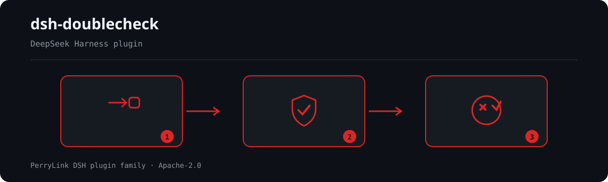

<div align="center">

# dsh-doublecheck
- **1024 store channel**: `npm i -g dsh1024` once, then `dsh1024 plugin --profile web add dsh-doublecheck` (counts toward the [deepseek1024.com](https://deepseek1024.com) install ranking).
[](https://gitee.com/perrylink/dsh-doublecheck)
[](https://dshfind.com/plugins/PerryLink/dsh-doublecheck?ref=badge)
[](https://api.securityscorecards.dev/projects/github.com/PerryLink/dsh-doublecheck)

**The delivery quality gate for DeepSeek Harness: grill the requirements, test the implementation, prove the delivery — then gate the handoff with a deliverable/rework decision.**

*Requirements get interrogated before the first edit; delivery is proven, never claimed.*

[](LICENSE)
[](https://github.com/topics/dsh-plugin)
[](https://github.com/PerryLink/dsh-plugin-doctor#verified-徽章)
[](https://dsh.market/)
[](#)
[](https://github.com/PerryLink/dsh-doublecheck/actions)
[](https://github.com/PerryLink/dsh-doublecheck/releases)
[](https://www.npmjs.com/package/dsh-doublecheck)
[](https://www.npmjs.com/package/dsh-doublecheck)

[English](README.md) · [简体中文](README-zh.md) · [Español](README-es.md) · [Português](README-pt.md) · [हिन्दी](README-hi.md)

```sh
dsh plugin --profile <name> add dsh-doublecheck
```


</div>

---

**📖 Ecosystem knowledge base** — measured data, not marketing: [plugin development guide · plugin-selection data · maintenance criteria](https://perrylink.github.io/dsh-plugin-guide/).

<!-- star-cta -->
## Install & uninstall

- **git channel** (latest `main`): `dsh plugin --profile web add github:PerryLink/dsh-doublecheck` — the `prepare` script builds with production dependencies only.
- **npm channel** (published releases): `dsh plugin --profile web add dsh-doublecheck`.
- **tarball channel**: `pnpm pack` in this repo, then `dsh plugin --profile web add ./dsh-doublecheck-<version>.tgz`.
- **uninstall**: `dsh plugin --profile web remove dsh-doublecheck` (or remove the rows from the profile patch).

For a zero-configuration strict mode (every gate on at `block` intensity, gate coverage required), apply the shipped overlay on top of the bundle patch: `dsh --profile web --patch ./node_modules/dsh-doublecheck/strict.patch.yml`.

## ⭐ 如果它帮到了你

这个插件是 [DSH 插件家族](https://github.com/PerryLink)的一员（95 个，全部 Apache-2.0）。如果你在用，**给个 star** —— 它不会解锁任何功能，但会让下一个人在搜索里更容易找到它。

*English:* part of a 95 plugin family for DeepSeek Harness. If it is useful, **a star helps the next person find it** — nothing is gated behind it.


## What is dsh-doublecheck?

The delivery quality gate for DeepSeek Harness: grill the requirements, test the implementation, prove the delivery — then gate the handoff with a deliverable/rework decision.

Requirements get interrogated before the first edit; delivery is proven, never claimed.



*Workflow overview: request → policy / review → verdict. The examples below use the real command surface.*


## Compatibility

| Surface | Status |
|---|---|
| Harness | DeepSeek Harness `dsh-v0.2.1-rc.2` (verified 2026-10-18): `engines.dsh >=0.2.1-0 <0.3.0`; the gate and projection paths are covered by the rc.2 test suite. |
| Node | `^22.19.0 \|\| >=24.0.0` |
| Platforms | All (pure host; no native code, no direct network requests of its own) |
| Model | Any (the guard itself never calls a model; the critic and reviewer phases run as harness subagents) |

## What you get

`dsh-doublecheck` installs two plugin rows that read and enforce from the same durable session log:

1. **`doublecheck-grill`** — the requirements furnace: the bundled `grill-requirements` skill plus the model-facing `doublecheck_skills`, `doublecheck_spec`, and `doublecheck_report` tools and the per-dimension verification workflow.
2. **`doublecheck-guard`** — the discipline guard: the grill gate, the red/green evidence gates, the adversary review, the `/doublecheck` and `/gate` commands, the live `gate` settings card, and the four-phase delivery gate.

Together they enforce the **discipline loop** — *grill → design → red → green → review → verify*:

```text
grill ──▶ design ──▶ red ──▶ green ──▶ review ──▶ verify
   │
   └─ six requirement dimensions, consensus gate,
      structured spec committed to the session + workspace
```

| Stage | Meaning |
|---|---|
| **grill** | Interrogate the six requirement dimensions; refuse to implement until consensus. |
| **design** | The settled spec is committed via `doublecheck_spec`. |
| **red** | A failing test run proves the gap before implementation edits. |
| **green** | A passing test run after the edits closes the loop. |
| **review** | A forked adversary critic audits the delivery against the spec. |
| **verify** | `doublecheck_report` + a per-dimension verification workflow prove the delivery. |

## Quick start

```sh
dsh plugin --profile web add github:PerryLink/dsh-doublecheck
```

```sh
# 1. install the bundle into your profile
dsh plugin --profile web add github:PerryLink/dsh-doublecheck

# or from npm (published releases)
dsh plugin --profile web add dsh-doublecheck

# 2. restart and verify the row
dsh --profile web --dump-config | grep -E -A3 'id: doublecheck-(grill|guard)'
```

Both rows (`doublecheck-grill` and `doublecheck-guard`) activate automatically with the profile.

### Examples

These are the plugin's real entry points; install once, then call one.

#### Detailed example

**Command**

~~~sh
/gate run
~~~

**Output**

~~~text
# Delivery gate report

> **Verdict: rework required** — 2 red item(s)
> The gate is red. Re-open the work in plan mode to re-check the open items before delivering.
~~~

*Observed from `README.md §Example report (lines 243-251)`*

#### Failure branch

**Input**

~~~text
/doublecheck maybe
~~~

**Output**

~~~text
Unknown /doublecheck argument "maybe". Usage: /doublecheck status|report|on|off
~~~

*Observed from `plugins/dsh-doublecheck/src/guard/prose.ts:191-192; plugins/dsh-doublecheck/src/guard/command.ts:156; plugins/dsh-doublecheck/tests/command.spec.ts:201-208`*

#### Brief examples

- `doublecheck_skills`
- `doublecheck_spec`

## Configuration

All tunables are Schemastery `Config` fields (changeable from cordis.yml). An id-targeted override replaces the whole row — restate every key you need. `cordis.patch.yml` documents each key inline; Schema defaults are the single source of tuning defaults.

| Key | Default | Meaning |
|---|---|---|
| `specFile` | `'doublecheck-spec.md'` | Workspace file for the committed spec markdown (grill row). |
| `reportFile` | `'doublecheck-report.md'` | Workspace file for the delivery report (grill row). |
| `reportVerify` | `true` | Run the verification workflow by default (grill row). |
| `verifyProvider` | `'fork'` | Subagent provider for the per-dimension checkers (grill row). |
| `verifyMode` | `'all'` | `all` = one parallel checker per dimension; `single` = one combined checker (grill row). |
| `intensity` | `'remind'` | Enforcement strength of the grill, red/green, and review gates (`remind` / `warn` / `block`). |
| `enableByDefault` | `true` | Master switch for sessions without a `/doublecheck on\|off` record. |
| `language` | `'en'` | Injected reminder/deny/review/gate prose language (`en` / `zh`). |
| `guardTools` | `['edit', 'write']` | Mutation tool names both gates watch. |
| `vagueTaskMaxChars` | `200` | Longer tasks are never treated as vague. |
| `remindOnce` | `true` | Inject each reminder at most once per session (durable across restarts). |
| `testToolNames` | `['bash', 'pwsh']` | Shell tool names that can run tests. |
| `testCommandPatterns` | *(pnpm/npm/yarn/bun test, pytest, go/cargo/make test, node --test, deno test, uv run pytest)* | Regexes a command must match to count as a test run. |
| `testFilePatterns` | *(test dirs, `*.test.*` / `*.spec.*`)* | Regexes identifying test files — always editable, exempt from the red gate. |
| `modules.grill` | `true` | Off disables the grill gate. |
| `modules.tdd` | `true` | On enables the red/green evidence gates. |
| `modules.adversary` | `false` | On enables the forked critic review at green. |
| `adversaryModel` | `null` | Critic model route; `null` = main model self-reviews. |
| `adversaryProvider` | `'fork'` | Subagent provider the critic runs on. |
| `adversaryMaxFindings` | `5` | Findings cap (1–20) injected into the session. |
| `adversaryTools` | `['read', 'glob', 'grep']` | Critic tool allowlist; keep it read-only. |
| `adversaryTimeoutMs` | `120000` | Hard time budget for one critic run. |
| `gate.enabled` | `true` | Master switch for the gate panel and the turn-boundary red notice. |
| `gate.planSuggestion` | `true` | Append the plan-mode re-check suggestion to red reports. |
| `gate.reportFile` | `'gate-report.md'` | Workspace file for the gate report. |
| `gate.requirements.checklist` | *(six spec-dimension questions)* | Pluggable key-question checklist: `{ id, question, specDimension, required }`. |
| `gate.requirements.minConfirmed` | `6` | Minimum required questions that must pass (1..required count). |
| `gate.requirements.interrogateTool` | `'ask_user_question'` | Tool name whose calls count as interrogation evidence. |
| `gate.tests.requirePassingRun` | `true` | A non-passing (or missing) latest test run is a red light. |
| `gate.tests.allowFailingRuns` | `0` | Failing runs after the latest green allowed before red. |
| `gate.tests.requireCoverage` | `false` | On requires coverage evidence in the test output. |
| `gate.tests.minCoveragePct` | `80` | Minimum coverage percentage (0–100). |
| `gate.tests.evalReports.enabled` | `false` | On folds the dsh-eval report (dsh-auto-review's eval engine) into the test evidence. |
| `gate.tests.evalReports.dir` | `'.eval-reports'` | Workspace-relative directory holding the engine's report. |
| `gate.tests.evalReports.file` | `'report.json'` | Report file name inside the directory. |
| `gate.tests.evalReports.required` | `false` | A missing report is a red light exactly when true (a skip otherwise). |
| `gate.consistency.*` | `provider: 'fork'`, `model: null`, `tools: ['read','glob','grep']`, `timeoutMs: 120000`, `maxFindings: 5` | The local consistency reviewer's knobs (`model: null` = main model). |
| `gate.review.engine` | `'auto'` | `auto` = dsh-auto-review verdict records when present, else the local reviewer; `local` = always local. |
| `gate.review.provider` | `'fork'` | The local review reviewer's provider (its `model`/`tools`/`timeoutMs`/`maxFindings` match `gate.consistency.*`). |

Every `gate.*` key above is one **live field**: the guard row marks the whole
`gate` block `.volatile()`, so it is the row's editable settings card (the form
namespace is the row's profile entry id). The remaining keys are ordinary
composition config from the profile patch. The block is read once at load, so an
edit takes effect on the next load — `gate.enabled` decides whether the
turn-boundary red notice is installed at all. On a host line whose schemastery
predates `.volatile()` the row still mounts: the card is absent and the block
comes from the profile patch exactly as before.

Misconfiguration fails loud at load: invalid regexes, empty or duplicated name lists, out-of-range thresholds, and duplicate checklist ids throw instead of silently doing nothing. `strict.patch.yml` is the all-gates-block overlay that restates the guard row at `intensity: block` with every module on and the coverage requirement enabled.

## Tools & surfaces

| Surface | Kind | Notes |
|---|---|---|
| `doublecheck_skills` | tool | Lists and loads the package's four bundled skills through the skill registry seam. |
| `doublecheck_spec` | tool | Commits the grilled six-dimension spec to the session log and a workspace markdown copy. |
| `doublecheck_report` | tool | Folds the discipline evidence into a delivery report (optional per-dimension verification workflow). |
| `/doublecheck status\|report\|on\|off` | command | Switch, modules, intensity, stage facts, folded report, and the durable on/off override. |
| `/gate status\|run\|config` | command | Live checklist progress, the settled deliverable/rework report, and the effective config. |
| `grill-requirements`, `red-green-tdd`, `delivery-review`, `delivery-proof` | skill | Bundled discipline skills covering all six loop stages. |
| `gate` | live config field | The pluggable checklist is the guard row's one `.volatile()` field: it is edited from the row's settings card (namespace = the row's profile entry id) and read once at load. |
| `strict.patch.yml` | overlay | Every gate on at `block` intensity plus the coverage requirement, in one patch layer. |
| `dsh-doublecheck/invariant` | companion row | Reports package-owned write-path contradictions through the host `invariants` registry. |
| `doublecheck` | session projection | One bounded status line a client renders: stage, latest gate verdict, red-light count, edits, spec/review flags. See [Reading the status line](#reading-the-status-line). |

### Reading the status line

The `doublecheck` session projection is a plain **string**, and it is deliberately one line — the whole point is that a client can show it without cutting anything off. A chat bridge's `/status`, a status bar, or any custom consumer renders it as it is:

```text
gate:rework r2 | stage:green | test:green edits:12 spec:yes review:yes | goal:ship parser fix
```

| Segment | Reads as |
|---|---|
| `gate:<verdict> r<n>` | The latest delivery-gate verdict — `none` before any run, `deliverable`, or `rework` — and its red-light count `r<n>`. |
| `stage:<stage>` | The discipline stage reached on durable evidence: `grill`, `design`, `red`, `green`, `review`, `verify`. |
| `test:<color>` | The latest test-run color: `none`, `red`, `green`. |
| `edits:<n>` | Implementation edits folded from the session log (test-file writes are not counted). |
| `spec:yes` / `spec:no` | Whether a committed `doublecheck_spec` exists. |
| `review:yes` / `review:no` | Whether an adversary review record exists. |
| `goal:<excerpt>` | The committed spec goal, clipped. Present only when `spec:yes`. |

The line is bounded **by construction**, so no renderer truncates it:

- Hard budget: **120 characters**. A renderer that keeps values up to 120 characters — the WeChat bridge's generic projection renderer is one — shows the entire line. The old object-shaped payload was 131 characters when *empty*, which is why the verdict and the red count used to be cut off.
- The first three segments are **lossless**. Counts above `9999` red lights or `99999` edits print as `9999+` / `99999+` instead of growing without bound; a non-finite or negative count prints as `0`.
- `goal:` is the one lossy segment. It is flattened to a single line (newlines and control characters become spaces, `|` becomes `/`) and clipped to the budget that is left, at most 40 characters, ending in `…` when it was clipped. The complete goal is in `/doublecheck status` and the delivery report.
- This is a glance, not the record: `/gate status` and `/doublecheck status` render the full state.

The projection's `stateVersion` is **3**. Bumping it discards a persisted projection-cache row written by an older version and refolds the key from the session log, so an upgraded session recomputes the line instead of showing a stale one. The persisted fold state itself is unchanged, and a pre-upgrade session never fails to load.

## Gate phases

The delivery gate aggregates the session's durable evidence into a configurable four-phase checklist and settles one **deliverable / rework required** decision. Every phase folds the session log alone (replay IS the state), so a run re-derives identically after resume or fork.

| Phase | Checks | Evidence source | Model cost |
|---|---|---|---|
| Requirements interrogation | Key-question checklist confirmed item by item (six spec-dimension questions by default) | Committed `doublecheck_spec` + `ask_user_question` calls | none |
| Test evidence | Latest run color, failing runs after green, optional coverage threshold, optional dsh-eval report | Shell test runs in the session log (`[exit code: N]`, coverage percentages); the dsh-eval report file when `gate.tests.evalReports.enabled` | none |
| Implementation consistency | Diff ↔ requirement mapping: every edit must serve a spec dimension | Local forked reviewer (structured findings, read-only tools) | one subagent |
| Review conclusion | The delivery verdict; `engine: auto` consumes dsh-auto-review's durable verdict records when present, else the local reviewer | `autoReview/verdict` / `autoReview/rejection` events, or the local forked reviewer | one subagent (local) |

Red lights are failed checks (a missing spec, a failing latest run, coverage below minimum, an unmapped edit, blocker/major findings) — each carries a rework suggestion. Warnings and skips never flip the decision. The gate integrates [dsh-auto-review](https://github.com/PerryLink/dsh-auto-review) as a weak dependency: `review.engine: auto` folds its verdict records when present and degrades to the local reviewer otherwise; `gate.tests.evalReports.enabled` folds its eval engine's dsh-eval report (prompt-regression / stress / fairness suites) into the test evidence and skips honestly when no report exists. The gate never synthesizes approval requests.

## Example report

`/gate run` returns this markdown — paste it into a PR description:

````markdown
# Delivery gate report

> **Verdict: rework required** — 2 red item(s)
> The gate is red. Re-open the work in plan mode to re-check the open items before delivering.

## 1. Requirements interrogation — PASS
- [✔] **What outcome must the delivery produce?** — spec dimension "goal" committed
- [✔] **What is in scope, and what is out of scope?** — spec dimension "scope" committed
- [✔] **Which observable checks prove the work is done?** — spec dimension "acceptanceCriteria" committed
- [✔] **What can go wrong, and what is the correct behavior in each case?** — spec dimension "failureModes" committed
- [✔] **What is traded when goals conflict; what is optional?** — spec dimension "priorities" committed
- [✔] **What does the user explicitly not want?** — spec dimension "nonGoals" committed

## 2. Test evidence — FAIL
- [✔] **passing test run** — latest test run passed
- [✔] **failing cases after green** — 0 failing run(s) after green (allowed: 0)
- [✖] **coverage evidence** — 61% coverage below the 80% minimum — rework: raise coverage above the configured minimum

## 3. Implementation consistency — WARN
- [⚠] **[minor] src/telemetry.ts touched without a requirement** — [minor] the edit adds a metric no spec dimension covers

## 4. Review conclusion — PASS
- [✔] **dsh-auto-review conclusion** — 3 call(s) approved by dsh-auto-review (latest risk: low)

## Red items
1. **tests/coverage** — 61% coverage below the 80% minimum — *rework: raise coverage above the configured minimum*
2. **consistency/finding-1** — [minor] the edit adds a metric no spec dimension covers — *rework: src/telemetry.ts touched without a requirement*

## Audit
- review engine: dsh-auto-review
- generated at: 2026-08-14T12:00:00.000Z
- counts, ids, and verdicts only: no file contents or session text are embedded, and recognized secrets are redacted.
````

## CI output

`/gate run` also writes a `gate-report.json` (the same settled state as lossless JSON, next to `gate-report.md`). The `doublecheck-gate` CLI turns that file into machine-readable output for GitHub Actions:

```sh
# JSON (PR comment / status payload)
doublecheck-gate --format json --input gate-report.json
# SARIF 2.1.0 (code-scanning upload / status check)
doublecheck-gate --format sarif < gate-report.json
```

The CLI only serializes the already-settled `GateState` — it never re-runs the four-phase gate or the evidence folds. Its exit code maps the verdict: `0` = deliverable, `1` = rework, `2` = usage/parse error.

## Permissions & data

- **Reads**: the session log (`tool/call` / `tool/result` / `tool/ptc-dispatch`, injected `user/message` sources, and the foreign `autoReview/*` verdict records) in-process only; the optional plan-mode service state. PTC sub-dispatches carry the predecessor `tool/code-dispatch` label on hosts before the V3 rename; both labels fold identically. Injected notices carry the producer-owned `dsh-doublecheck` message-source kind; logs recorded before that kind existed arrive as `plugin:dsh-doublecheck` (the harness's V3→V4 migration on a released catch-all wrapper) or as the released `plugin` wrapper, and all three fold identically.
- **Writes**: `doublecheck-spec.md`, `doublecheck-report.md`, `gate-report.md`, and `gate-report.json` in the session workspace (paths configurable) through the `ctx.fs` seam; the durable `doublecheck/state` and `doublecheck/gate` session events.
- **Model calls**: the gate's consistency and local-review phases (one subagent each per `/gate run`), the optional adversary review, and the `doublecheck_report` verification workflow start subagent runs; nothing else calls a model or the network.
- **Never touched**: credentials, environment variables, or any file outside the session workspace. The workshop manifest declares `filesystem:read` and `filesystem:write` only. Gate reports carry counts, ids, and verdicts only; recognized secrets in reviewer texts are redacted before storage or display.

## Security boundaries

- **Model-visible ⟺ logged.** Every injected reminder, review, and gate notice rides the standard channels and lands in the session log; the durable spec/state/gate facts ride tool results or `SessionEventMap` members.
- **Fail closed / fail loud.** Guard and gate config are validated in `apply` (assertions throw); a reviewer or adversary seam that cannot run settles as an honest "unavailable"/skip notice instead of a fake verdict.
- **Audit-safe reports.** Gate and delivery reports record counts, ids, and verdicts only — no file contents or session text — and model-produced finding texts pass a secret redactor before storage or display.
- **No network of its own.** The plugin makes no direct network requests; the critic and reviewer subagents ride the harness subagent seam.
- **Weak dependency on dsh-auto-review.** It is never imported or hard-required; the gate folds its durable verdict records and degrades to the local reviewer, and never synthesizes approval requests.

## Known limitations

- **Durable writes.** `/doublecheck on\|off` → `doublecheck/state` and `/gate run` → `doublecheck/gate` ride the host's `ignorable` append surface (post-rc.6 through `0.1.1-rc.2`). On hosts without that surface (rc.6/rc.8, and `0.1.2-alpha.1`, which removed the envelope — `0.1.2-rc.1` restores the field for stored-log read compatibility only and still cannot stamp it), the writes are skipped and the switch stays process-local.
0.1.2-rc.1 (adapted 2026-09-02): the session envelope keeps its ignorable field for stored-log read compatibility only - Session.append still cannot stamp it, so audit-gate behavior is unchanged.
0.1.5-alpha.1 (adapted 2026-09-09): session format V3 renames the durable sub-dispatch event `tool/code-dispatch` to `tool/ptc-dispatch` (payload unchanged; both labels fold identically). Session.append still exposes no `ignorable` channel, so durable writes stay skipped and the switch stays process-local - behavior unchanged. (The `doublecheck-gate` settings namespace this entry introduced was removed in 0.1.7-alpha.1, when the harness deleted the namespace registry.)
0.1.5-rc.1 (adapted 2026-09-10): dependency pins move to the published 0.1.5-rc.1 line; no seam change affects this plugin's behavior.
0.1.5-rc.2 (adapted 2026-09-11): dependency pins move to the published 0.1.5-rc.2 line; no seam change affects this plugin's behavior.
0.1.7-alpha.1 (adapted 2026-10-04): the harness deleted the shared catch-all `plugin` message-source kind (notices now carry the producer-owned `dsh-doublecheck` kind, and the `remindOnce` fold still reads the two pre-upgrade shapes a durable log can hold), and it replaced the settings-namespace registry with `SettingsForms` (the `doublecheck-gate` namespace is gone; the gate checklist is now the guard row's one `.volatile()` field, still read once at load). Dev/test pins for `@deepseek-ai/cordis` and `@deepseek-ai/schemastery` move to `^4.0.3` / `^3.18.3`, where `Volatile` and `.volatile()` first exist; the peer ranges stay `^4.0.2` / `^3.18.2` and the live-field surface is detected at load, so the older host lines mount the row with no settings card. No behavior change beyond the settings storage location.
- **Optional seams.** The guard row's settings card appears when the settings service is mounted; the card is this row's own Config (namespace = its profile entry id), and the `gate` block is read once at load, so its values apply to the `/gate` panel and the gate-red notice on the next load. The live-field surface is detected at load, so on a host line whose schemastery predates `.volatile()` the row mounts anyway — without a card, with the `gate` block taken from the profile patch. The `/gate status` plan-mode line reads the optional `ctx.planMode` (shows `unknown` without it); the adversary review needs `ctx.subagents`; verification needs `workflowEngine`.
- **Local degrade.** `gate.review.engine: auto` degrades to the local reviewer when dsh-auto-review is absent or has no verdict records this session — the report names the reason instead of inventing a verdict.
- **dsh-eval evidence is file-based.** The dsh-auto-review eval engine (`dsh-eval`) writes its prompt-regression / stress / fairness results to a workspace report file, not the session log. `gate.tests.evalReports.enabled` folds that file (off by default; skips when absent) and the folded counts ride the durable `doublecheck/gate` record so a settled run still replays.

## Development

```sh
pnpm install             # node ^22.19 || >=24
pnpm run build           # tsc --noEmitOnError (lib/ is committed)
pnpm run prepare         # tsc --noEmitOnError (git-install channel)
pnpm run prepublishOnly  # build + full test suite
pnpm run typecheck       # tsc --noEmit + tests tsconfig
pnpm run lint            # eslint src tests
pnpm test                # vitest run
pnpm run test:coverage   # vitest run --coverage
pnpm run pack:check      # build + pack the tarball
```

## Interoperability with other DSH plugins

Verified against **DSH `0.2.0-rc.2`** (the runtime this README ships for) and the high-star plugin set surveyed on 2026-10-05.

This plugin **does not interfere** with other plugins, including the widely installed high-star ones:

- **No tool-name collision.** Every tool is namespaced; no bare name owned by a shipped tool or another plugin is registered.
- **No service-key collision.** It provides no service key at all, so it cannot collide on one.
- **No slot collision.** It registers no client slot key, so it cannot contend for a `shadows-shipped-ui` seat.
- **No HTTP route collision.** It registers no `webServer` prefix.
- **No patch-layer collision.** The bundle patch only `insert`s its own row; it never overrides a built-in row's `config`.
- **No global mutation.** It does not patch prototypes, rewrite `process.env`, or replace the global fetch dispatcher.

**Shared event listeners are non-interfering by construction.** It observes the ordering-sensitive events `agent/turn-stopping`, `tools/post-execute`, `tools/pre-execute` with `ctx.on()` — Cordis's broadcast registration, where every listener runs and none can starve another. **Every listener here delegates through `next()`**, so the chain is never short-circuited, and a mutation is applied to the value `next()` produced rather than returned in its place:
  - `tools/post-execute` — also used by `cc-safety-net` (1576★).
  - `tools/pre-execute` — also used by `cc-safety-net` (1576★).

Static evidence: `dsh-plugin-doctor` K10–K13 report `pass` for every check on this repository.

## Topics

`dsh`, `dsh-plugin`, `deepseek-harness`, `engineering-discipline`, `requirements`, `guard`, `skill`, `quality-gate`, `delivery-gate`

## Contributors

- [@PerryLink](https://github.com/PerryLink) — creator and maintainer: the grill → design → red → green → review → verify discipline loop, the four-phase delivery gate, the five-language docs, and the CI/release pipeline.

## PerryLink DSH Plugin Family

This project is part of the DeepSeek Harness plugin family from [PerryLink](https://github.com/PerryLink). The roster stays collapsed below so every README keeps a short first screen; expand it to see every row and its status.

<details>
<summary>Expand all plugins</summary>

| Plugin | Status |
|---|---|
| **[dsh-aqua-input-check](https://github.com/PerryLink/dsh-aqua-input-check)** |  |
| **[dsh-archive-check](https://github.com/PerryLink/dsh-archive-check)** |  |
| **[dsh-auto-review](https://github.com/PerryLink/dsh-auto-review)** |  |
| **[dsh-autotier](https://github.com/PerryLink/dsh-autotier)** |  |
| **[dsh-bid-ca-precheck](https://github.com/PerryLink/dsh-bid-ca-precheck)** |  |
| **[dsh-bid-qual-check](https://github.com/PerryLink/dsh-bid-qual-check)** |  |
| **[dsh-cert-mcp](https://github.com/PerryLink/dsh-cert-mcp)** |  |
| **[dsh-checkpoint-rewind](https://github.com/PerryLink/dsh-checkpoint-rewind)** |  |
| **[dsh-click](https://github.com/PerryLink/dsh-click)** |  |
| **[dsh-composer-history](https://github.com/PerryLink/dsh-composer-history)** |  |
| **[dsh-contract-stance](https://github.com/PerryLink/dsh-contract-stance)** |  |
| **[dsh-customs-doc-check](https://github.com/PerryLink/dsh-customs-doc-check)** |  |
| **[dsh-data-quality](https://github.com/PerryLink/dsh-data-quality)** |  |
| **[dsh-demurrage-ledger](https://github.com/PerryLink/dsh-demurrage-ledger)** |  |
| **[dsh-doublecheck](https://github.com/PerryLink/dsh-doublecheck)** |  |
| **[dsh-drill-script-check](https://github.com/PerryLink/dsh-drill-script-check)** |  |
| **[dsh-eia-guide-check](https://github.com/PerryLink/dsh-eia-guide-check)** |  |
| **[dsh-emergency-plan](https://github.com/PerryLink/dsh-emergency-plan)** |  |
| **[dsh-essay-rubric-check](https://github.com/PerryLink/dsh-essay-rubric-check)** |  |
| **[dsh-evidence-check](https://github.com/PerryLink/dsh-evidence-check)** |  |
| **[dsh-export-ctl-check](https://github.com/PerryLink/dsh-export-ctl-check)** |  |
| **[dsh-fast](https://github.com/PerryLink/dsh-fast)** |  |
| **[dsh-fmea-table-check](https://github.com/PerryLink/dsh-fmea-table-check)** |  |
| **[dsh-forecast-penalty](https://github.com/PerryLink/dsh-forecast-penalty)** |  |
| **[dsh-fund-research](https://github.com/PerryLink/dsh-fund-research)** |  |
| **[dsh-github](https://github.com/PerryLink/dsh-github)** |  |
| **[dsh-gongwen-flow-check](https://github.com/PerryLink/dsh-gongwen-flow-check)** |  |
| **[dsh-gongwen-word-check](https://github.com/PerryLink/dsh-gongwen-word-check)** |  |
| **[dsh-guard-plan-qc](https://github.com/PerryLink/dsh-guard-plan-qc)** |  |
| **[dsh-hazchem-check](https://github.com/PerryLink/dsh-hazchem-check)** |  |
| **[dsh-hazplan-check](https://github.com/PerryLink/dsh-hazplan-check)** |  |
| **[dsh-hidden-risk-map](https://github.com/PerryLink/dsh-hidden-risk-map)** |  |
| **[dsh-hs-classify](https://github.com/PerryLink/dsh-hs-classify)** |  |
| **[dsh-icd-rule-check](https://github.com/PerryLink/dsh-icd-rule-check)** |  |
| **[dsh-industry-research](https://github.com/PerryLink/dsh-industry-research)** |  |
| **[dsh-lawcite-adapter](https://github.com/PerryLink/dsh-lawcite-adapter)** |  |
| **[dsh-laya](https://github.com/PerryLink/dsh-laya)** |  |
| **[dsh-lc-doc-check](https://github.com/PerryLink/dsh-lc-doc-check)** |  |
| **[dsh-learning-gap-check](https://github.com/PerryLink/dsh-learning-gap-check)** |  |
| **[dsh-library](https://github.com/PerryLink/dsh-library)** |  |
| **[dsh-local-ai](https://github.com/PerryLink/dsh-local-ai)** |  |
| **[dsh-lsp-actions](https://github.com/PerryLink/dsh-lsp-actions)** |  |
| **[dsh-mask](https://github.com/PerryLink/dsh-mask)** |  |
| **[dsh-mcp-panel](https://github.com/PerryLink/dsh-mcp-panel)** |  |
| **[dsh-medrec-qc](https://github.com/PerryLink/dsh-medrec-qc)** |  |
| **[dsh-memento](https://github.com/PerryLink/dsh-memento)** |  |
| **[dsh-nsfc-form-check](https://github.com/PerryLink/dsh-nsfc-form-check)** |  |
| **[dsh-nurse-record-check](https://github.com/PerryLink/dsh-nurse-record-check)** |  |
| **[dsh-observe](https://github.com/PerryLink/dsh-observe)** |  |
| **[dsh-origin-rvc-check](https://github.com/PerryLink/dsh-origin-rvc-check)** |  |
| **[dsh-ota-review-check](https://github.com/PerryLink/dsh-ota-review-check)** |  |
| **[dsh-output-styles](https://github.com/PerryLink/dsh-output-styles)** |  |
| **[dsh-paper-doc-adapter](https://github.com/PerryLink/dsh-paper-doc-adapter)** |  |
| **[dsh-permission-rules](https://github.com/PerryLink/dsh-permission-rules)** |  |
| **[dsh-permit-report-check](https://github.com/PerryLink/dsh-permit-report-check)** |  |
| **[dsh-pipeline-check](https://github.com/PerryLink/dsh-pipeline-check)** |  |
| **[dsh-pleading-draft](https://github.com/PerryLink/dsh-pleading-draft)** |  |
| **[dsh-plugin-doctor](https://github.com/PerryLink/dsh-plugin-doctor)** |  |
| **[dsh-plugin-guide](https://github.com/PerryLink/dsh-plugin-guide)** |  |
| **[dsh-plugin-kit](https://github.com/PerryLink/dsh-plugin-kit)** |  |
| **[dsh-plugin-upgrade](https://github.com/PerryLink/dsh-plugin-upgrade)** |  |
| **[dsh-policy-brief-draft](https://github.com/PerryLink/dsh-policy-brief-draft)** |  |
| **[dsh-power-loss-split](https://github.com/PerryLink/dsh-power-loss-split)** |  |
| **[dsh-power-ticket-check](https://github.com/PerryLink/dsh-power-ticket-check)** |  |
| **[dsh-ppap-check](https://github.com/PerryLink/dsh-ppap-check)** |  |
| **[dsh-protest-deadline](https://github.com/PerryLink/dsh-protest-deadline)** |  |
| **[dsh-railway-window](https://github.com/PerryLink/dsh-railway-window)** |  |
| **[dsh-repair-order-qc](https://github.com/PerryLink/dsh-repair-order-qc)** |  |
| **[dsh-research-report](https://github.com/PerryLink/dsh-research-report)** |  |
| **[dsh-review-reply-check](https://github.com/PerryLink/dsh-review-reply-check)** |  |
| **[dsh-rulefile-check](https://github.com/PerryLink/dsh-rulefile-check)** |  |
| **[dsh-safety-brief-check](https://github.com/PerryLink/dsh-safety-brief-check)** |  |
| **[dsh-score](https://github.com/PerryLink/dsh-score)** |  |
| **[dsh-session-sync](https://github.com/PerryLink/dsh-session-sync)** |  |
| **[dsh-site-log-check](https://github.com/PerryLink/dsh-site-log-check)** |  |
| **[dsh-skill-pack-security](https://github.com/PerryLink/dsh-skill-pack-security)** |  |
| **[dsh-soe-decision-check](https://github.com/PerryLink/dsh-soe-decision-check)** |  |
| **[dsh-soilwater-check](https://github.com/PerryLink/dsh-soilwater-check)** |  |
| **[dsh-sop-sync-check](https://github.com/PerryLink/dsh-sop-sync-check)** |  |
| **[dsh-spc-gbt-adapter](https://github.com/PerryLink/dsh-spc-gbt-adapter)** |  |
| **[dsh-talk](https://github.com/PerryLink/dsh-talk)** |  |
| **[dsh-tender-extract](https://github.com/PerryLink/dsh-tender-extract)** |  |
| **[dsh-tender-matrix](https://github.com/PerryLink/dsh-tender-matrix)** |  |
| **[dsh-test-drive](https://github.com/PerryLink/dsh-test-drive)** |  |
| **[dsh-ticktick](https://github.com/PerryLink/dsh-ticktick)** |  |
| **[dsh-translate](https://github.com/PerryLink/dsh-translate)** |  |
| **[dsh-warranty-calc](https://github.com/PerryLink/dsh-warranty-calc)** |  |
| **[dsh-budget](https://github.com/PerryLink/dsh-budget)** | 🧊 FROZEN — see the repo README |
| **[dsh-claude-move](https://github.com/PerryLink/dsh-claude-move)** | 🧊 FROZEN — see the repo README |
| **[dsh-defend](https://github.com/PerryLink/dsh-defend)** | 🧊 FROZEN — see the repo README |
| **[dsh-draw](https://github.com/PerryLink/dsh-draw)** | 🧊 FROZEN — see the repo README |
| **[dsh-reach](https://github.com/PerryLink/dsh-reach)** | 🧊 FROZEN — see the repo README |
| **[dsh-background-agents](https://github.com/PerryLink/dsh-background-agents)** | 🚫 RETIRED — see the repo README |
| **[dsh-session-pin](https://github.com/PerryLink/dsh-session-pin)** | 🚫 RETIRED — see the repo README |
| **[dsh-team-rooms](https://github.com/PerryLink/dsh-team-rooms)** | 🚫 RETIRED — see the repo README |

</details>

## License

[Apache License 2.0](LICENSE) © 2026 dsh-doublecheck contributors
