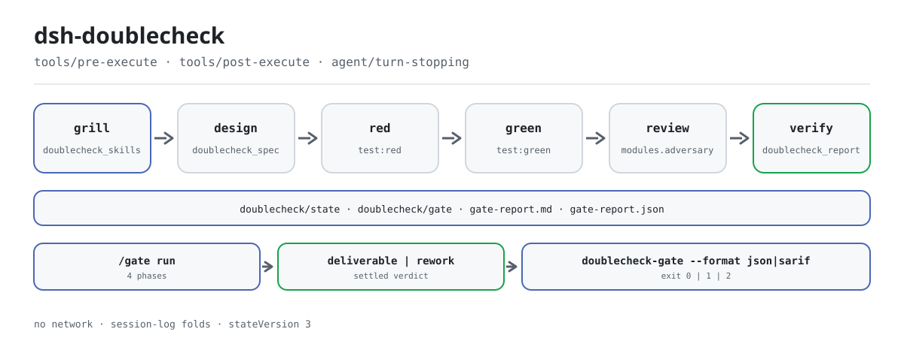

<div align="center">

<picture>
  <source media="(prefers-color-scheme: dark)" srcset="docs/assets/dsh-doublecheck-flow-dark.svg">
  
</picture>

# dsh-doublecheck

**Transforma «já está pronto» em um veredicto com provas: interrogue os requisitos primeiro, prove o teste em vermelho e depois em verde, e deixe um portão de quatro fases decidir entregável ou retrabalho antes da entrega.**

O portão de qualidade de entrega para o DeepSeek Harness: duas linhas de plugin vigiam o mesmo registro de sessão reproduzível e transformam o ciclo de disciplina grill → design → red → green → review → verify em comandos, ferramentas e um veredicto que fica registrado em um relatório.

[Instalar](#instalação-em-três-passos) · [Configuração](#configuração) · [FAQ](#faq) · [简体中文](README.md) · [English](README.en.md) · [Español](README.es.md) · [Português](README.pt.md) · [हिन्दी](README.hi.md)

[](LICENSE)
[](#compatibilidade)
[](https://www.npmjs.com/package/dsh-doublecheck)
[](https://github.com/PerryLink/dsh-doublecheck/actions/workflows/ci.yml)
[](#compatibilidade)

[](https://github.com/PerryLink/dsh-doublecheck/stargazers)
[](https://www.npmjs.com/package/dsh-doublecheck)
[](https://dshfind.com/plugins/PerryLink/dsh-doublecheck?ref=badge)
[](https://securityscorecards.dev/viewer/?uri=github.com/PerryLink/dsh-doublecheck)
[](https://dsh.market/)
[](https://gitee.com/perrylink/dsh-doublecheck)

```sh
dsh plugin --profile <name> add dsh-doublecheck
```

</div>

<sub>Plugin da comunidade, sem afiliação com a DeepSeek. Repositório canônico: <https://github.com/PerryLink/dsh-doublecheck> (o Gitee é um espelho).</sub>

## O que é

O `dsh-doublecheck` não instala um prompt: instala duas linhas de plugin. O `doublecheck-grill` interroga os requisitos e os registra como spec; o `doublecheck-guard` guarda cada limite de edição, de teste e de entrega. Os dois leem o mesmo registro de sessão durável, então depois de retomar, bifurcar ou reiniciar eles veem exatamente as mesmas provas.

Um `/gate run` dobra o que já aconteceu na sessão em uma lista de quatro fases — se os requisitos foram confirmados um a um, se a última execução de testes está em vermelho ou verde, se cada edição serve a uma dimensão do spec, o que a revisão conclui — e fixa um veredicto **entregável / requer retrabalho**, escrito como um relatório que você cola na descrição de um PR.

Ele não escreve o seu código nem julga a aparência dele. Faz uma coisa só: faz a frase «já está pronto» carregar provas.

## Instalação em três passos

1. **Instalar** (escolha um canal):

   ```sh
   # canal git (última main; o script prepare compila só com dependências de produção)
   dsh plugin --profile web add github:PerryLink/dsh-doublecheck
   # canal npm (versões publicadas)
   dsh plugin --profile web add dsh-doublecheck
   # canal tarball: pnpm pack neste repositório e depois
   dsh plugin --profile web add ./dsh-doublecheck-<version>.tgz
   ```

   As duas linhas (`doublecheck-grill` e `doublecheck-guard`) ativam com o perfil.

2. **Configuração mínima**: nenhuma é necessária — o patch do bundle já insere as duas linhas; uma sobreposição por id precisa reenunciar toda a config da linha (ver «Configuração»). A forma equivalente no patch do perfil:

   ```yaml
   - insert:
       - id: doublecheck-grill
         name: 'dsh-doublecheck/grill'
       - id: doublecheck-guard
         name: 'dsh-doublecheck/guard'
   ```

3. **Verificar que monta**:

   ```sh
   dsh --profile web --dump-config | grep -E -A3 'id: doublecheck-(grill|guard)'
   ```

   ```text
   > /doublecheck status
   > /gate status
   ```

**Desinstalar**: `dsh plugin --profile web remove dsh-doublecheck` (ou remova as duas linhas do patch do perfil).

> Se quiser um modo estrito sem configuração — cada portão na intensidade `block` e com prova de cobertura obrigatória — aplique a camada incluída sobre o patch do bundle: `dsh --profile web --patch ./node_modules/dsh-doublecheck/strict.patch.yml`.

## Capacidades principais

Cada ponto de controle do `dsh-doublecheck` tira a prova do registro de sessão, não da frase «eu testei»:

- **Fornalha de requisitos (`doublecheck-grill`)** — a skill `grill-requirements`, as ferramentas `doublecheck_skills`, `doublecheck_spec` e `doublecheck_report` e o fluxo de verificação por dimensão. Sem consenso, a implementação não é tocada.
- **Guarda de disciplina (`doublecheck-guard`)** — o portão de grill, os portões de prova vermelho/verde, a revisão adversária, os comandos `/doublecheck` e `/gate`, o cartão de ajustes `gate` e o portão de entrega de quatro fases, na intensidade `remind` / `warn` / `block`.
- **A prova vem do registro, não de um autorrelato** — cada lembrete, revisão e aviso de portão injetado viaja pelos canais padrão até o registro de sessão; os fatos duráveis viajam por `doublecheck/state`, `doublecheck/gate` ou resultados de ferramentas. A reprodução é o estado, então uma sessão retomada ou bifurcada reobtém o mesmo `/gate run`.
- **Uma verificação falha, uma luz vermelha** — falta o spec, a última execução não está verde, a cobertura fica abaixo do limite, uma edição não se mapeia a nenhuma dimensão do spec ou aparece um achado blocker/major: tudo vira uma luz vermelha com sugestão de retrabalho; avisos e saltos nunca viram o veredicto.
- **Relatórios auditáveis** — os relatórios de portão e de entrega registram apenas contagens, ids e veredictos, sem conteúdo de arquivos nem texto de sessão; os textos de achados produzidos pelo modelo passam por um removedor de segredos antes de serem guardados ou exibidos.

O ciclo é uma linha só: grill → design → red → green → review → verify. Cada passo deixa prova reproduzível, enquanto as seis dimensões do requisito, o portão de consenso e o spec estruturado ficam na sessão e no espaço de trabalho.

As seis etapas do ciclo de disciplina:

| Etapa | Significado |
|---|---|
| **grill** | Interroga as seis dimensões do requisito; recusa implementar até o consenso. |
| **design** | O spec acordado é registrado por `doublecheck_spec`. |
| **red** | Uma execução de testes que falha prova a lacuna antes de tocar a implementação. |
| **green** | Uma execução de testes que passa depois das edições fecha o ciclo. |
| **review** | Um crítico adversário bifurcado audita a entrega contra o spec. |
| **verify** | `doublecheck_report` mais um fluxo de verificação por dimensão provam a entrega. |

## Ferramentas e superfícies

| Superfície | Tipo | Notas |
|---|---|---|
| `doublecheck_skills` | ferramenta | Lista e carrega as quatro skills incluídas pelo seam de registro de skills. |
| `doublecheck_spec` | ferramenta | Registra o spec de seis dimensões no log de sessão e em uma cópia markdown do espaço de trabalho. |
| `doublecheck_report` | ferramenta | Dobra a prova de disciplina em um relatório de entrega (fluxo de verificação por dimensão opcional). |
| `/doublecheck status\|report\|on\|off` | comando | Interruptor, módulos, intensidade, fatos de etapa, relatório dobrado e a sobreposição durável de ligado/desligado. |
| `/gate status\|run\|config` | comando | Progresso ao vivo da lista, relatório já fixado de entregável/retrabalho e configuração efetiva. |
| `grill-requirements`, `red-green-tdd`, `delivery-review`, `delivery-proof` | skill | Skills de disciplina incluídas que cobrem as seis etapas do ciclo. |
| `gate` | campo de config vivo | A lista configurável é o único campo `.volatile()` da linha de guarda: é editada no cartão de ajustes da linha (namespace = id da entrada do perfil) e lida uma vez ao carregar. |
| `strict.patch.yml` | camada | Todos os portões na intensidade `block` mais o requisito de cobertura, em uma única camada de patch. |
| `dsh-doublecheck/invariant` | linha companheira | Relata contradições do caminho de escrita do pacote pelo registro `invariants` do host. |
| `doublecheck` | projeção de sessão | Uma linha de status limitada que um cliente renderiza: etapa, último veredicto do portão, luzes vermelhas, edições, marcas de spec/revisão. Ver [Como ler a linha de status](#como-ler-a-linha-de-status). |

### Como ler a linha de status

A projeção de sessão `doublecheck` é uma **string** e, de propósito, uma linha só — a ideia é que qualquer cliente possa mostrá-la sem cortar nada. O `/status` de uma ponte de chat, uma barra de status ou qualquer consumidor próprio renderiza exatamente como está:

```text
gate:rework r2 | stage:green | test:green edits:12 spec:yes review:yes | goal:ship parser fix
```

| Segmento | Lê-se como |
|---|---|
| `gate:<veredicto> r<n>` | O último veredicto do portão de entrega — `none` antes de qualquer execução, senão `deliverable` ou `rework` — e a contagem de luzes vermelhas `r<n>`. |
| `stage:<etapa>` | A etapa de disciplina alcançada com base na prova durável: `grill`, `design`, `red`, `green`, `review`, `verify`. |
| `test:<cor>` | A cor da última execução de testes: `none`, `red`, `green`. |
| `edits:<n>` | Edições de implementação dobradas do log de sessão (escrever arquivos de teste não conta). |
| `spec:yes` / `spec:no` | Se existe um `doublecheck_spec` registrado. |
| `review:yes` / `review:no` | Se existe um registro de revisão adversária. |
| `goal:<trecho>` | O objetivo do spec registrado, cortado. Aparece só quando `spec:yes`. |

A linha é limitada **por construção**, então nenhum renderizador a trunca:

- Orçamento rígido: **120 caracteres**. Um renderizador que mantém valores de até 120 caracteres — o renderizador genérico de projeções da ponte do WeChat é um — mostra a linha inteira. A antiga forma de objeto ocupava 131 caracteres **vazia**, e por isso o veredicto e a contagem de vermelhos costumavam ser cortados.
- Os três primeiros segmentos são **sem perda**. Contagens acima de `9999` luzes vermelhas ou `99999` edições são impressas como `9999+` / `99999+` em vez de crescer sem limite; um valor não finito ou negativo imprime `0`.
- `goal:` é o único segmento com perda. Ele é achatado em uma linha (quebras e caracteres de controle viram espaços, `|` vira `/`) e cortado no orçamento restante, no máximo 40 caracteres, terminando em `…` quando cortado. O objetivo completo está em `/doublecheck status` e no relatório de entrega.
- Isto é um olhar rápido, não o registro: `/gate status` e `/doublecheck status` renderizam o estado completo.

O `stateVersion` da projeção é **3**. Incrementá-lo descarta a linha de cache persistida por uma versão anterior e dobra a chave de novo a partir do log de sessão, então uma sessão atualizada recalcula a linha em vez de mostrar uma obsoleta. O estado dobrado persistido não muda, e uma sessão anterior à atualização nunca falha ao carregar.

## Fases do portão

O portão de entrega agrega a prova durável da sessão em uma lista configurável de quatro fases e fixa uma decisão de **entregável / requer retrabalho**. Cada fase dobra só o log de sessão (a reprodução É o estado), então uma execução se rededuz igual depois de retomar ou bifurcar.

| Fase | Verifica | Fonte da prova | Custo de modelo |
|---|---|---|---|
| Interrogação de requisitos | Lista de perguntas-chave confirmada item por item (seis perguntas de dimensão de spec por padrão) | `doublecheck_spec` registrado + chamadas de `ask_user_question` | nenhum |
| Prova de testes | Cor da última execução, falhas depois do verde, limite de cobertura opcional, relatório dsh-eval opcional | Execuções de teste de shell no log de sessão (`[exit code: N]`, percentuais de cobertura); o arquivo de relatório dsh-eval quando `gate.tests.evalReports.enabled` | nenhum |
| Consistência da implementação | Mapa diff ↔ requisito: cada edição tem de servir a uma dimensão do spec | Revisor bifurcado local (achados estruturados, ferramentas somente leitura) | um subagent |
| Conclusão da revisão | O veredicto de entrega; `engine: auto` consome os registros de veredicto do dsh-auto-review quando existem, senão o revisor local | Eventos `autoReview/verdict` / `autoReview/rejection`, ou o revisor bifurcado local | um subagent (local) |

Luzes vermelhas são verificações que falharam (falta o spec, a última execução falha, cobertura abaixo do mínimo, uma edição sem mapeamento, achados blocker/major) — cada uma carrega uma sugestão de retrabalho. Avisos e saltos nunca viram a decisão. O portão integra o [dsh-auto-review](https://github.com/PerryLink/dsh-auto-review) como dependência fraca: `review.engine: auto` dobra os registros de veredicto dele quando existem e degrada para o revisor local caso contrário; `gate.tests.evalReports.enabled` dobra o relatório dsh-eval do motor de avaliação dele (suítes de regressão de prompt / estresse / justiça) na prova de testes e pula com honestidade quando não há relatório. O portão nunca sintetiza pedidos de aprovação.

## Exemplos

Estes são os pontos de entrada reais do plugin; instale uma vez e chame um.

### Exemplo detalhado

**Comando**

~~~sh
/gate run
~~~

**Saída**

~~~text
# Delivery gate report

> **Verdict: rework required** — 2 red item(s)
> The gate is red. Re-open the work in plan mode to re-check the open items before delivering.
~~~

*Observed from `README.md §Example report (lines 243-251)`*

### Ramo de falha

**Entrada**

~~~text
/doublecheck maybe
~~~

**Saída**

~~~text
Unknown /doublecheck argument "maybe". Usage: /doublecheck status|report|on|off
~~~

*Observed from `plugins/dsh-doublecheck/src/guard/prose.ts:191-192; plugins/dsh-doublecheck/src/guard/command.ts:156; plugins/dsh-doublecheck/tests/command.spec.ts:201-208`*

### Exemplos breves

- `doublecheck_skills`
- `doublecheck_spec`

### Relatório de exemplo

`/gate run` devolve este markdown — cole na descrição de um PR:

````markdown
# Delivery gate report

> **Verdict: rework required** — 2 red item(s)
> The gate is red. Re-open the work in plan mode to re-check the open items before delivering.

## 1. Requirements interrogation — PASS
- [✔] **What outcome must the delivery produce?** — spec dimension "goal" committed
- [✔] **What is in scope, and what is out of scope?** — spec dimension "scope" committed
- [✔] **Which observable checks prove the work is done?** — spec dimension "acceptanceCriteria" committed
- [✔] **What can go wrong, and what is the correct behavior in each case?** — spec dimension "failureModes" committed
- [✔] **What is traded when goals conflict; what is optional?** — spec dimension "priorities" committed
- [✔] **What does the user explicitly not want?** — spec dimension "nonGoals" committed

## 2. Test evidence — FAIL
- [✔] **passing test run** — latest test run passed
- [✔] **failing cases after green** — 0 failing run(s) after green (allowed: 0)
- [✖] **coverage evidence** — 61% coverage below the 80% minimum — rework: raise coverage above the configured minimum

## 3. Implementation consistency — WARN
- [⚠] **[minor] src/telemetry.ts touched without a requirement** — [minor] the edit adds a metric no spec dimension covers

## 4. Review conclusion — PASS
- [✔] **dsh-auto-review conclusion** — 3 call(s) approved by dsh-auto-review (latest risk: low)

## Red items
1. **tests/coverage** — 61% coverage below the 80% minimum — *rework: raise coverage above the configured minimum*
2. **consistency/finding-1** — [minor] the edit adds a metric no spec dimension covers — *rework: src/telemetry.ts touched without a requirement*

## Audit
- review engine: dsh-auto-review
- generated at: 2026-08-14T12:00:00.000Z
- counts, ids, and verdicts only: no file contents or session text are embedded, and recognized secrets are redacted.
````

### Saída de CI

`/gate run` também escreve um `gate-report.json` (o mesmo estado fixado como JSON sem perda, ao lado de `gate-report.md`). A CLI `doublecheck-gate` transforma esse arquivo em saída legível por máquina para o GitHub Actions:

```sh
# JSON (comentário de PR / carga de status)
doublecheck-gate --format json --input gate-report.json
# SARIF 2.1.0 (envio para code-scanning / verificação de status)
doublecheck-gate --format sarif < gate-report.json
```

A CLI só serializa o `GateState` já fixado — ela nunca reexecuta o portão de quatro fases nem as dobras de prova. O código de saída mapeia o veredicto: `0` = entregável, `1` = retrabalho, `2` = erro de uso/análise.

## Configuração

Todos os ajustes são campos `Config` do Schemastery (modificáveis no cordis.yml). Uma sobreposição por id substitui a linha inteira — reenuncie cada chave de que você precisa. O `cordis.patch.yml` documenta cada chave em linha; os padrões do Schema são a única fonte dos ajustes.

Chaves mais usadas:

| Chave | Padrão | Significado |
|---|---|---|
| `specFile` | `'doublecheck-spec.md'` | Arquivo do espaço de trabalho para o spec markdown registrado (linha grill). |
| `reportFile` | `'doublecheck-report.md'` | Arquivo do espaço de trabalho para o relatório de entrega (linha grill). |
| `intensity` | `'remind'` | Força de aplicação dos portões de grill, vermelho/verde e revisão (`remind` / `warn` / `block`). |
| `enableByDefault` | `true` | Interruptor mestre para sessões sem um registro `/doublecheck on\|off`. |
| `language` | `'en'` | Idioma dos textos injetados de lembrete/negativa/revisão/portão (`en` / `zh`). |
| `modules.adversary` | `false` | Ligado, habilita a revisão do crítico bifurcado ao chegar ao verde. |
| `gate.enabled` | `true` | Interruptor mestre do painel do portão e do aviso vermelho no limite do turno. |
| `gate.review.engine` | `'auto'` | `auto` = registros de veredicto do dsh-auto-review quando existem, senão o revisor local; `local` = sempre local. |

<details>
<summary>Tabela completa de configuração (39 chaves)</summary>

| Chave | Padrão | Significado |
|---|---|---|
| `specFile` | `'doublecheck-spec.md'` | Arquivo do espaço de trabalho para o spec markdown registrado (linha grill). |
| `reportFile` | `'doublecheck-report.md'` | Arquivo do espaço de trabalho para o relatório de entrega (linha grill). |
| `reportVerify` | `true` | Executar o fluxo de verificação por padrão (linha grill). |
| `verifyProvider` | `'fork'` | Provedor de subagent para os verificadores por dimensão (linha grill). |
| `verifyMode` | `'all'` | `all` = um verificador paralelo por dimensão; `single` = um verificador combinado (linha grill). |
| `intensity` | `'remind'` | Força de aplicação dos portões de grill, vermelho/verde e revisão (`remind` / `warn` / `block`). |
| `enableByDefault` | `true` | Interruptor mestre para sessões sem um registro `/doublecheck on\|off`. |
| `language` | `'en'` | Idioma dos textos injetados de lembrete/negativa/revisão/portão (`en` / `zh`). |
| `guardTools` | `['edit', 'write']` | Nomes das ferramentas de mutação que os dois portões vigiam. |
| `vagueTaskMaxChars` | `200` | Tarefas mais longas nunca são tratadas como vagas. |
| `remindOnce` | `true` | Injetar cada lembrete no máximo uma vez por sessão (durável entre reinícios). |
| `testToolNames` | `['bash', 'pwsh']` | Nomes de ferramentas de shell que podem executar testes. |
| `testCommandPatterns` | *(pnpm / npm / yarn / bun test, pytest, go / cargo / make test, node --test, deno test, uv run pytest)* | Regex que um comando precisa satisfazer para contar como execução de testes. |
| `testFilePatterns` | *(diretórios de teste, `*.test.*` / `*.spec.*`)* | Regex que identificam arquivos de teste — sempre editáveis, isentos do portão vermelho. |
| `modules.grill` | `true` | Desligado, desabilita o portão de grill. |
| `modules.tdd` | `true` | Ligado, habilita os portões de prova vermelho/verde. |
| `modules.adversary` | `false` | Ligado, habilita a revisão do crítico bifurcado ao chegar ao verde. |
| `adversaryModel` | `null` | Rota de modelo do crítico; `null` = o modelo principal se autorrevisa. |
| `adversaryProvider` | `'fork'` | Provedor de subagent em que o crítico roda. |
| `adversaryMaxFindings` | `5` | Teto de achados (1–20) injetados na sessão. |
| `adversaryTools` | `['read', 'glob', 'grep']` | Lista permitida de ferramentas do crítico; mantenha somente leitura. |
| `adversaryTimeoutMs` | `120000` | Orçamento rígido de tempo para uma execução do crítico. |
| `gate.enabled` | `true` | Interruptor mestre do painel do portão e do aviso vermelho no limite do turno. |
| `gate.planSuggestion` | `true` | Anexar a sugestão de rechecagem em modo plano aos relatórios vermelhos. |
| `gate.reportFile` | `'gate-report.md'` | Arquivo do espaço de trabalho para o relatório do portão. |
| `gate.requirements.checklist` | *(seis perguntas de dimensão de spec)* | Lista configurável de perguntas-chave: `{ id, question, specDimension, required }`. |
| `gate.requirements.minConfirmed` | `6` | Mínimo de perguntas obrigatórias que precisam passar (1..número de obrigatórias). |
| `gate.requirements.interrogateTool` | `'ask_user_question'` | Nome de ferramenta cujas chamadas contam como prova de interrogação. |
| `gate.tests.requirePassingRun` | `true` | Uma última execução de testes não aprovada (ou ausente) é luz vermelha. |
| `gate.tests.allowFailingRuns` | `0` | Execuções com falha após o último verde permitidas antes da luz vermelha. |
| `gate.tests.requireCoverage` | `false` | Ligado, exige prova de cobertura na saída dos testes. |
| `gate.tests.minCoveragePct` | `80` | Percentual mínimo de cobertura (0–100). |
| `gate.tests.evalReports.enabled` | `false` | Ligado, dobra o relatório dsh-eval (o motor de avaliação do dsh-auto-review) na prova de testes. |
| `gate.tests.evalReports.dir` | `'.eval-reports'` | Diretório relativo ao espaço de trabalho que guarda o relatório do motor. |
| `gate.tests.evalReports.file` | `'report.json'` | Nome do arquivo de relatório dentro do diretório. |
| `gate.tests.evalReports.required` | `false` | Um relatório ausente é luz vermelha exatamente quando true (senão é pulado). |
| `gate.consistency.*` | `provider: 'fork'`, `model: null`, `tools: ['read','glob','grep']`, `timeoutMs: 120000`, `maxFindings: 5` | Os ajustes do revisor de consistência local (`model: null` = modelo principal). |
| `gate.review.engine` | `'auto'` | `auto` = registros de veredicto do dsh-auto-review quando existem, senão o revisor local; `local` = sempre local. |
| `gate.review.provider` | `'fork'` | Provedor do revisor local (seu `model`/`tools`/`timeoutMs`/`maxFindings` coincidem com `gate.consistency.*`). |

</details>

Cada chave `gate.*` acima faz parte de um único **campo vivo**: a linha de guarda marca o bloco `gate` inteiro como `.volatile()`, então ele é o cartão de ajustes editável da linha (o namespace do formulário é o id da entrada do perfil). As demais são config de composição normal do patch do perfil. O bloco é lido uma vez ao carregar, então uma edição vale no próximo carregamento — `gate.enabled` decide se o aviso vermelho do limite do turno é instalado. Em uma linha de host cuja schemastery é anterior a `.volatile()` a linha monta de qualquer forma: o cartão não existe e o bloco vem do patch do perfil exatamente como antes.

Configuração errada falha alto ao carregar: regex inválidas, listas de nomes vazias ou duplicadas, limites fora de faixa e ids de lista duplicados lançam erro em vez de não fazer nada em silêncio. O `strict.patch.yml` é a camada que bloqueia todos os portões e reenuncia a linha de guarda com `intensity: block`, todos os módulos ligados e o requisito de cobertura ativado.

Exemplo de sobreposição no patch do perfil:

```yaml
- insert:
    - id: doublecheck-guard
      name: 'dsh-doublecheck/guard'
      config:
        language: zh
        intensity: block
        modules:
          tdd: true
          adversary: true
        gate:
          tests:
            requireCoverage: true
```

## FAQ

<details>
<summary>Onde os dados ficam? Um relatório pode vazar o conteúdo dos meus arquivos?</summary>

Os fatos duráveis são dois eventos de sessão, `doublecheck/state` (o interruptor durável) e `doublecheck/gate` (o estado de portão fixado), mais quatro arquivos do espaço de trabalho: `doublecheck-spec.md`, `doublecheck-report.md`, `gate-report.md`, `gate-report.json` (caminhos configuráveis). Os relatórios de portão e de entrega registram apenas contagens, ids e veredictos: sem conteúdo de arquivos e sem texto de sessão, e os textos de achados produzidos pelo modelo passam por um removedor de segredos antes de serem guardados ou exibidos. Nada fora do espaço de trabalho da sessão é tocado.

</details>

<details>
<summary>O que acontece em hosts sem escritas duráveis? Falha em silêncio?</summary>

Nada é silencioso. Os registros duráveis por trás de `/doublecheck on|off` e `/gate run` viajam pela superfície de append `ignorable` do host; em um host sem ela as escritas são puladas e o interruptor volta ao estado de processo (ver «Limitações conhecidas»). O cartão de ajustes da linha de guarda precisa do serviço de settings: onde a schemastery do host é anterior a `.volatile()` não há cartão, mas a linha monta mesmo assim e o bloco `gate` continua vindo do patch do perfil. Quando um seam de revisor ou de adversário não pode rodar, a conclusão é escrita com honestidade como «unavailable»/pulo em vez de um veredicto fabricado.

</details>

<details>
<summary>Ele briga com outros plugins por nomes de comando, eventos ou slots?</summary>

Não. Cada ferramenta leva namespace, não oferece nenhuma chave de serviço, não registra slots de cliente nem prefixos `webServer`, e cada listener de evento compartilhado delega com `next()` sem curto-circuitar a cadeia. O argumento ponto por ponto está em «Interoperabilidade com outros plugins DSH».

</details>

<details>
<summary>Quantas chamadas de modelo custa um `/gate run`?</summary>

As fases de interrogação de requisitos e de prova de testes são dobras puras, sem custo de modelo; as fases de consistência e de conclusão da revisão iniciam um subagent bifurcado cada uma (com `gate.review.engine: auto` e registros de veredicto do dsh-auto-review presentes, a fase de conclusão pode ser consumida a custo zero). A revisão adversária opcional soma mais um. Nada mais chama modelo ou rede.

</details>

## Limites de segurança

- **Visível ao modelo ⟺ registrado.** Cada lembrete, revisão e aviso de portão injetado viaja pelos canais padrão e fica no log de sessão; os fatos duráveis de spec/estado/portão viajam por resultados de ferramentas ou por membros de `SessionEventMap`.
- **Falhar fechado / falhar alto.** A config de guarda e de portão é validada em `apply` (as asserções lançam); um seam de revisor ou de adversário que não pode rodar se resolve como um aviso honesto de «unavailable»/pulo em vez de um veredicto falso.
- **Relatórios auditáveis.** Os relatórios de portão e de entrega registram apenas contagens, ids e veredictos — sem conteúdo de arquivos nem texto de sessão — e os textos de achados produzidos pelo modelo passam por um removedor de segredos antes de serem guardados ou exibidos.
- **Sem rede própria.** O plugin não faz requisições de rede diretas; os subagents crítico e revisor viajam pelo seam de subagents do host.
- **Dependência fraca do dsh-auto-review.** Ele nunca é importado nem exigido de forma dura; o portão dobra os registros de veredicto duráveis dele e degrada para o revisor local, e nunca sintetiza pedidos de aprovação.

## Permissões e dados

- **Leituras**: o log de sessão (`tool/call` / `tool/result` / `tool/ptc-dispatch`, fontes `user/message` injetadas e os registros de veredicto alheios `autoReview/*`) só em processo; o estado opcional do serviço de modo plano. As subchamadas PTC carregam o rótulo predecessor `tool/code-dispatch` em hosts anteriores à renomeação V3; os dois rótulos dobram igual. Os avisos injetados carregam o kind de origem `dsh-doublecheck` do próprio produtor; logs gravados antes desse kind chegam como `plugin:dsh-doublecheck` (a migração V3→V4 do harness sobre um wrapper catch-all publicado) ou como o wrapper `plugin` publicado, e as três formas dobram igual.
- **Escritas**: `doublecheck-spec.md`, `doublecheck-report.md`, `gate-report.md` e `gate-report.json` no espaço de trabalho da sessão (caminhos configuráveis) pelo seam `ctx.fs`; os eventos de sessão duráveis `doublecheck/state` e `doublecheck/gate`.
- **Chamadas de modelo**: as fases de consistência e de revisão local do portão (um subagent cada por `/gate run`), a revisão adversária opcional e o fluxo de verificação do `doublecheck_report` iniciam subagents; nada mais chama modelo ou rede.
- **Nunca tocado**: credenciais, variáveis de ambiente ou qualquer arquivo fora do espaço de trabalho da sessão. O manifesto de workshop declara apenas `filesystem:read` e `filesystem:write`. Os relatórios de portão carregam só contagens, ids e veredictos; segredos reconhecidos nos textos de revisão são removidos antes de serem guardados ou exibidos.

## Limitações conhecidas

- **Escritas duráveis.** `/doublecheck on\|off` → `doublecheck/state` e `/gate run` → `doublecheck/gate` viajam pela superfície de append `ignorable` do host (depois da rc.6 até `0.1.1-rc.2`). Em hosts sem essa superfície (rc.6/rc.8, e `0.1.2-alpha.1`, que removeu o envelope — `0.1.2-rc.1` restaura o campo só para compatibilidade de leitura de logs guardados e continua sem poder estampá-lo), as escritas são puladas e o interruptor fica em estado de processo.
0.1.2-rc.1 (adaptado 2026-09-02): o envelope de sessão mantém o campo ignorable só para compatibilidade de leitura de logs guardados - Session.append continua sem poder estampá-lo, então o comportamento do portão de auditoria não muda.
0.1.5-alpha.1 (adaptado 2026-09-09): o formato de sessão V3 renomeia o evento durável de subdespacho `tool/code-dispatch` para `tool/ptc-dispatch` (carga inalterada; os dois rótulos dobram igual). Session.append continua sem expor um canal `ignorable`, então as escritas duráveis seguem puladas e o interruptor segue em estado de processo - comportamento inalterado. (O namespace de settings `doublecheck-gate` que esta entrada introduziu foi removido em 0.1.7-alpha.1, quando o harness apagou o registro de namespaces.)
0.1.5-rc.1 (adaptado 2026-09-10): os pins de dependências passam para a linha publicada 0.1.5-rc.1; nenhuma mudança de seam afeta o comportamento deste plugin.
0.1.5-rc.2 (adaptado 2026-09-11): os pins de dependências passam para a linha publicada 0.1.5-rc.2; nenhuma mudança de seam afeta o comportamento deste plugin.
0.1.7-alpha.1 (adaptado 2026-10-04): o harness removeu o kind de origem de mensagem catch-all `plugin` compartilhado (os avisos agora carregam o kind `dsh-doublecheck` do próprio produtor, e a dobra `remindOnce` continua lendo as duas formas anteriores à atualização que um log durável pode conter) e substituiu o registro de namespaces de settings por `SettingsForms` (o namespace `doublecheck-gate` desaparece; a lista do portão agora é o único campo `.volatile()` da linha de guarda, ainda lido uma vez ao carregar). Os pins de dev/teste de `@deepseek-ai/cordis` e `@deepseek-ai/schemastery` passam para `^4.0.3` / `^3.18.3`, onde `Volatile` e `.volatile()` existem pela primeira vez; as faixas de peer continuam `^4.0.2` / `^3.18.2` e a superfície de campo vivo é detectada ao carregar, então as linhas de host mais antigas montam a linha sem cartão de ajustes. Nenhuma mudança de comportamento além do local de armazenamento dos settings.
- **Seams opcionais.** O cartão de ajustes da linha de guarda aparece quando o serviço de settings está montado; o cartão é a Config da própria linha (namespace = seu id de entrada no perfil), e o bloco `gate` é lido uma vez ao carregar, então seus valores valem para o painel `/gate` e o aviso vermelho no próximo carregamento. A superfície de campo vivo é detectada ao carregar, então em uma linha de host cuja schemastery é anterior a `.volatile()` a linha monta mesmo assim — sem cartão, com o bloco `gate` vindo do patch do perfil. A linha de modo plano de `/gate status` lê o opcional `ctx.planMode` (mostra `unknown` sem ele); a revisão adversária precisa de `ctx.subagents`; a verificação precisa de `workflowEngine`.
- **Degradação local.** `gate.review.engine: auto` degrada para o revisor local quando o dsh-auto-review está ausente ou não tem registros de veredicto nesta sessão — o relatório nomeia o motivo em vez de inventar um veredicto.
- **A prova do dsh-eval é por arquivo.** O motor de avaliação do dsh-auto-review (`dsh-eval`) grava seus resultados de regressão de prompt / estresse / justiça em um arquivo de relatório do espaço de trabalho, não no log de sessão. `gate.tests.evalReports.enabled` dobra esse arquivo (desligado por padrão; pula quando ausente) e as contagens dobradas viajam com o registro durável `doublecheck/gate` para que uma execução fixada continue reproduzível.

## Interoperabilidade com outros plugins DSH

Verificado contra **DSH `0.2.0-rc.2`** (o runtime para o qual este README é publicado) e o conjunto de plugins de muitas estrelas sondado em 2026-10-05.

Este plugin **não interfere** em outros plugins, incluindo os de muitas estrelas amplamente instalados:

- **Sem colisão de nome de ferramenta.** Cada ferramenta leva namespace; nenhum nome nu de uma ferramenta publicada ou de outro plugin é registrado.
- **Sem colisão de chave de serviço.** Não oferece nenhuma chave de serviço, então não pode colidir em uma.
- **Sem colisão de slot.** Não registra chave de slot de cliente, então não disputa um assento de `shadows-shipped-ui`.
- **Sem colisão de rota HTTP.** Não registra nenhum prefixo `webServer`.
- **Sem colisão de camada de patch.** O patch do bundle só `insert`a a própria linha; nunca sobrescreve a `config` de uma linha embutida.
- **Sem mutação global.** Não altera protótipos, não reescreve `process.env` nem substitui o dispatcher global de fetch.

**Os listeners de eventos compartilhados não interferem por construção.** Ele observa os eventos sensíveis à ordem `agent/turn-stopping`, `tools/post-execute`, `tools/pre-execute` com `ctx.on()` — o registro de difusão do Cordis, em que cada listener roda e nenhum pode matar de fome outro. **Cada listener delega com `next()`**, então a cadeia nunca é curto-circuitada, e uma mutação é aplicada ao valor que `next()` produziu em vez de ser devolvida no lugar dele:

- `tools/post-execute` — also used by `cc-safety-net` (1576★).
- `tools/pre-execute` — also used by `cc-safety-net` (1576★).

Prova estática: `dsh-plugin-doctor` K10–K13 informa `pass` em cada verificação deste repositório.

## Compatibilidade

| Superfície | Estado |
|---|---|
| Harness | DeepSeek Harness `dsh-v0.2.2-rc.1` (adaptado 2026-11-05): `engines.dsh` ganha `>=0.2.2-0 <0.3.0` (toda linha anterior continua admitida); os caminhos do portão e da projeção são cobertos pela suíte rc.1. |
| Node | `^22.19.0 \|\| >=24.9.0` |
| Plataformas | Todas (host puro; sem código nativo, sem requisições de rede próprias) |
| Modelo | Qualquer (a guarda nunca chama um modelo; as fases de crítico e revisor rodam como subagents do harness) |

## Ecossistema e qualidade

- [Espelho Gitee](https://gitee.com/perrylink/dsh-doublecheck) (espelho sincronizado; o GitHub é o canônico)
- [Página do plugin no dshfind](https://dshfind.com/plugins/PerryLink/dsh-doublecheck) (instalações e ranking)
- [Relatório OpenSSF Scorecard](https://securityscorecards.dev/viewer/?uri=github.com/PerryLink/dsh-doublecheck) (gerado por [.github/workflows/scorecard.yml](.github/workflows/scorecard.yml))
- [Relatório de verificação do dsh-plugin-doctor](https://github.com/PerryLink/dsh-plugin-doctor#verified-徽章) (K10–K13 todos `pass`)
- [DSH Market](https://dsh.market/) (listado)
- **Canal da loja 1024**: `npm i -g dsh1024` uma vez, depois `dsh1024 plugin --profile web add dsh-doublecheck` (conta para o ranking de instalações do [deepseek1024.com](https://deepseek1024.com))
- [Base de conhecimento do ecossistema](https://perrylink.github.io/dsh-plugin-guide/): dados medidos, não marketing: guia de desenvolvimento de plugins · dados de seleção de plugins · critérios de manutenção

## Desenvolvimento

```sh
pnpm install             # node ^22.19 || >=24
pnpm run build           # tsc --noEmitOnError (lib/ é comprometido no repo)
pnpm run prepare         # tsc --noEmitOnError (canal de instalação git)
pnpm run prepublishOnly  # build + suíte completa de testes
pnpm run typecheck       # tsc --noEmit + tsconfig de testes
pnpm run lint            # eslint src tests
pnpm test                # vitest run
pnpm run test:coverage   # vitest run --coverage
pnpm run pack:check      # build + empacotar o tarball
pnpm run check:readmes   # portão de consistência dos README em cinco idiomas
```

`lib/` é comprometido de propósito: o canal de instalação git resolve o pacote sem etapa de build, então reconstrua com `pnpm run build` e confirme a árvore regenerada depois de mudar o código-fonte. As imagens do README são geradas programaticamente por [`scripts/gen-readme-assets.py`](scripts/gen-readme-assets.py) (Python + Pillow, saída SVG vetorial) e podem ser reexecutadas sem risco.

Topics: `dsh`, `dsh-plugin`, `deepseek-harness`, `engineering-discipline`, `requirements`, `guard`, `skill`, `quality-gate`, `delivery-gate`

## Família e agradecimentos

Este projeto faz parte da família de plugins de DeepSeek Harness da [PerryLink](https://github.com/PerryLink) (todos Apache-2.0). Se ele for útil, **uma estrela ajuda a próxima pessoa a encontrá-lo** — nada fica bloqueado atrás dela.

- [@PerryLink](https://github.com/PerryLink) — criador e mantenedor: o ciclo de disciplina grill → design → red → green → review → verify, o portão de entrega de quatro fases, a documentação em cinco idiomas e a esteira de CI/release.

<details>
<summary>Expandir todos os plugins</summary>

| Plugin | Status |
|---|---|
| **[dsh-aqua-input-check](https://github.com/PerryLink/dsh-aqua-input-check)** |  |
| **[dsh-archive-check](https://github.com/PerryLink/dsh-archive-check)** |  |
| **[dsh-auto-review](https://github.com/PerryLink/dsh-auto-review)** |  |
| **[dsh-autotier](https://github.com/PerryLink/dsh-autotier)** | 🧊 CONGELADO — ver o README do repo |
| **[dsh-bid-ca-precheck](https://github.com/PerryLink/dsh-bid-ca-precheck)** |  |
| **[dsh-bid-qual-check](https://github.com/PerryLink/dsh-bid-qual-check)** |  |
| **[dsh-cert-mcp](https://github.com/PerryLink/dsh-cert-mcp)** | 🧊 CONGELADO — ver o README do repo |
| **[dsh-checkpoint-rewind](https://github.com/PerryLink/dsh-checkpoint-rewind)** |  |
| **[dsh-click](https://github.com/PerryLink/dsh-click)** |  |
| **[dsh-composer-history](https://github.com/PerryLink/dsh-composer-history)** |  |
| **[dsh-contract-stance](https://github.com/PerryLink/dsh-contract-stance)** |  |
| **[dsh-customs-doc-check](https://github.com/PerryLink/dsh-customs-doc-check)** |  |
| **[dsh-data-quality](https://github.com/PerryLink/dsh-data-quality)** | 🧊 CONGELADO — ver o README do repo |
| **[dsh-demurrage-ledger](https://github.com/PerryLink/dsh-demurrage-ledger)** |  |
| **[dsh-doublecheck](https://github.com/PerryLink/dsh-doublecheck)** |  |
| **[dsh-drill-script-check](https://github.com/PerryLink/dsh-drill-script-check)** |  |
| **[dsh-eia-guide-check](https://github.com/PerryLink/dsh-eia-guide-check)** |  |
| **[dsh-emergency-plan](https://github.com/PerryLink/dsh-emergency-plan)** |  |
| **[dsh-essay-rubric-check](https://github.com/PerryLink/dsh-essay-rubric-check)** |  |
| **[dsh-evidence-check](https://github.com/PerryLink/dsh-evidence-check)** |  |
| **[dsh-export-ctl-check](https://github.com/PerryLink/dsh-export-ctl-check)** |  |
| **[dsh-fast](https://github.com/PerryLink/dsh-fast)** |  |
| **[dsh-fmea-table-check](https://github.com/PerryLink/dsh-fmea-table-check)** |  |
| **[dsh-forecast-penalty](https://github.com/PerryLink/dsh-forecast-penalty)** |  |
| **[dsh-fund-research](https://github.com/PerryLink/dsh-fund-research)** |  |
| **[dsh-github](https://github.com/PerryLink/dsh-github)** |  |
| **[dsh-gongwen-flow-check](https://github.com/PerryLink/dsh-gongwen-flow-check)** |  |
| **[dsh-gongwen-word-check](https://github.com/PerryLink/dsh-gongwen-word-check)** |  |
| **[dsh-guard-plan-qc](https://github.com/PerryLink/dsh-guard-plan-qc)** |  |
| **[dsh-hazchem-check](https://github.com/PerryLink/dsh-hazchem-check)** |  |
| **[dsh-hazplan-check](https://github.com/PerryLink/dsh-hazplan-check)** |  |
| **[dsh-hidden-risk-map](https://github.com/PerryLink/dsh-hidden-risk-map)** |  |
| **[dsh-hs-classify](https://github.com/PerryLink/dsh-hs-classify)** |  |
| **[dsh-icd-rule-check](https://github.com/PerryLink/dsh-icd-rule-check)** |  |
| **[dsh-industry-research](https://github.com/PerryLink/dsh-industry-research)** |  |
| **[dsh-lawcite-adapter](https://github.com/PerryLink/dsh-lawcite-adapter)** |  |
| **[dsh-laya](https://github.com/PerryLink/dsh-laya)** |  |
| **[dsh-lc-doc-check](https://github.com/PerryLink/dsh-lc-doc-check)** |  |
| **[dsh-learning-gap-check](https://github.com/PerryLink/dsh-learning-gap-check)** |  |
| **[dsh-library](https://github.com/PerryLink/dsh-library)** |  |
| **[dsh-local-ai](https://github.com/PerryLink/dsh-local-ai)** |  |
| **[dsh-lsp-actions](https://github.com/PerryLink/dsh-lsp-actions)** |  |
| **[dsh-mask](https://github.com/PerryLink/dsh-mask)** |  |
| **[dsh-mcp-panel](https://github.com/PerryLink/dsh-mcp-panel)** |  |
| **[dsh-medrec-qc](https://github.com/PerryLink/dsh-medrec-qc)** |  |
| **[dsh-memento](https://github.com/PerryLink/dsh-memento)** | 🧊 CONGELADO — ver o README do repo |
| **[dsh-nsfc-form-check](https://github.com/PerryLink/dsh-nsfc-form-check)** |  |
| **[dsh-nurse-record-check](https://github.com/PerryLink/dsh-nurse-record-check)** |  |
| **[dsh-observe](https://github.com/PerryLink/dsh-observe)** |  |
| **[dsh-origin-rvc-check](https://github.com/PerryLink/dsh-origin-rvc-check)** |  |
| **[dsh-ota-review-check](https://github.com/PerryLink/dsh-ota-review-check)** |  |
| **[dsh-output-styles](https://github.com/PerryLink/dsh-output-styles)** |  |
| **[dsh-paper-doc-adapter](https://github.com/PerryLink/dsh-paper-doc-adapter)** |  |
| **[dsh-permission-rules](https://github.com/PerryLink/dsh-permission-rules)** |  |
| **[dsh-permit-report-check](https://github.com/PerryLink/dsh-permit-report-check)** |  |
| **[dsh-pipeline-check](https://github.com/PerryLink/dsh-pipeline-check)** |  |
| **[dsh-pleading-draft](https://github.com/PerryLink/dsh-pleading-draft)** |  |
| **[dsh-plugin-doctor](https://github.com/PerryLink/dsh-plugin-doctor)** | 🚫 APOSENTADO (repo arquivado) |
| **[dsh-plugin-guide](https://github.com/PerryLink/dsh-plugin-guide)** |  |
| **[dsh-plugin-kit](https://github.com/PerryLink/dsh-plugin-kit)** | 🚫 APOSENTADO (repo arquivado) |
| **[dsh-plugin-upgrade](https://github.com/PerryLink/dsh-plugin-upgrade)** | 🚫 APOSENTADO (repo arquivado) |
| **[dsh-policy-brief-draft](https://github.com/PerryLink/dsh-policy-brief-draft)** |  |
| **[dsh-power-loss-split](https://github.com/PerryLink/dsh-power-loss-split)** |  |
| **[dsh-power-ticket-check](https://github.com/PerryLink/dsh-power-ticket-check)** |  |
| **[dsh-ppap-check](https://github.com/PerryLink/dsh-ppap-check)** |  |
| **[dsh-protest-deadline](https://github.com/PerryLink/dsh-protest-deadline)** |  |
| **[dsh-railway-window](https://github.com/PerryLink/dsh-railway-window)** |  |
| **[dsh-repair-order-qc](https://github.com/PerryLink/dsh-repair-order-qc)** |  |
| **[dsh-research-report](https://github.com/PerryLink/dsh-research-report)** |  |
| **[dsh-review-reply-check](https://github.com/PerryLink/dsh-review-reply-check)** |  |
| **[dsh-rulefile-check](https://github.com/PerryLink/dsh-rulefile-check)** |  |
| **[dsh-safety-brief-check](https://github.com/PerryLink/dsh-safety-brief-check)** |  |
| **[dsh-score](https://github.com/PerryLink/dsh-score)** | 🧊 CONGELADO — ver o README do repo |
| **[dsh-session-sync](https://github.com/PerryLink/dsh-session-sync)** |  |
| **[dsh-site-log-check](https://github.com/PerryLink/dsh-site-log-check)** |  |
| **[dsh-skill-pack-security](https://github.com/PerryLink/dsh-skill-pack-security)** |  |
| **[dsh-soe-decision-check](https://github.com/PerryLink/dsh-soe-decision-check)** |  |
| **[dsh-soilwater-check](https://github.com/PerryLink/dsh-soilwater-check)** |  |
| **[dsh-sop-sync-check](https://github.com/PerryLink/dsh-sop-sync-check)** |  |
| **[dsh-spc-gbt-adapter](https://github.com/PerryLink/dsh-spc-gbt-adapter)** |  |
| **[dsh-talk](https://github.com/PerryLink/dsh-talk)** |  |
| **[dsh-tender-extract](https://github.com/PerryLink/dsh-tender-extract)** |  |
| **[dsh-tender-matrix](https://github.com/PerryLink/dsh-tender-matrix)** |  |
| **[dsh-test-drive](https://github.com/PerryLink/dsh-test-drive)** |  |
| **[dsh-ticktick](https://github.com/PerryLink/dsh-ticktick)** | 🚫 APOSENTADO (repo arquivado) |
| **[dsh-translate](https://github.com/PerryLink/dsh-translate)** |  |
| **[dsh-warranty-calc](https://github.com/PerryLink/dsh-warranty-calc)** |  |
| **[dsh-budget](https://github.com/PerryLink/dsh-budget)** | 🧊 CONGELADO — ver o README do repo |
| **[dsh-claude-move](https://github.com/PerryLink/dsh-claude-move)** | 🧊 CONGELADO — ver o README do repo |
| **[dsh-defend](https://github.com/PerryLink/dsh-defend)** | 🧊 CONGELADO — ver o README do repo |
| **[dsh-draw](https://github.com/PerryLink/dsh-draw)** | 🧊 CONGELADO — ver o README do repo |
| **[dsh-reach](https://github.com/PerryLink/dsh-reach)** | 🧊 CONGELADO — ver o README do repo |
| **[dsh-background-agents](https://github.com/PerryLink/dsh-background-agents)** | 🚫 APOSENTADO (repo arquivado) |
| **[dsh-session-pin](https://github.com/PerryLink/dsh-session-pin)** | 🚫 APOSENTADO (repo arquivado) |
| **[dsh-team-rooms](https://github.com/PerryLink/dsh-team-rooms)** | 🚫 APOSENTADO (repo arquivado) |

</details>

## Licença

[Apache License 2.0](LICENSE) © 2026 dsh-doublecheck contributors

<p align="center"><sub>Apache-2.0 · Plugin da comunidade, sem afiliação com a DeepSeek.</sub></p>
